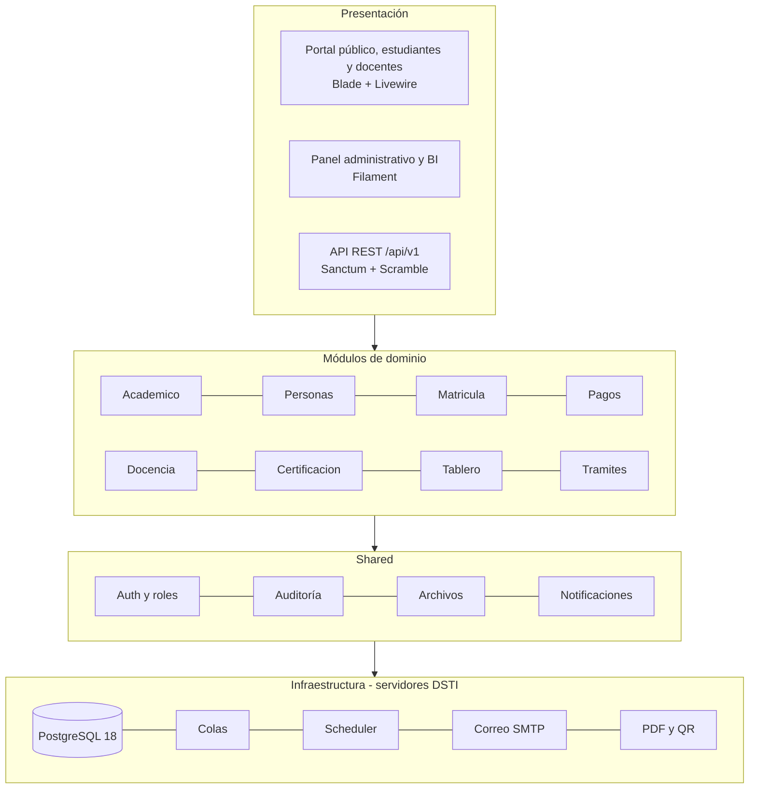

# Arquitectura

**Monolito modular en Laravel**: un solo despliegue, organizado por módulos de negocio. Cada módulo aplica MVC con una capa de Actions para la lógica de negocio. Cumple el "MVC o multicapa análoga" y los "servicios desacoplados" del Anexo (II.1) y responde a las malas prácticas señaladas por la DSTI (1.2: código monolítico y acoplado, sin separación de lógica y presentación).

## Capas



## Flujo dentro de un módulo

```
Controller / Livewire / Filament Resource / API Controller
        → Form Request (validación)
        → Action (regla de negocio, transacción)
        → Model (Eloquent: relaciones, casts, scopes)
```

Todas las entradas (web, API, Filament, consola) llaman a la **misma Action**. Nunca se pone lógica de negocio en controladores, closures de Filament ni modelos.

## Estructura de carpetas

```
app/
├── Modules/<Modulo>/
│   ├── Actions/            lógica de negocio (clases final e invocables)
│   ├── Contracts/          API pública: interfaces que consumen otros módulos
│   ├── Data/               API pública: DTOs readonly entre módulos
│   ├── Enums/              API pública: estados y catálogos con sus transiciones
│   ├── Events/             API pública: eventos que otros módulos escuchan
│   ├── Filament/Resources/ recursos del panel administrativo
│   ├── Http/Controllers/   controladores web y API (delgados)
│   ├── Http/Requests/      validación
│   ├── Listeners/  Livewire/  Models/  Policies/
│   ├── Database/           Migrations/, Factories/ y Seeders/ del módulo
│   ├── resources/views/    vistas Blade (namespace: kebab del módulo)
│   ├── routes/web.php  routes/api.php (prefijo /api/v1)
│   └── <Modulo>ServiceProvider.php
├── Shared/
│   ├── Audit/  Auth/  Files/  Notifications/  Integrations/
│   └── Support/ModuleServiceProvider.php   carga migraciones, vistas y rutas del módulo
└── Providers/Filament/AdminPanelProvider.php   descubre los Resources de cada módulo
tests/
├── Architecture/   reglas de desacople (Pest arch)
├── Feature/        flujos transversales
└── Modules/<Modulo>/
```

## Módulos

| Módulo | Anexo | Responsabilidad |
|---|---|---|
| Academico | M1.2 | Oferta académica compartida: idiomas, niveles, periodos, grupos, horarios, aulas, esquemas de evaluación |
| Personas | M1.1, M3.1 | Identidad común (documento, nombres) y tipo de vínculo con la UNASAM |
| Matricula | M1 | Clasificación, matrícula con bloqueos, ficha, traslados y retiros |
| Pagos | M2 | Registro y validación de pagos, desbloqueos, reportes de recaudación |
| Docencia | M3 | Padrón, carga académica, asistencia y pre-actas, expediente de horas |
| Certificacion | M4 | Actas finales, constancias y certificados con QR |
| Tablero | M5 | KPIs descriptivos (solo lectura) |
| Tramites | M6 | Portal público y pipelines de trámites |

Detalle funcional: [`modulos.md`](modulos.md).

## Reglas de desacople

1. **Un módulo solo usa la API pública de otro**: `Contracts/`, `Data/`, `Enums/` y `Events/`. Todo lo demás es interno (`Models`, `Actions`, `Http` o cualquier carpeta nueva). Lo verifica `tests/Architecture/ModulesTest.php` como lista blanca.
2. **Precondiciones de negocio por consulta síncrona** a un contrato (por ejemplo, la matrícula pregunta a Pagos si el pago está validado). **Efectos secundarios por eventos** (notificaciones, avance de trámites), despachados después del commit.
3. **Cada módulo es dueño de sus tablas**, con prefijo (`aca_`, `per_`, `mat_`, `pag_`, `doc_`, `cer_`, `tra_`). Entre módulos no hay `belongsTo` hacia modelos ajenos, pero **sí llaves foráneas reales en PostgreSQL**.
4. **Tablero es de solo lectura**: consulta mediante queries dedicadas o vistas de PostgreSQL (materializadas si pesan), no mediante contratos.
5. **Contratos solo donde hacen falta.** No se crean interfaces "por si acaso". Cada contrato es una interfaz invocable que implementa una Action del módulo dueño y se registra en `$bindings` de su `ServiceProvider` (por ejemplo `ReservaDeVacante` → `ReservarVacante`).
6. **Ayudas compartidas** en `app/Shared/Support`: `RestriccionUnica` (reconoce qué índice único se violó para mostrar un error de formulario), `NormalizaCodigo` (códigos en mayúsculas y sin espacios), `AccionDeNegocio` (ejecuta una Action desde Filament y muestra su mensaje).
7. **Transacciones**: siempre con `App\Shared\Support\Database\Transaccion::ejecutar`, nunca con `DB::transaction` (lo verifica `tests/Architecture/TransaccionesTest.php`). Reintenta deadlocks y explica esperas agotadas; desde el panel, sobre un registro ya cargado, se usa `reintentar: false`. Detalle en [ADR 0006](adr/0006-resiliencia-y-trazabilidad.md).
8. **Reglas de negocio incumplidas** lanzan `App\Shared\Support\Exceptions\ReglaDeNegocioIncumplida` con un mensaje para el usuario. Al conectar web, API y Filament, se mostrará ese mensaje (HTTP 422) sin detalles técnicos. El panel y el portal registran cada rechazo con `RegistroDeRechazos`, sin datos personales.

## Sistema de diseño

Portales y panel comparten una sola fuente de estilos ([ADR 0008](adr/0008-sistema-de-diseno.md)).

| Pieza | Dónde |
|---|---|
| Colores, radios, sombras, tamaños | `resources/css/ciln/tokens.css` |
| Utilidades de portal (`control`, `casilla`, `enlace`, `tarjeta-interna`, `columnas`) | `resources/css/app.css` |
| Tema del panel y `tabla-reporte` | `resources/css/filament/admin/theme.css` |
| Paletas del panel (copia en PHP, verificada por prueba) | `app/Shared/Ui/PaletaCiln.php` |
| Layouts: base, portal con barra lateral, acceso dividido | `resources/views/components/layouts/` |
| Identidad: emblema y hojas-bandera | `resources/views/components/ciln/` |
| Controles y bloques del portal | `resources/views/components/portal/` |
| Selector y calendario propios (Alpine), registrados una sola vez | `resources/js/ciln/` y `resources/js/app.js` |
| Formatos de presentación compartidos (fecha corta) | `app/Shared/Ui/Formato.php` |

Regla: una pantalla nueva usa estos componentes y utilidades; si un patrón aparece en dos pantallas, se vuelve componente.

## Agregar un módulo

1. Crear `app/Modules/<Nuevo>/` con la misma estructura y su `<Nuevo>ServiceProvider` (extiende `ModuleServiceProvider`).
2. Registrar el provider en `bootstrap/providers.php`.
3. Agregar el nombre a `MODULES` en `tests/Architecture/ModulesTest.php`.

Decisiones de fondo: [`adr/`](adr/).
