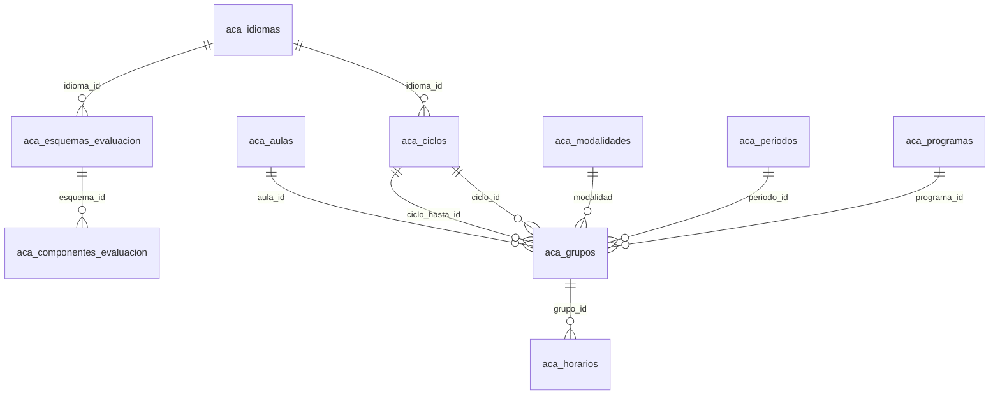
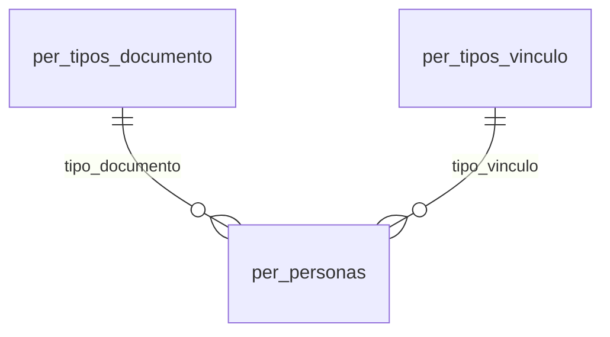
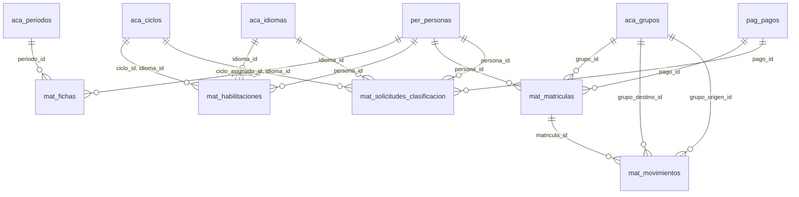
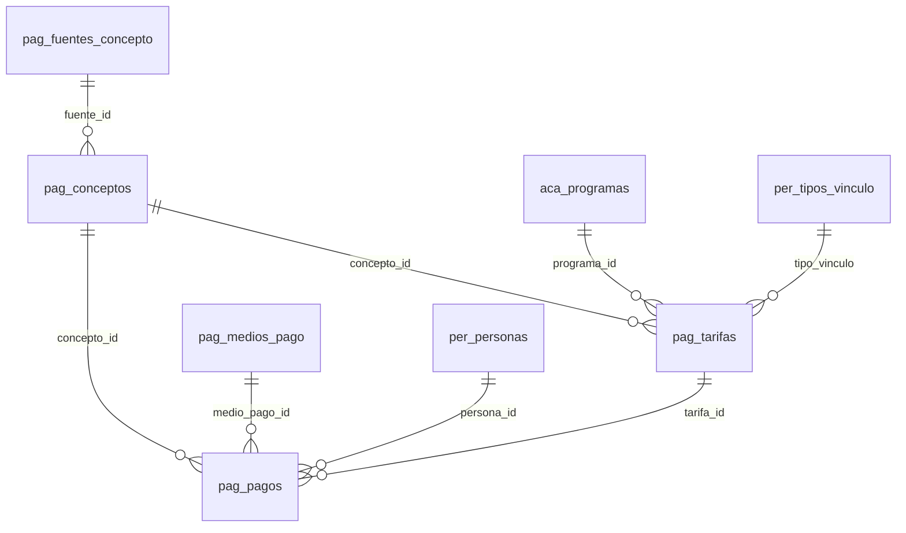
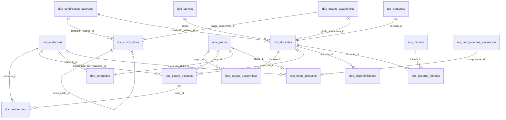
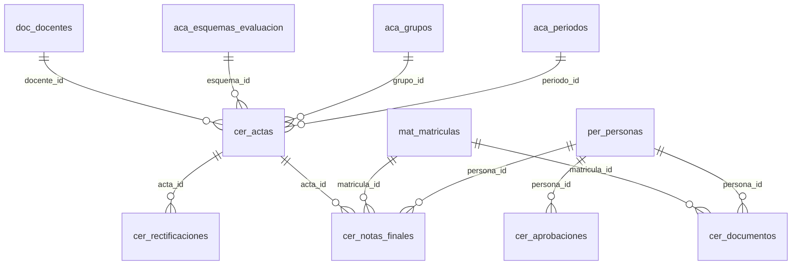
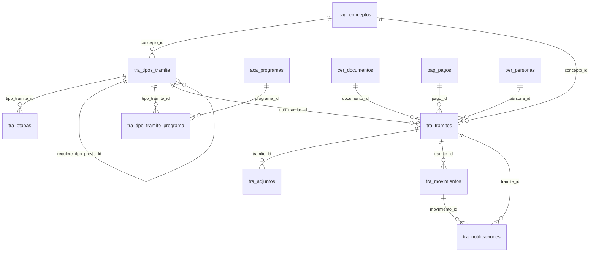
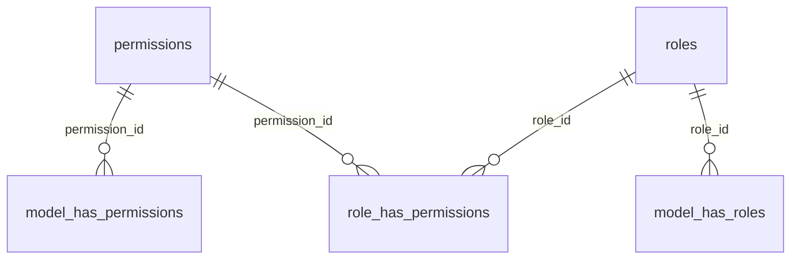

# Diccionario de datos

## 1. Introducción

Este diccionario describe la base de datos del Sistema de Gestión Académica y Administrativa del Centro de Idiomas y Lenguas Nativas (CILN) de la UNASAM. Se genera directamente del catálogo de PostgreSQL con el comando `php artisan docs:diccionario-de-datos`, por lo que coincide con la base de datos instalada. Las descripciones de tablas y columnas están guardadas en la propia base como comentarios (`COMMENT ON`) y pueden consultarse con cualquier cliente de PostgreSQL.

| Dato | Valor |
|---|---|
| Gestor de base de datos | PostgreSQL 18.6 (Debian 18.6-1.pgdg13+2) |
| Esquema | `public` |
| Última migración aplicada | `2026_12_04_100000_add_usuario_to_users_table` |

**Convenciones:**

- Cada módulo es dueño de sus tablas, identificadas por un prefijo: `aca_` Académico, `per_` Personas, `mat_` Matrícula, `pag_` Pagos, `doc_` Docencia, `cer_` Certificación, `tra_` Trámites, `aud_` Auditoría y `sis_` Parámetros del sistema.
- Las relaciones entre módulos son llaves foráneas reales de PostgreSQL. El diagrama de cada módulo omite las columnas que solo registran qué cuenta hizo una operación (por ejemplo, `validado_por`), que se detallan en cada tabla.
- Los importes se guardan como `numeric` en soles; las fechas y horas, con zona horaria (`timestamptz`) y se muestran en hora de Lima.
- Las reglas de negocio críticas se garantizan en la propia base: restricciones `CHECK`, `UNIQUE`, `EXCLUDE` y triggers.
- Los registros financieros y académicos no se borran: se anulan con motivo y usuario. Los cambios de las tablas críticas quedan en la pista de auditoría inmutable `aud_registros`.
- En la columna **Nulo**, "Sí" indica que el dato es opcional.

## 2. Resumen por módulo

| Módulo | Tablas | Columnas |
|---|---|---|
| Académico (oferta académica) | 10 | 100 |
| Personas | 4 | 44 |
| Matrícula | 5 | 55 |
| Pagos | 6 | 64 |
| Docencia | 12 | 101 |
| Certificación | 10 | 135 |
| Trámites | 9 | 93 |
| Auditoría | 1 | 10 |
| Parámetros del sistema | 1 | 16 |
| Seguridad y control de acceso | 9 | 53 |
| Infraestructura de la aplicación | 7 | 45 |
| **Total** | **74** | **716** |

## 3. Académico (oferta académica)

### 3.1. `aca_aulas`

Aulas físicas con su capacidad.

| N° | Columna | Tipo | Nulo | Por defecto | Descripción |
|---|---|---|---|---|---|
| 1 | `id` | bigint | No | Autoincremental | Identificador interno (llave primaria). |
| 2 | `codigo` | varchar(20) | No |  | Código del aula; único y fijo tras crearse. |
| 3 | `nombre` | varchar(80) | No |  | Nombre del aula. |
| 4 | `capacidad` | smallint | No |  | Número máximo de estudiantes. |
| 5 | `ubicacion` | varchar(150) | Sí |  | Ubicación (pabellón, piso). |
| 6 | `activo` | boolean | No | `true` | Indica si el aula se puede asignar. |
| 7 | `created_at` | timestamptz | Sí |  | Fecha y hora de creación del registro. |
| 8 | `updated_at` | timestamptz | Sí |  | Fecha y hora de la última modificación del registro. |

**Llave primaria y restricciones únicas:**

- `aca_aulas_pkey`: `PRIMARY KEY (id)`
- `aca_aulas_codigo_unique`: `UNIQUE (codigo)`

**Reglas de validación:**

- `aca_aulas_capacidad_check`: `CHECK ((capacidad > 0))`

**Triggers:**

- `aca_aulas_auditoria`: AFTER INSERT, DELETE, UPDATE, ejecuta `aud_registrar()`

### 3.2. `aca_ciclos`

Plan de estudios de cada idioma: ciclos I a XII con su nivel y horas lectivas.

| N° | Columna | Tipo | Nulo | Por defecto | Descripción |
|---|---|---|---|---|---|
| 1 | `id` | bigint | No | Autoincremental | Identificador interno (llave primaria). |
| 2 | `idioma_id` | bigint | No |  | Idioma al que pertenece el ciclo. Referencia a `aca_idiomas`. |
| 3 | `numero` | smallint | No |  | Número del ciclo (1 a 12); único por idioma. |
| 4 | `nivel` | varchar(255) | No |  | Nivel curricular del ciclo. Valores: `basico`, `intermedio`, `avanzado`. |
| 5 | `nombre` | varchar(60) | No |  | Nombre del ciclo. |
| 6 | `horas_lectivas` | smallint | No |  | Horas lectivas del ciclo. |
| 7 | `activo` | boolean | No | `true` | Indica si el ciclo se puede ofertar. |
| 8 | `created_at` | timestamptz | Sí |  | Fecha y hora de creación del registro. |
| 9 | `updated_at` | timestamptz | Sí |  | Fecha y hora de la última modificación del registro. |

**Llave primaria y restricciones únicas:**

- `aca_ciclos_pkey`: `PRIMARY KEY (id)`
- `aca_ciclos_id_idioma_id_unique`: `UNIQUE (id, idioma_id)`
- `aca_ciclos_idioma_id_numero_unique`: `UNIQUE (idioma_id, numero)`

**Llaves foráneas:**

- `aca_ciclos_idioma_id_foreign`: `FOREIGN KEY (idioma_id) REFERENCES aca_idiomas(id) ON DELETE RESTRICT`

**Reglas de validación:**

- `aca_ciclos_horas_lectivas_check`: `CHECK ((horas_lectivas > 0))`
- `aca_ciclos_nivel_check`: `CHECK (((nivel) = ANY ((ARRAY['basico', 'intermedio', 'avanzado']))))`
- `aca_ciclos_numero_check`: `CHECK (((numero >= 1) AND (numero <= 12)))`

**Triggers:**

- `aca_ciclos_auditoria`: AFTER INSERT, DELETE, UPDATE, ejecuta `aud_registrar()`

### 3.3. `aca_componentes_evaluacion`

Componentes de un sistema de evaluación, cada uno habilidad o examen; cada grupo se promedia con promedio simple.

| N° | Columna | Tipo | Nulo | Por defecto | Descripción |
|---|---|---|---|---|---|
| 1 | `id` | bigint | No | Autoincremental | Identificador interno (llave primaria). |
| 2 | `esquema_id` | bigint | No |  | Sistema de evaluación al que pertenece. Referencia a `aca_esquemas_evaluacion`. |
| 3 | `codigo` | varchar(30) | No |  | Código del componente. |
| 4 | `nombre` | varchar(80) | No |  | Nombre del componente (por ejemplo, examen parcial). |
| 5 | `orden` | smallint | No |  | Orden de presentación. |
| 6 | `created_at` | timestamptz | Sí |  | Fecha y hora de creación del registro. |
| 7 | `updated_at` | timestamptz | Sí |  | Fecha y hora de la última modificación del registro. |
| 8 | `grupo` | varchar(20) | No |  | Grupo del componente: habilidades o examenes; la nota final promedia el promedio de cada grupo. Valores: `habilidades`, `examenes`. |

**Llave primaria y restricciones únicas:**

- `aca_componentes_evaluacion_pkey`: `PRIMARY KEY (id)`
- `aca_componentes_evaluacion_esquema_id_codigo_unique`: `UNIQUE (esquema_id, codigo)`

**Llaves foráneas:**

- `aca_componentes_evaluacion_esquema_id_foreign`: `FOREIGN KEY (esquema_id) REFERENCES aca_esquemas_evaluacion(id) ON DELETE CASCADE`

**Reglas de validación:**

- `aca_componentes_evaluacion_grupo_conocido_check`: `CHECK (((grupo) = ANY ((ARRAY['habilidades', 'examenes']))))`
- `aca_componentes_evaluacion_orden_check`: `CHECK ((orden > 0))`

**Triggers:**

- `aca_componentes_evaluacion_auditoria`: AFTER INSERT, DELETE, UPDATE, ejecuta `aud_registrar()`
- `aca_componentes_evaluacion_grupos`: AFTER INSERT, DELETE, UPDATE, ejecuta `aca_componentes_grupos()`

### 3.4. `aca_esquemas_evaluacion`

Sistemas de evaluación configurables por idioma, nivel y vigencia.

| N° | Columna | Tipo | Nulo | Por defecto | Descripción |
|---|---|---|---|---|---|
| 1 | `id` | bigint | No | Autoincremental | Identificador interno (llave primaria). |
| 2 | `nombre` | varchar(100) | No |  | Nombre del sistema de evaluación. |
| 3 | `idioma_id` | bigint | Sí |  | Idioma al que aplica; nulo si aplica a todos. Referencia a `aca_idiomas`. |
| 4 | `nivel` | varchar(255) | Sí |  | Nivel al que aplica; nulo si aplica a todos. Valores: `basico`, `intermedio`, `avanzado`. |
| 5 | `nota_maxima` | numeric(4,2) | No | `'20'` | Nota máxima de la escala. |
| 6 | `nota_minima_aprobatoria` | numeric(4,2) | No |  | Nota mínima para aprobar. |
| 7 | `vigente_desde` | date | No |  | Inicio de vigencia. |
| 8 | `vigente_hasta` | date | Sí |  | Fin de vigencia; nulo si sigue vigente. |
| 9 | `created_at` | timestamptz | Sí |  | Fecha y hora de creación del registro. |
| 10 | `updated_at` | timestamptz | Sí |  | Fecha y hora de la última modificación del registro. |

**Llave primaria y restricciones únicas:**

- `aca_esquemas_evaluacion_pkey`: `PRIMARY KEY (id)`

**Llaves foráneas:**

- `aca_esquemas_evaluacion_idioma_id_foreign`: `FOREIGN KEY (idioma_id) REFERENCES aca_idiomas(id) ON DELETE RESTRICT`

**Reglas de validación:**

- `aca_esquemas_evaluacion_nivel_check`: `CHECK (((nivel) = ANY ((ARRAY['basico', 'intermedio', 'avanzado']))))`
- `aca_esquemas_evaluacion_notas_check`: `CHECK (((nota_minima_aprobatoria > (0)) AND (nota_minima_aprobatoria <= nota_maxima)))`
- `aca_esquemas_evaluacion_vigencia_check`: `CHECK (((vigente_hasta IS NULL) OR (vigente_hasta >= vigente_desde)))`

**Triggers:**

- `aca_esquemas_evaluacion_auditoria`: AFTER INSERT, DELETE, UPDATE, ejecuta `aud_registrar()`
- `aca_esquemas_evaluacion_grupos`: AFTER INSERT, ejecuta `aca_esquemas_grupos()`

### 3.5. `aca_grupos`

Oferta académica: grupo de un ciclo en un periodo, con modalidad, aula, cupos y vacantes.

| N° | Columna | Tipo | Nulo | Por defecto | Descripción |
|---|---|---|---|---|---|
| 1 | `id` | bigint | No | Autoincremental | Identificador interno (llave primaria). |
| 2 | `ulid` | char(26) | No |  | Identificador público no secuencial (ULID) usado en URL y en la API. |
| 3 | `periodo_id` | bigint | No |  | Periodo en que se dicta. Referencia a `aca_periodos`. |
| 4 | `ciclo_id` | bigint | No |  | Ciclo que dicta. Referencia a `aca_ciclos`. |
| 5 | `aula_id` | bigint | Sí |  | Aula física asignada; nulo en la modalidad virtual. Referencia a `aca_aulas`. |
| 6 | `codigo` | varchar(20) | No |  | Código del grupo; único dentro del periodo. |
| 7 | `modalidad` | varchar(255) | No |  | Modalidad de dictado. Referencia a `aca_modalidades` por su código. Referencia a `aca_modalidades`. |
| 8 | `es_acelerado` | boolean | No | `false` | Indica si el grupo es de régimen acelerado. |
| 9 | `enlace_virtual` | varchar(255) | Sí |  | Enlace de la clase virtual. |
| 10 | `cupo_maximo` | smallint | No |  | Cupo máximo de estudiantes. |
| 11 | `cupo_minimo` | smallint | No |  | Cupo mínimo para abrir el grupo. |
| 12 | `matriculados` | smallint | No | `'0'` | Matriculados activos; las vacantes son cupo_maximo menos este valor. Solo lo cambia el sistema con bloqueo de fila. |
| 13 | `estado` | varchar(255) | No | `'programado'` | Estado del grupo. Valores: `programado`, `abierto`, `cerrado`, `cancelado`, `finalizado`. |
| 14 | `created_at` | timestamptz | Sí |  | Fecha y hora de creación del registro. |
| 15 | `updated_at` | timestamptz | Sí |  | Fecha y hora de la última modificación del registro. |
| 16 | `programa_id` | bigint | No |  | Programa al que pertenece el grupo; su régimen decide si el grupo puede ser regular o acelerado. Referencia a aca_programas. Referencia a `aca_programas`. |
| 17 | `ciclo_hasta_id` | bigint | Sí |  | Segundo ciclo que cubre un grupo acelerado: el siguiente del mismo idioma y nivel; vacío en un grupo regular. Referencia a aca_ciclos. Referencia a `aca_ciclos`. |

**Llave primaria y restricciones únicas:**

- `aca_grupos_pkey`: `PRIMARY KEY (id)`
- `aca_grupos_periodo_id_codigo_unique`: `UNIQUE (periodo_id, codigo)`
- `aca_grupos_ulid_unique`: `UNIQUE (ulid)`

**Llaves foráneas:**

- `aca_grupos_aula_id_foreign`: `FOREIGN KEY (aula_id) REFERENCES aca_aulas(id) ON DELETE RESTRICT`
- `aca_grupos_ciclo_hasta_id_foreign`: `FOREIGN KEY (ciclo_hasta_id) REFERENCES aca_ciclos(id) ON DELETE RESTRICT`
- `aca_grupos_ciclo_id_foreign`: `FOREIGN KEY (ciclo_id) REFERENCES aca_ciclos(id) ON DELETE RESTRICT`
- `aca_grupos_modalidad_foreign`: `FOREIGN KEY (modalidad) REFERENCES aca_modalidades(codigo) ON UPDATE RESTRICT ON DELETE RESTRICT`
- `aca_grupos_periodo_id_foreign`: `FOREIGN KEY (periodo_id) REFERENCES aca_periodos(id) ON DELETE RESTRICT`
- `aca_grupos_programa_id_foreign`: `FOREIGN KEY (programa_id) REFERENCES aca_programas(id) ON DELETE RESTRICT`

**Reglas de validación:**

- `aca_grupos_ciclo_hasta_check`: `CHECK (((es_acelerado AND (ciclo_hasta_id IS NOT NULL)) OR ((NOT es_acelerado) AND (ciclo_hasta_id IS NULL))))`
- `aca_grupos_cupos_check`: `CHECK (((cupo_maximo > 0) AND (cupo_minimo >= 0) AND (cupo_minimo <= cupo_maximo)))`
- `aca_grupos_estado_check`: `CHECK (((estado) = ANY ((ARRAY['programado', 'abierto', 'cerrado', 'cancelado', 'finalizado']))))`
- `aca_grupos_matriculados_check`: `CHECK (((matriculados >= 0) AND (matriculados <= cupo_maximo)))`

**Triggers:**

- `aca_grupos_auditoria`: AFTER INSERT, DELETE, UPDATE, ejecuta `aud_registrar()`
- `aca_grupos_aula_libre`: AFTER UPDATE OF aula_id, periodo_id, estado, ejecuta `aca_grupos_aula_libre()`
- `aca_grupos_ciclo_hasta`: BEFORE INSERT, UPDATE OF ciclo_id, ciclo_hasta_id, ejecuta `aca_controlar_ciclo_hasta()`
- `doc_aca_grupos_docente_sin_cruces`: AFTER UPDATE OF periodo_id, estado, ejecuta `doc_docente_sin_cruces_por_grupo()`

### 3.6. `aca_horarios`

Días y horas de clase de cada grupo.

| N° | Columna | Tipo | Nulo | Por defecto | Descripción |
|---|---|---|---|---|---|
| 1 | `id` | bigint | No | Autoincremental | Identificador interno (llave primaria). |
| 2 | `grupo_id` | bigint | No |  | Grupo al que pertenece el horario. Referencia a `aca_grupos`. |
| 3 | `dia_semana` | smallint | No |  | Día de la semana (1 = lunes a 7 = domingo). |
| 4 | `hora_inicio` | time | No |  | Hora de inicio. |
| 5 | `hora_fin` | time | No |  | Hora de fin. |
| 6 | `created_at` | timestamptz | Sí |  | Fecha y hora de creación del registro. |
| 7 | `updated_at` | timestamptz | Sí |  | Fecha y hora de la última modificación del registro. |

**Llave primaria y restricciones únicas:**

- `aca_horarios_pkey`: `PRIMARY KEY (id)`
- `aca_horarios_grupo_id_dia_semana_hora_inicio_unique`: `UNIQUE (grupo_id, dia_semana, hora_inicio)`

**Llaves foráneas:**

- `aca_horarios_grupo_id_foreign`: `FOREIGN KEY (grupo_id) REFERENCES aca_grupos(id) ON DELETE CASCADE`

**Reglas de validación:**

- `aca_horarios_dia_semana_check`: `CHECK (((dia_semana >= 1) AND (dia_semana <= 7)))`
- `aca_horarios_horas_check`: `CHECK ((hora_fin > hora_inicio))`

**Triggers:**

- `aca_horarios_auditoria`: AFTER INSERT, DELETE, UPDATE, ejecuta `aud_registrar()`
- `aca_horarios_aula_libre`: AFTER INSERT, UPDATE, ejecuta `aca_horarios_aula_libre()`
- `doc_aca_horarios_docente_sin_cruces`: AFTER INSERT, UPDATE, ejecuta `doc_docente_sin_cruces_por_horario()`

### 3.7. `aca_idiomas`

Idiomas extranjeros y lenguas nativas que ofrece el CILN.

| N° | Columna | Tipo | Nulo | Por defecto | Descripción |
|---|---|---|---|---|---|
| 1 | `id` | bigint | No | Autoincremental | Identificador interno (llave primaria). |
| 2 | `codigo` | varchar(10) | No |  | Código corto del idioma; único y fijo tras crearse. |
| 3 | `nombre` | varchar(80) | No |  | Nombre del idioma; único. |
| 4 | `es_lengua_nativa` | boolean | No | `false` | Indica si es una lengua originaria del Perú. |
| 5 | `activo` | boolean | No | `true` | Indica si el idioma ofrece ciclos para grupos nuevos. |
| 6 | `created_at` | timestamptz | Sí |  | Fecha y hora de creación del registro. |
| 7 | `updated_at` | timestamptz | Sí |  | Fecha y hora de la última modificación del registro. |
| 8 | `bandera` | varchar(30) | Sí |  | Identificador de la bandera o emblema que se muestra en el portal. |
| 9 | `curriculo` | varchar(10) | No | `'01'` | Código del currículo vigente del idioma, impreso en la constancia de notas. |

**Llave primaria y restricciones únicas:**

- `aca_idiomas_pkey`: `PRIMARY KEY (id)`
- `aca_idiomas_codigo_unique`: `UNIQUE (codigo)`
- `aca_idiomas_nombre_unique`: `UNIQUE (nombre)`

**Triggers:**

- `aca_idiomas_auditoria`: AFTER INSERT, DELETE, UPDATE, ejecuta `aud_registrar()`

### 3.8. `aca_modalidades`

Modalidades de dictado que el CILN administra; cada grupo tiene una y el portal muestra su descripción.

| N° | Columna | Tipo | Nulo | Por defecto | Descripción |
|---|---|---|---|---|---|
| 1 | `id` | bigint | No | Autoincremental | Identificador interno. |
| 2 | `codigo` | varchar(40) | No |  | Código único de la modalidad; se genera al crearla y no cambia. |
| 3 | `nombre` | varchar(60) | No |  | Nombre único de la modalidad, como aparece en el portal y en los documentos. |
| 4 | `descripcion` | text | Sí |  | Descripción que muestra la página pública. |
| 5 | `usa_aula` | boolean | No |  | Indica si sus grupos se dictan en un aula; si no, el grupo necesita el enlace de la clase. |
| 6 | `usa_enlace` | boolean | No |  | Indica si sus grupos admiten el enlace de una clase en línea. |
| 7 | `activo` | boolean | No | `true` | Indica si se ofrece para grupos nuevos. |
| 8 | `orden` | smallint | No | `'0'` | Orden en las listas y en la página pública. |
| 9 | `created_at` | timestamptz | Sí |  | Fecha y hora de registro. |
| 10 | `updated_at` | timestamptz | Sí |  | Fecha y hora de la última modificación. |

**Llave primaria y restricciones únicas:**

- `aca_modalidades_pkey`: `PRIMARY KEY (id)`
- `aca_modalidades_codigo_unique`: `UNIQUE (codigo)`
- `aca_modalidades_nombre_unique`: `UNIQUE (nombre)`

**Reglas de validación:**

- `aca_modalidades_codigo_check`: `CHECK (((codigo) ~ '^[a-z0-9_]+$'))`
- `aca_modalidades_lugar_check`: `CHECK ((usa_aula OR usa_enlace))`
- `aca_modalidades_nombre_check`: `CHECK ((btrim((nombre)) <> ''))`
- `aca_modalidades_orden_check`: `CHECK ((orden >= 0))`

**Triggers:**

- `aca_modalidades_auditoria`: AFTER INSERT, DELETE, UPDATE, ejecuta `aud_registrar()`

### 3.9. `aca_periodos`

Periodos académicos con sus fechas de clases, matrícula y registro de actas.

| N° | Columna | Tipo | Nulo | Por defecto | Descripción |
|---|---|---|---|---|---|
| 1 | `id` | bigint | No | Autoincremental | Identificador interno (llave primaria). |
| 2 | `anio` | smallint | No |  | Año del periodo. |
| 3 | `numero` | smallint | No |  | Número del periodo dentro del año (1 a 12). |
| 4 | `nombre` | varchar(60) | No |  | Nombre del periodo. |
| 5 | `fecha_inicio` | date | No |  | Inicio de clases. |
| 6 | `fecha_fin` | date | No |  | Fin de clases. |
| 7 | `matricula_inicio` | date | No |  | Inicio de la matrícula. |
| 8 | `matricula_fin` | date | No |  | Fin de la matrícula. |
| 9 | `estado` | varchar(255) | No | `'planificado'` | Estado del periodo. Valores: `planificado`, `matricula_abierta`, `en_curso`, `cerrado`. |
| 10 | `created_at` | timestamptz | Sí |  | Fecha y hora de creación del registro. |
| 11 | `updated_at` | timestamptz | Sí |  | Fecha y hora de la última modificación del registro. |
| 12 | `actas_inicio` | date | Sí |  | Inicio del plazo para registrar notas y cerrar actas. |
| 13 | `actas_fin` | date | Sí |  | Fin del plazo para registrar notas y cerrar actas. |
| 14 | `matricula_extemporanea_fin` | date | Sí |  | Último día de la matrícula extemporánea, posterior al fin de la matrícula regular; vacío si el periodo no la tiene. El pago de matrícula en ese plazo lleva el recargo de la configuración de pagos. |

**Llave primaria y restricciones únicas:**

- `aca_periodos_pkey`: `PRIMARY KEY (id)`
- `aca_periodos_anio_numero_unique`: `UNIQUE (anio, numero)`

**Reglas de validación:**

- `aca_periodos_actas_check`: `CHECK ((((actas_inicio IS NULL) = (actas_fin IS NULL)) AND ((actas_fin IS NULL) OR (actas_fin >= actas_inicio))))`
- `aca_periodos_anio_check`: `CHECK (((anio >= 2000) AND (anio <= 2100)))`
- `aca_periodos_estado_check`: `CHECK (((estado) = ANY ((ARRAY['planificado', 'matricula_abierta', 'en_curso', 'cerrado']))))`
- `aca_periodos_fechas_check`: `CHECK ((fecha_fin > fecha_inicio))`
- `aca_periodos_matricula_check`: `CHECK (((matricula_fin >= matricula_inicio) AND (matricula_fin <= fecha_fin)))`
- `aca_periodos_matricula_extemporanea_check`: `CHECK (((matricula_extemporanea_fin IS NULL) OR ((matricula_extemporanea_fin > matricula_fin) AND (matricula_extemporanea_fin <= fecha_fin))))`
- `aca_periodos_numero_check`: `CHECK (((numero >= 1) AND (numero <= 12)))`

**Triggers:**

- `aca_periodos_auditoria`: AFTER INSERT, DELETE, UPDATE, ejecuta `aud_registrar()`
- `aca_periodos_aula_libre`: AFTER UPDATE OF fecha_inicio, fecha_fin, ejecuta `aca_periodos_aula_libre()`
- `doc_aca_periodos_docente_sin_cruces`: AFTER UPDATE OF fecha_inicio, fecha_fin, ejecuta `doc_docente_sin_cruces_por_periodo()`

### 3.10. `aca_programas`

Programas del centro (Jóvenes y Adultos, Niños, Posgrado) con el régimen de ciclo que admiten sus grupos.

| N° | Columna | Tipo | Nulo | Por defecto | Descripción |
|---|---|---|---|---|---|
| 1 | `id` | bigint | No | Autoincremental | Identificador interno. |
| 2 | `codigo` | varchar(20) | No |  | Código único del programa, en mayúsculas. |
| 3 | `nombre` | varchar(80) | No |  | Nombre único del programa, como aparece en los documentos. |
| 4 | `regimen` | varchar(10) | No |  | Régimen de ciclo que admiten sus grupos. Valores: regular, acelerado, ambos. Valores: `regular`, `acelerado`, `ambos`. |
| 5 | `activo` | boolean | No | `true` | Indica si el programa está disponible para nuevos grupos. |
| 6 | `created_at` | timestamptz | Sí |  | Fecha y hora de registro. |
| 7 | `updated_at` | timestamptz | Sí |  | Fecha y hora de la última modificación. |
| 8 | `por_defecto` | boolean | No | `false` | Programa que se propone para grupos nuevos y que se imprime en los documentos de grupos anteriores a los programas; solo uno a la vez y siempre activo. |

**Llave primaria y restricciones únicas:**

- `aca_programas_pkey`: `PRIMARY KEY (id)`
- `aca_programas_codigo_unique`: `UNIQUE (codigo)`
- `aca_programas_nombre_unique`: `UNIQUE (nombre)`

**Índices únicos parciales:**

- `aca_programas_por_defecto_unique`: `(por_defecto) WHERE por_defecto`

**Reglas de validación:**

- `aca_programas_por_defecto_activo_check`: `CHECK (((NOT por_defecto) OR activo))`
- `aca_programas_regimen_valido_check`: `CHECK (((regimen) = ANY ((ARRAY['regular', 'acelerado', 'ambos']))))`

**Triggers:**

- `aca_programas_auditoria`: AFTER INSERT, DELETE, UPDATE, ejecuta `aud_registrar()`

## 4. Personas

### 4.1. `per_personas`

Identidad única de cada persona: postulantes, estudiantes y docentes. Contiene datos personales protegidos por la Ley 29733.

| N° | Columna | Tipo | Nulo | Por defecto | Descripción |
|---|---|---|---|---|---|
| 1 | `id` | bigint | No | Autoincremental | Identificador interno (llave primaria). |
| 2 | `ulid` | char(26) | No |  | Identificador público no secuencial (ULID) usado en URL y en la API. |
| 3 | `user_id` | bigint | Sí |  | Cuenta de acceso de la persona; una cuenta por persona. Referencia a `users`. |
| 4 | `tipo_documento` | varchar(255) | No |  | Tipo de documento de identidad. Referencia a `per_tipos_documento` por su código. Referencia a `per_tipos_documento`. |
| 5 | `numero_documento` | varchar(20) | No |  | Número de documento: DNI de 8 dígitos; CE o pasaporte de 6 a 12 caracteres. |
| 6 | `apellido_paterno` | varchar(60) | No |  | Apellido paterno. |
| 7 | `apellido_materno` | varchar(60) | Sí |  | Apellido materno. |
| 8 | `nombres` | varchar(80) | No |  | Nombres. |
| 9 | `fecha_nacimiento` | date | Sí |  | Fecha de nacimiento. |
| 10 | `correo` | varchar(150) | Sí |  | Correo electrónico de contacto. |
| 11 | `celular` | varchar(16) | Sí |  | Número de celular (7 a 15 dígitos, prefijo + opcional). |
| 12 | `tipo_vinculo` | varchar(255) | No | `'publico_general'` | Vínculo con la UNASAM, que define la tarifa. Referencia a `per_tipos_vinculo` por su código. Referencia a `per_tipos_vinculo`. |
| 13 | `created_at` | timestamptz | Sí |  | Fecha y hora de creación del registro. |
| 14 | `updated_at` | timestamptz | Sí |  | Fecha y hora de la última modificación del registro. |
| 15 | `direccion` | varchar(200) | Sí |  | Dirección domiciliaria. |
| 16 | `foto` | varchar(120) | Sí |  | Ruta de la fotografía en el almacenamiento privado. |
| 17 | `tratamiento_aceptado_en` | timestamptz | Sí |  | Fecha y hora en que aceptó el tratamiento de sus datos personales (Ley 29733), al crear su cuenta o, si la registró el personal, al firmar su autorización. |
| 18 | `habilitada_en` | timestamptz | Sí | `CURRENT_TIMESTAMP` | Cuándo se habilitó la cuenta del estudiante (al validarse su primer pago); vacío mientras solo ve las secciones generales del portal. |

**Llave primaria y restricciones únicas:**

- `per_personas_pkey`: `PRIMARY KEY (id)`
- `per_personas_tipo_documento_numero_documento_unique`: `UNIQUE (tipo_documento, numero_documento)`
- `per_personas_ulid_unique`: `UNIQUE (ulid)`
- `per_personas_user_id_unique`: `UNIQUE (user_id)`

**Llaves foráneas:**

- `per_personas_tipo_documento_foreign`: `FOREIGN KEY (tipo_documento) REFERENCES per_tipos_documento(codigo) ON UPDATE RESTRICT ON DELETE RESTRICT`
- `per_personas_tipo_vinculo_foreign`: `FOREIGN KEY (tipo_vinculo) REFERENCES per_tipos_vinculo(codigo) ON UPDATE RESTRICT ON DELETE RESTRICT`
- `per_personas_user_id_foreign`: `FOREIGN KEY (user_id) REFERENCES users(id) ON DELETE SET NULL`

**Reglas de validación:**

- `per_personas_celular_check`: `CHECK (((celular IS NULL) OR ((celular) ~ '^\+?[0-9]{7,15}$')))`
- `per_personas_fecha_nacimiento_check`: `CHECK (((fecha_nacimiento IS NULL) OR (fecha_nacimiento > '1900-01-01')))`
- `per_personas_numero_documento_formato_check`: `CHECK (((numero_documento) ~ '^[A-Z0-9]{1,20}$')) NOT VALID`

**Triggers:**

- `per_personas_auditoria`: AFTER INSERT, DELETE, UPDATE, ejecuta `aud_registrar()`

### 4.2. `per_textos_legales`

Textos legales del portal (Ley 29733): política de privacidad y frase de consentimiento del registro; una sola fila, creada al guardarlos por primera vez.

| N° | Columna | Tipo | Nulo | Por defecto | Descripción |
|---|---|---|---|---|---|
| 1 | `id` | smallint | No | `'1'` | Identificador de la única fila; siempre 1. |
| 2 | `politica_privacidad` | text | No |  | Cuerpo de la política de privacidad en Markdown; {universidad}, {centro} y {domicilio} se reemplazan al mostrarla. El HTML escrito se muestra como texto. |
| 3 | `domicilio_titular` | varchar(200) | No |  | Domicilio legal de la universidad, titular del banco de datos personales. |
| 4 | `consentimiento_registro` | varchar(600) | No |  | Frase que acepta quien crea su cuenta; {politica} es el enlace a la política de privacidad. |
| 5 | `politica_actualizada_el` | date | No |  | Fecha de la última modificación de la política o del domicilio, que la página muestra como última actualización. |
| 6 | `created_at` | timestamptz | Sí |  | Fecha y hora de creación de la fila. |
| 7 | `updated_at` | timestamptz | Sí |  | Fecha y hora de la última modificación. |

**Llave primaria y restricciones únicas:**

- `per_textos_legales_pkey`: `PRIMARY KEY (id)`

**Reglas de validación:**

- `per_textos_legales_enlace_check`: `CHECK ((strpos((consentimiento_registro), '{politica}') > 0))`
- `per_textos_legales_textos_check`: `CHECK (((btrim(politica_privacidad) <> '') AND (btrim((domicilio_titular)) <> '') AND (btrim((consentimiento_registro)) <> '')))`
- `per_textos_legales_unica_check`: `CHECK ((id = 1))`

**Triggers:**

- `per_textos_legales_auditoria`: AFTER INSERT, DELETE, UPDATE, ejecuta `aud_registrar()`

### 4.3. `per_tipos_documento`

Tipos de documento de identidad que el CILN administra, con la regla de formato de su número.

| N° | Columna | Tipo | Nulo | Por defecto | Descripción |
|---|---|---|---|---|---|
| 1 | `id` | bigint | No | Autoincremental | Identificador interno. |
| 2 | `codigo` | varchar(40) | No |  | Código único del tipo de documento; se genera al crearlo y no cambia. |
| 3 | `nombre` | varchar(60) | No |  | Nombre único del tipo de documento, como aparece en los formularios, las fichas y los documentos emitidos. |
| 4 | `solo_digitos` | boolean | No | `false` | Indica si el número admite solo dígitos; si no, admite letras y dígitos sin espacios ni guiones. |
| 5 | `longitud_minima` | smallint | No |  | Cantidad mínima de caracteres del número. |
| 6 | `longitud_maxima` | smallint | No |  | Cantidad máxima de caracteres del número, hasta 20. |
| 7 | `activo` | boolean | No | `true` | Indica si se ofrece en los formularios para registros nuevos. |
| 8 | `por_defecto` | boolean | No | `false` | Tipo de documento preseleccionado al crear una cuenta en el portal; solo uno a la vez y siempre activo. |
| 9 | `orden` | smallint | No | `'0'` | Orden en las listas. |
| 10 | `created_at` | timestamptz | Sí |  | Fecha y hora de registro. |
| 11 | `updated_at` | timestamptz | Sí |  | Fecha y hora de la última modificación. |

**Llave primaria y restricciones únicas:**

- `per_tipos_documento_pkey`: `PRIMARY KEY (id)`
- `per_tipos_documento_codigo_unique`: `UNIQUE (codigo)`
- `per_tipos_documento_nombre_unique`: `UNIQUE (nombre)`

**Índices únicos parciales:**

- `per_tipos_documento_por_defecto_unique`: `(por_defecto) WHERE por_defecto`

**Reglas de validación:**

- `per_tipos_documento_codigo_check`: `CHECK (((codigo) ~ '^[a-z0-9_]+$'))`
- `per_tipos_documento_longitud_check`: `CHECK (((1 <= longitud_minima) AND (longitud_minima <= longitud_maxima) AND (longitud_maxima <= 20)))`
- `per_tipos_documento_nombre_check`: `CHECK ((btrim((nombre)) <> ''))`
- `per_tipos_documento_orden_check`: `CHECK ((orden >= 0))`
- `per_tipos_documento_por_defecto_activo_check`: `CHECK (((NOT por_defecto) OR activo))`

**Triggers:**

- `per_tipos_documento_auditoria`: AFTER INSERT, DELETE, UPDATE, ejecuta `aud_registrar()`

### 4.4. `per_tipos_vinculo`

Tipos de vínculo con la UNASAM que el CILN administra; cada persona tiene uno y define la tarifa que paga.

| N° | Columna | Tipo | Nulo | Por defecto | Descripción |
|---|---|---|---|---|---|
| 1 | `id` | bigint | No | Autoincremental | Identificador interno. |
| 2 | `codigo` | varchar(40) | No |  | Código único del vínculo; se genera al crearlo y no cambia. |
| 3 | `nombre` | varchar(80) | No |  | Nombre único del vínculo, como aparece en el portal y en los reportes. |
| 4 | `activo` | boolean | No | `true` | Indica si se ofrece en los formularios y admite tarifas nuevas. |
| 5 | `por_defecto` | boolean | No | `false` | Vínculo que recibe quien crea su cuenta en el portal; solo uno a la vez y siempre activo. |
| 6 | `orden` | smallint | No | `'0'` | Orden en las listas y en la tabla de tarifas del portal. |
| 7 | `created_at` | timestamptz | Sí |  | Fecha y hora de registro. |
| 8 | `updated_at` | timestamptz | Sí |  | Fecha y hora de la última modificación. |

**Llave primaria y restricciones únicas:**

- `per_tipos_vinculo_pkey`: `PRIMARY KEY (id)`
- `per_tipos_vinculo_codigo_unique`: `UNIQUE (codigo)`
- `per_tipos_vinculo_nombre_unique`: `UNIQUE (nombre)`

**Índices únicos parciales:**

- `per_tipos_vinculo_por_defecto_unique`: `(por_defecto) WHERE por_defecto`

**Reglas de validación:**

- `per_tipos_vinculo_codigo_check`: `CHECK (((codigo) ~ '^[a-z0-9_]+$'))`
- `per_tipos_vinculo_nombre_check`: `CHECK ((btrim((nombre)) <> ''))`
- `per_tipos_vinculo_orden_check`: `CHECK ((orden >= 0))`
- `per_tipos_vinculo_por_defecto_activo_check`: `CHECK (((NOT por_defecto) OR activo))`

**Triggers:**

- `per_tipos_vinculo_auditoria`: AFTER INSERT, DELETE, UPDATE, ejecuta `aud_registrar()`

## 5. Matrícula

### 5.1. `mat_fichas`

Código de la ficha de matrícula de cada persona en cada periodo, impreso con QR para verificarla.

| N° | Columna | Tipo | Nulo | Por defecto | Descripción |
|---|---|---|---|---|---|
| 1 | `id` | bigint | No | Autoincremental | Identificador interno (llave primaria). |
| 2 | `codigo` | char(26) | No |  | Código único de la ficha. |
| 3 | `persona_id` | bigint | No |  | Estudiante de la ficha. Referencia a `per_personas`. |
| 4 | `periodo_id` | bigint | No |  | Periodo de la ficha. Referencia a `aca_periodos`. |
| 5 | `created_at` | timestamptz | Sí |  | Fecha y hora de creación del registro. |
| 6 | `updated_at` | timestamptz | Sí |  | Fecha y hora de la última modificación del registro. |

**Llave primaria y restricciones únicas:**

- `mat_fichas_pkey`: `PRIMARY KEY (id)`
- `mat_fichas_codigo_unique`: `UNIQUE (codigo)`
- `mat_fichas_persona_id_periodo_id_unique`: `UNIQUE (persona_id, periodo_id)`

**Llaves foráneas:**

- `mat_fichas_periodo_id_foreign`: `FOREIGN KEY (periodo_id) REFERENCES aca_periodos(id) ON DELETE RESTRICT`
- `mat_fichas_persona_id_foreign`: `FOREIGN KEY (persona_id) REFERENCES per_personas(id) ON DELETE RESTRICT`

### 5.2. `mat_habilitaciones`

Ciclo en el que cada persona puede matricularse en cada idioma. Sin fila, la persona empieza en el ciclo I.

| N° | Columna | Tipo | Nulo | Por defecto | Descripción |
|---|---|---|---|---|---|
| 1 | `id` | bigint | No | Autoincremental | Identificador interno (llave primaria). |
| 2 | `persona_id` | bigint | No |  | Persona habilitada. Referencia a `per_personas`. |
| 3 | `idioma_id` | bigint | No |  | Idioma de la habilitación. Referencia a `aca_idiomas`. |
| 4 | `ciclo_id` | bigint | No |  | Ciclo habilitado; pertenece al idioma. |
| 5 | `origen` | varchar(255) | No |  | Origen de la habilitación: clasificación, aprobación del ciclo anterior, ajuste administrativo, examen de suficiencia o reclasificación. Valores: `clasificacion`, `aprobacion`, `ajuste_administrativo`, `suficiencia`, `reclasificacion`. |
| 6 | `actualizado_por` | bigint | Sí |  | Cuenta que hizo el último ajuste. Referencia a `users`. |
| 7 | `created_at` | timestamptz | Sí |  | Fecha y hora de creación del registro. |
| 8 | `updated_at` | timestamptz | Sí |  | Fecha y hora de la última modificación del registro. |
| 9 | `motivo` | varchar(500) | Sí |  | Motivo, obligatorio en un ajuste administrativo. |

**Llave primaria y restricciones únicas:**

- `mat_habilitaciones_pkey`: `PRIMARY KEY (id)`
- `mat_habilitaciones_persona_id_idioma_id_unique`: `UNIQUE (persona_id, idioma_id)`

**Llaves foráneas:**

- `mat_habilitaciones_actualizado_por_foreign`: `FOREIGN KEY (actualizado_por) REFERENCES users(id) ON DELETE RESTRICT`
- `mat_habilitaciones_ciclo_fk`: `FOREIGN KEY (ciclo_id, idioma_id) REFERENCES aca_ciclos(id, idioma_id) ON DELETE RESTRICT`
- `mat_habilitaciones_idioma_id_foreign`: `FOREIGN KEY (idioma_id) REFERENCES aca_idiomas(id) ON DELETE RESTRICT`
- `mat_habilitaciones_persona_id_foreign`: `FOREIGN KEY (persona_id) REFERENCES per_personas(id) ON DELETE RESTRICT`

**Reglas de validación:**

- `mat_habilitaciones_motivo_check`: `CHECK (((((origen) = 'ajuste_administrativo') = (motivo IS NOT NULL)) AND ((motivo IS NULL) OR ((char_length((motivo)) >= 5) AND (char_length((motivo)) <= 500)))))`
- `mat_habilitaciones_origen_check`: `CHECK (((origen) = ANY ((ARRAY['clasificacion', 'aprobacion', 'ajuste_administrativo', 'suficiencia', 'reclasificacion']))))`

**Triggers:**

- `mat_habilitaciones_auditoria`: AFTER INSERT, DELETE, UPDATE, ejecuta `aud_registrar()`

### 5.3. `mat_matriculas`

Matrícula de una persona en un grupo.

| N° | Columna | Tipo | Nulo | Por defecto | Descripción |
|---|---|---|---|---|---|
| 1 | `id` | bigint | No | Autoincremental | Identificador interno (llave primaria). |
| 2 | `ulid` | char(26) | No |  | Identificador público no secuencial (ULID) usado en URL y en la API. |
| 3 | `persona_id` | bigint | No |  | Estudiante matriculado. Referencia a `per_personas`. |
| 4 | `grupo_id` | bigint | No |  | Grupo en el que se matricula. Referencia a `aca_grupos`. |
| 5 | `condicion` | varchar(255) | No |  | Condición del estudiante en el ciclo: regular o repitente. Valores: `regular`, `repitente`. |
| 6 | `estado` | varchar(255) | No | `'activa'` | Estado de la matrícula. Valores: `activa`, `retirada`. |
| 7 | `matriculado_en` | timestamptz | No | `CURRENT_TIMESTAMP` | Fecha y hora de la matrícula. |
| 8 | `retirado_en` | timestamptz | Sí |  | Fecha y hora del retiro; solo si la matrícula está retirada. |
| 9 | `created_at` | timestamptz | Sí |  | Fecha y hora de creación del registro. |
| 10 | `updated_at` | timestamptz | Sí |  | Fecha y hora de la última modificación del registro. |
| 11 | `pago_id` | bigint | Sí |  | Pago validado que habilitó la matrícula; un pago habilita una sola matrícula. Referencia a `pag_pagos`. |

**Llave primaria y restricciones únicas:**

- `mat_matriculas_pkey`: `PRIMARY KEY (id)`
- `mat_matriculas_pago_id_unique`: `UNIQUE (pago_id)`
- `mat_matriculas_ulid_unique`: `UNIQUE (ulid)`

**Índices únicos parciales:**

- `mat_matriculas_activa_unique`: `(persona_id, grupo_id) WHERE ((estado) = 'activa')`

**Llaves foráneas:**

- `mat_matriculas_grupo_id_foreign`: `FOREIGN KEY (grupo_id) REFERENCES aca_grupos(id) ON DELETE RESTRICT`
- `mat_matriculas_pago_id_foreign`: `FOREIGN KEY (pago_id) REFERENCES pag_pagos(id) ON DELETE RESTRICT`
- `mat_matriculas_persona_id_foreign`: `FOREIGN KEY (persona_id) REFERENCES per_personas(id) ON DELETE RESTRICT`

**Reglas de validación:**

- `mat_matriculas_condicion_check`: `CHECK (((condicion) = ANY ((ARRAY['regular', 'repitente']))))`
- `mat_matriculas_estado_check`: `CHECK (((estado) = ANY ((ARRAY['activa', 'retirada']))))`
- `mat_matriculas_retiro_check`: `CHECK ((((estado) = 'retirada') = (retirado_en IS NOT NULL)))`

**Triggers:**

- `mat_matriculas_auditoria`: AFTER INSERT, DELETE, UPDATE, ejecuta `aud_registrar()`

### 5.4. `mat_movimientos`

Traslados y retiros de matrícula con su sustento. Inmutables.

| N° | Columna | Tipo | Nulo | Por defecto | Descripción |
|---|---|---|---|---|---|
| 1 | `id` | bigint | No | Autoincremental | Identificador interno (llave primaria). |
| 2 | `matricula_id` | bigint | No |  | Matrícula afectada. Referencia a `mat_matriculas`. |
| 3 | `tipo` | varchar(255) | No |  | Tipo de movimiento: traslado o retiro. Valores: `traslado`, `retiro`. |
| 4 | `grupo_origen_id` | bigint | No |  | Grupo de origen. Referencia a `aca_grupos`. |
| 5 | `grupo_destino_id` | bigint | Sí |  | Grupo de destino; solo en un traslado. Referencia a `aca_grupos`. |
| 6 | `motivo` | text | No |  | Sustento del movimiento. |
| 7 | `autorizado_por` | bigint | No |  | Cuenta que autorizó el movimiento. Referencia a `users`. |
| 8 | `efectuado_en` | timestamptz | No | `CURRENT_TIMESTAMP` | Fecha y hora del movimiento. |
| 9 | `created_at` | timestamptz | Sí |  | Fecha y hora de creación del registro. |
| 10 | `updated_at` | timestamptz | Sí |  | Fecha y hora de la última modificación del registro. |

**Llave primaria y restricciones únicas:**

- `mat_movimientos_pkey`: `PRIMARY KEY (id)`

**Llaves foráneas:**

- `mat_movimientos_autorizado_por_foreign`: `FOREIGN KEY (autorizado_por) REFERENCES users(id) ON DELETE RESTRICT`
- `mat_movimientos_grupo_destino_id_foreign`: `FOREIGN KEY (grupo_destino_id) REFERENCES aca_grupos(id) ON DELETE RESTRICT`
- `mat_movimientos_grupo_origen_id_foreign`: `FOREIGN KEY (grupo_origen_id) REFERENCES aca_grupos(id) ON DELETE RESTRICT`
- `mat_movimientos_matricula_id_foreign`: `FOREIGN KEY (matricula_id) REFERENCES mat_matriculas(id) ON DELETE RESTRICT`

**Reglas de validación:**

- `mat_movimientos_destino_check`: `CHECK (((((tipo) = 'traslado') AND (grupo_destino_id IS NOT NULL) AND (grupo_destino_id <> grupo_origen_id)) OR (((tipo) = 'retiro') AND (grupo_destino_id IS NULL))))`
- `mat_movimientos_motivo_check`: `CHECK ((length(TRIM(BOTH FROM motivo)) > 0))`
- `mat_movimientos_tipo_check`: `CHECK (((tipo) = ANY ((ARRAY['traslado', 'retiro']))))`

**Triggers:**

- `mat_movimientos_auditoria`: AFTER INSERT, DELETE, UPDATE, ejecuta `aud_registrar()`
- `mat_movimientos_inmutable`: BEFORE DELETE, UPDATE, ejecuta `mat_impedir_cambios_de_movimiento()`
- `mat_movimientos_sin_truncate`: BEFORE TRUNCATE, ejecuta `mat_impedir_cambios_de_movimiento()`

### 5.5. `mat_solicitudes_clasificacion`

Solicitudes y resultados del examen de clasificación (placement test).

| N° | Columna | Tipo | Nulo | Por defecto | Descripción |
|---|---|---|---|---|---|
| 1 | `id` | bigint | No | Autoincremental | Identificador interno (llave primaria). |
| 2 | `ulid` | char(26) | No |  | Identificador público no secuencial (ULID) usado en URL y en la API. |
| 3 | `persona_id` | bigint | No |  | Persona que solicita el examen. Referencia a `per_personas`. |
| 4 | `idioma_id` | bigint | No |  | Idioma del examen. Referencia a `aca_idiomas`. |
| 5 | `estado` | varchar(255) | No | `'pendiente_evaluacion'` | Estado de la solicitud. Valores: `pendiente_evaluacion`, `evaluado`, `expirado`, `pago_anulado`. |
| 6 | `vence_en` | date | No |  | Fecha en que vence la solicitud si no se evalúa. |
| 7 | `fecha_examen` | date | Sí |  | Fecha en que se rindió el examen. |
| 8 | `puntaje` | numeric(5,2) | Sí |  | Puntaje obtenido (0 a 100). |
| 9 | `ciclo_asignado_id` | bigint | Sí |  | Ciclo en el que se ubica a la persona; pertenece al idioma de la solicitud. |
| 10 | `evaluado_por` | bigint | Sí |  | Cuenta del personal que registró el resultado. Referencia a `users`. |
| 11 | `evaluado_en` | timestamptz | Sí |  | Fecha y hora del registro del resultado. |
| 12 | `observaciones` | text | Sí |  | Observaciones del evaluador. |
| 13 | `created_at` | timestamptz | Sí |  | Fecha y hora de creación del registro. |
| 14 | `updated_at` | timestamptz | Sí |  | Fecha y hora de la última modificación del registro. |
| 15 | `pago_id` | bigint | Sí |  | Pago validado que habilitó la solicitud; un pago habilita una sola solicitud. Referencia a `pag_pagos`. |
| 16 | `corregido_por` | bigint | Sí |  | Cuenta que corrigió el resultado. Referencia a `users`. |
| 17 | `corregido_en` | timestamptz | Sí |  | Fecha y hora de la corrección. |
| 18 | `motivo_correccion` | varchar(500) | Sí |  | Motivo de la corrección. |
| 19 | `puntaje_maximo` | smallint | Sí |  | Puntaje máximo del examen vigente cuando se registró o corrigió el resultado; vacío en resultados anteriores a este dato. |

**Llave primaria y restricciones únicas:**

- `mat_solicitudes_clasificacion_pkey`: `PRIMARY KEY (id)`
- `mat_solicitudes_clasificacion_pago_id_unique`: `UNIQUE (pago_id)`
- `mat_solicitudes_clasificacion_ulid_unique`: `UNIQUE (ulid)`

**Índices únicos parciales:**

- `mat_solicitudes_clasificacion_pendiente_unique`: `(persona_id, idioma_id) WHERE ((estado) = 'pendiente_evaluacion')`

**Llaves foráneas:**

- `mat_solicitudes_clasificacion_ciclo_fk`: `FOREIGN KEY (ciclo_asignado_id, idioma_id) REFERENCES aca_ciclos(id, idioma_id) ON DELETE RESTRICT`
- `mat_solicitudes_clasificacion_corregido_por_foreign`: `FOREIGN KEY (corregido_por) REFERENCES users(id) ON DELETE RESTRICT`
- `mat_solicitudes_clasificacion_evaluado_por_foreign`: `FOREIGN KEY (evaluado_por) REFERENCES users(id) ON DELETE RESTRICT`
- `mat_solicitudes_clasificacion_idioma_id_foreign`: `FOREIGN KEY (idioma_id) REFERENCES aca_idiomas(id) ON DELETE RESTRICT`
- `mat_solicitudes_clasificacion_pago_id_foreign`: `FOREIGN KEY (pago_id) REFERENCES pag_pagos(id) ON DELETE RESTRICT`
- `mat_solicitudes_clasificacion_persona_id_foreign`: `FOREIGN KEY (persona_id) REFERENCES per_personas(id) ON DELETE RESTRICT`

**Reglas de validación:**

- `mat_solicitudes_clasificacion_correccion_check`: `CHECK ((((corregido_en IS NULL) = (corregido_por IS NULL)) AND ((corregido_en IS NULL) = (motivo_correccion IS NULL)) AND ((corregido_en IS NULL) OR ((estado) = 'evaluado')) AND ((motivo_correccion IS NULL) OR ((char_length((motivo_correccion)) >= 5) AND (char_length((motivo_correccion)) <= 500)))))`
- `mat_solicitudes_clasificacion_estado_check`: `CHECK (((estado) = ANY ((ARRAY['pendiente_evaluacion', 'evaluado', 'expirado', 'pago_anulado']))))`
- `mat_solicitudes_clasificacion_evaluado_check`: `CHECK ((((estado) <> 'evaluado') OR ((puntaje IS NOT NULL) AND (ciclo_asignado_id IS NOT NULL) AND (fecha_examen IS NOT NULL) AND (evaluado_por IS NOT NULL) AND (evaluado_en IS NOT NULL))))`
- `mat_solicitudes_clasificacion_puntaje_check`: `CHECK (((puntaje IS NULL) OR ((puntaje >= (0)) AND (puntaje <= (100)))))`
- `mat_solicitudes_clasificacion_puntaje_maximo_check`: `CHECK ((((puntaje_maximo >= 10) AND (puntaje_maximo <= 100)) AND (puntaje <= (puntaje_maximo))))`

**Triggers:**

- `mat_solicitudes_clasificacion_auditoria`: AFTER INSERT, DELETE, UPDATE, ejecuta `aud_registrar()`

## 6. Pagos

### 6.1. `pag_conceptos`

Conceptos de pago del TUPA/TUSNE (matrícula, pensión, examen, certificado, constancia, trámite).

| N° | Columna | Tipo | Nulo | Por defecto | Descripción |
|---|---|---|---|---|---|
| 1 | `id` | bigint | No | Autoincremental | Identificador interno (llave primaria). |
| 2 | `codigo` | varchar(20) | No |  | Código del concepto en el TUPA/TUSNE. |
| 3 | `nombre` | varchar(150) | No |  | Nombre del concepto. |
| 4 | `tipo` | varchar(255) | No |  | Tipo de concepto, que define qué habilita el pago. Valores: `matricula`, `pension`, `examen_clasificacion`, `certificado`, `constancia`, `tramite`, `otro`. |
| 5 | `activo` | boolean | No | `true` | Indica si se puede usar en pagos nuevos. |
| 6 | `created_at` | timestamptz | Sí |  | Fecha y hora de creación del registro. |
| 7 | `updated_at` | timestamptz | Sí |  | Fecha y hora de la última modificación del registro. |
| 8 | `fuente_id` | bigint | No |  | Fuente normativa del concepto. Referencia a `pag_fuentes_concepto`. |

**Llave primaria y restricciones únicas:**

- `pag_conceptos_pkey`: `PRIMARY KEY (id)`
- `pag_conceptos_codigo_unique`: `UNIQUE (codigo)`

**Llaves foráneas:**

- `pag_conceptos_fuente_id_foreign`: `FOREIGN KEY (fuente_id) REFERENCES pag_fuentes_concepto(id) ON DELETE RESTRICT`

**Reglas de validación:**

- `pag_conceptos_tipo_check`: `CHECK (((tipo) = ANY ((ARRAY['matricula', 'pension', 'examen_clasificacion', 'certificado', 'constancia', 'tramite', 'otro']))))`

**Triggers:**

- `pag_conceptos_auditoria`: AFTER INSERT, DELETE, UPDATE, ejecuta `aud_registrar()`
- `pag_conceptos_tipo_protegido`: BEFORE UPDATE OF tipo, ejecuta `pag_proteger_tipo_de_concepto()`

### 6.2. `pag_configuracion`

Parámetros de pagos que configura el CILN; una sola fila.

| N° | Columna | Tipo | Nulo | Por defecto | Descripción |
|---|---|---|---|---|---|
| 1 | `id` | smallint | No | `'1'` | Identificador de la única fila; siempre 1. |
| 2 | `recargo_matricula_extemporanea` | smallint | No | `'20'` | Porcentaje entero (0 a 100) que se suma a la tarifa de matrícula pagada en el plazo de matrícula extemporánea del periodo. |
| 3 | `created_at` | timestamptz | Sí |  | Fecha y hora de creación de la fila. |
| 4 | `updated_at` | timestamptz | Sí |  | Fecha y hora de la última modificación. |
| 5 | `permite_pagos_anteriores_al_sistema` | boolean | No | `true` | Si es verdadero, el personal puede matricular en ventanilla con un pago hecho antes del sistema, sin el archivo del recibo y con motivo (decisión pendiente 153). |

**Llave primaria y restricciones únicas:**

- `pag_configuracion_pkey`: `PRIMARY KEY (id)`

**Reglas de validación:**

- `pag_configuracion_recargo_check`: `CHECK (((recargo_matricula_extemporanea >= 0) AND (recargo_matricula_extemporanea <= 100)))`
- `pag_configuracion_unica_check`: `CHECK ((id = 1))`

**Triggers:**

- `pag_configuracion_auditoria`: AFTER INSERT, DELETE, UPDATE, ejecuta `aud_registrar()`

### 6.3. `pag_fuentes_concepto`

Fuentes normativas de los conceptos de pago (TUPA, TUSNE).

| N° | Columna | Tipo | Nulo | Por defecto | Descripción |
|---|---|---|---|---|---|
| 1 | `id` | bigint | No | Autoincremental | Identificador interno (llave primaria). |
| 2 | `codigo` | varchar(40) | No |  | Código de la fuente. |
| 3 | `nombre` | varchar(60) | No |  | Nombre de la fuente. |
| 4 | `activo` | boolean | No | `true` | Indica si se puede usar en conceptos nuevos. |
| 5 | `orden` | smallint | No | `'0'` | Orden de presentación. |
| 6 | `created_at` | timestamptz | Sí |  | Fecha y hora de creación del registro. |
| 7 | `updated_at` | timestamptz | Sí |  | Fecha y hora de la última modificación del registro. |

**Llave primaria y restricciones únicas:**

- `pag_fuentes_concepto_pkey`: `PRIMARY KEY (id)`
- `pag_fuentes_concepto_codigo_unique`: `UNIQUE (codigo)`
- `pag_fuentes_concepto_nombre_unique`: `UNIQUE (nombre)`

**Reglas de validación:**

- `pag_fuentes_concepto_codigo_check`: `CHECK (((codigo) ~ '^[a-z0-9_]+$'))`
- `pag_fuentes_concepto_nombre_check`: `CHECK ((btrim((nombre)) <> ''))`
- `pag_fuentes_concepto_orden_check`: `CHECK ((orden >= 0))`

**Triggers:**

- `pag_fuentes_concepto_auditoria`: AFTER INSERT, DELETE, UPDATE, ejecuta `aud_registrar()`

### 6.4. `pag_medios_pago`

Medios de pago aceptados (agencia bancaria, transferencia, caja).

| N° | Columna | Tipo | Nulo | Por defecto | Descripción |
|---|---|---|---|---|---|
| 1 | `id` | bigint | No | Autoincremental | Identificador interno (llave primaria). |
| 2 | `codigo` | varchar(40) | No |  | Código del medio. |
| 3 | `nombre` | varchar(60) | No |  | Nombre del medio. |
| 4 | `activo` | boolean | No | `true` | Indica si se acepta en pagos nuevos. |
| 5 | `orden` | smallint | No | `'0'` | Orden de presentación. |
| 6 | `created_at` | timestamptz | Sí |  | Fecha y hora de creación del registro. |
| 7 | `updated_at` | timestamptz | Sí |  | Fecha y hora de la última modificación del registro. |

**Llave primaria y restricciones únicas:**

- `pag_medios_pago_pkey`: `PRIMARY KEY (id)`
- `pag_medios_pago_codigo_unique`: `UNIQUE (codigo)`
- `pag_medios_pago_nombre_unique`: `UNIQUE (nombre)`

**Reglas de validación:**

- `pag_medios_pago_codigo_check`: `CHECK (((codigo) ~ '^[a-z0-9_]+$'))`
- `pag_medios_pago_nombre_check`: `CHECK ((btrim((nombre)) <> ''))`
- `pag_medios_pago_orden_check`: `CHECK ((orden >= 0))`

**Triggers:**

- `pag_medios_pago_auditoria`: AFTER INSERT, DELETE, UPDATE, ejecuta `aud_registrar()`

### 6.5. `pag_pagos`

Pagos con su comprobante y su validación. Nunca se borran: un pago validado se anula con motivo.

| N° | Columna | Tipo | Nulo | Por defecto | Descripción |
|---|---|---|---|---|---|
| 1 | `id` | bigint | No | Autoincremental | Identificador interno (llave primaria). |
| 2 | `ulid` | char(26) | No |  | Identificador público no secuencial (ULID) usado en URL y en la API. |
| 3 | `persona_id` | bigint | No |  | Persona que paga. Referencia a `per_personas`. |
| 4 | `concepto_id` | bigint | No |  | Concepto pagado. Referencia a `pag_conceptos`. |
| 5 | `tarifa_id` | bigint | Sí |  | Tarifa vigente aplicada. Referencia a `pag_tarifas`. |
| 6 | `monto` | numeric(10,2) | No |  | Monto pagado en soles. |
| 7 | `numero_operacion` | varchar(40) | No |  | Número de operación del voucher, en mayúsculas; único por medio entre pagos no rechazados. |
| 8 | `fecha_pago` | date | No |  | Fecha de la operación bancaria. |
| 9 | `recibo_path` | varchar(255) | Sí |  | Ruta del comprobante digitalizado en el almacenamiento privado; opcional solo en un pago anterior al sistema. |
| 10 | `estado` | varchar(255) | No | `'pendiente'` | Estado de validación del pago. Valores: `pendiente`, `validado`, `rechazado`, `anulado`. |
| 11 | `registrado_por` | bigint | Sí |  | Cuenta que registró el pago. Referencia a `users`. |
| 12 | `validado_por` | bigint | Sí |  | Cuenta de tesorería que validó o rechazó el pago. Referencia a `users`. |
| 13 | `validado_en` | timestamptz | Sí |  | Fecha y hora de la validación o el rechazo. |
| 14 | `motivo_rechazo` | text | Sí |  | Motivo del rechazo. |
| 15 | `anulado_por` | bigint | Sí |  | Cuenta que anuló el pago. Referencia a `users`. |
| 16 | `anulado_en` | timestamptz | Sí |  | Fecha y hora de la anulación. |
| 17 | `motivo_anulacion` | text | Sí |  | Motivo de la anulación. |
| 18 | `created_at` | timestamptz | Sí |  | Fecha y hora de creación del registro. |
| 19 | `updated_at` | timestamptz | Sí |  | Fecha y hora de la última modificación del registro. |
| 20 | `exige_boleta_original` | boolean | No | `true` | Indica si la validación exige verificar la boleta original. |
| 21 | `boleta_original_verificada_por` | bigint | Sí |  | Cuenta que verificó la boleta original. Referencia a `users`. |
| 22 | `boleta_original_verificada_en` | timestamptz | Sí |  | Fecha y hora de la verificación de la boleta original. |
| 23 | `justificacion_monto` | text | Sí |  | Justificación cuando el monto difiere de la tarifa. |
| 24 | `recibo_sha256` | char(64) | Sí |  | Huella SHA-256 del comprobante, para impedir que el mismo archivo sustente dos pagos. |
| 25 | `medio_pago_id` | bigint | No |  | Medio de pago usado. Referencia a `pag_medios_pago`. |
| 26 | `anterior_al_sistema` | boolean | No | `false` | Verdadero si el pago se hizo antes del sistema y el personal lo registró validado al matricular en ventanilla. |
| 27 | `motivo_anterior` | text | Sí |  | Motivo por el que se registró un pago anterior al sistema; obligatorio solo en ese caso. |

**Llave primaria y restricciones únicas:**

- `pag_pagos_pkey`: `PRIMARY KEY (id)`
- `pag_pagos_ulid_unique`: `UNIQUE (ulid)`

**Índices únicos parciales:**

- `pag_pagos_operacion_unique`: `(medio_pago_id, numero_operacion) WHERE ((estado) <> 'rechazado')`
- `pag_pagos_recibo_sha256_unique`: `(recibo_sha256) WHERE (((estado) <> 'rechazado') AND (recibo_sha256 IS NOT NULL))`

**Llaves foráneas:**

- `pag_pagos_anulado_por_foreign`: `FOREIGN KEY (anulado_por) REFERENCES users(id) ON DELETE RESTRICT`
- `pag_pagos_boleta_original_verificada_por_foreign`: `FOREIGN KEY (boleta_original_verificada_por) REFERENCES users(id) ON DELETE RESTRICT`
- `pag_pagos_concepto_id_foreign`: `FOREIGN KEY (concepto_id) REFERENCES pag_conceptos(id) ON DELETE RESTRICT`
- `pag_pagos_medio_pago_id_foreign`: `FOREIGN KEY (medio_pago_id) REFERENCES pag_medios_pago(id) ON DELETE RESTRICT`
- `pag_pagos_persona_id_foreign`: `FOREIGN KEY (persona_id) REFERENCES per_personas(id) ON DELETE RESTRICT`
- `pag_pagos_registrado_por_foreign`: `FOREIGN KEY (registrado_por) REFERENCES users(id) ON DELETE RESTRICT`
- `pag_pagos_tarifa_id_foreign`: `FOREIGN KEY (tarifa_id) REFERENCES pag_tarifas(id) ON DELETE RESTRICT`
- `pag_pagos_validado_por_foreign`: `FOREIGN KEY (validado_por) REFERENCES users(id) ON DELETE RESTRICT`

**Reglas de validación:**

- `pag_pagos_anulacion_check`: `CHECK ((((estado) = 'anulado') = ((anulado_por IS NOT NULL) AND (anulado_en IS NOT NULL) AND (btrim(COALESCE(motivo_anulacion, '')) <> ''))))`
- `pag_pagos_boleta_original_check`: `CHECK ((((boleta_original_verificada_por IS NULL) = (boleta_original_verificada_en IS NULL)) AND ((NOT exige_boleta_original) OR ((estado) = ANY ((ARRAY['pendiente', 'rechazado']))) OR (boleta_original_verificada_por IS NOT NULL))))`
- `pag_pagos_datos_estado_check`: `CHECK (((((estado) = 'pendiente') AND (validado_por IS NULL) AND (validado_en IS NULL) AND (motivo_rechazo IS NULL)) OR (((estado) = 'validado') AND (validado_por IS NOT NULL) AND (validado_en IS NOT NULL) AND (motivo_rechazo IS NULL)) OR (((estado) = 'rechazado') AND (validado_por IS NOT NULL) AND (validado_en IS NOT NULL) AND (btrim(COALESCE(motivo_rechazo, '')) <> '')) OR (((estado) = 'anulado') AND (validado_por IS NOT NULL) AND (validado_en IS NOT NULL))))`
- `pag_pagos_estado_check`: `CHECK (((estado) = ANY ((ARRAY['pendiente', 'validado', 'rechazado', 'anulado']))))`
- `pag_pagos_justificacion_monto_check`: `CHECK (((justificacion_monto IS NULL) OR (btrim(justificacion_monto) <> '')))`
- `pag_pagos_monto_check`: `CHECK ((monto > (0)))`
- `pag_pagos_motivo_anterior_check`: `CHECK ((anterior_al_sistema = ((motivo_anterior IS NOT NULL) AND (btrim(motivo_anterior) <> ''))))`
- `pag_pagos_numero_operacion_check`: `CHECK ((((numero_operacion) = upper(btrim((numero_operacion)))) AND ((numero_operacion) <> '')))`
- `pag_pagos_recibo_check`: `CHECK (((recibo_path IS NOT NULL) OR anterior_al_sistema))`
- `pag_pagos_recibo_sha256_check`: `CHECK (((recibo_sha256 IS NULL) OR (recibo_sha256 ~ '^[0-9a-f]{64}$')))`

**Triggers:**

- `pag_pagos_auditoria`: AFTER INSERT, DELETE, UPDATE, ejecuta `aud_registrar()`
- `pag_pagos_ciclo_de_vida`: BEFORE UPDATE, ejecuta `pag_controlar_cambios()`
- `pag_pagos_sin_borrado`: BEFORE DELETE, ejecuta `pag_impedir_borrado()`
- `pag_pagos_sin_truncate`: BEFORE TRUNCATE, ejecuta `pag_impedir_borrado()`

### 6.6. `pag_tarifas`

Monto de cada concepto según el vínculo de la persona, con vigencia; no se superponen.

| N° | Columna | Tipo | Nulo | Por defecto | Descripción |
|---|---|---|---|---|---|
| 1 | `id` | bigint | No | Autoincremental | Identificador interno (llave primaria). |
| 2 | `concepto_id` | bigint | No |  | Concepto al que se aplica. Referencia a `pag_conceptos`. |
| 3 | `tipo_vinculo` | varchar(255) | No |  | Vínculo de la persona al que se aplica. Referencia a `per_tipos_vinculo` por su código. Referencia a `per_tipos_vinculo`. |
| 4 | `monto` | numeric(10,2) | No |  | Monto en soles. |
| 5 | `vigente_desde` | date | No |  | Inicio de vigencia. |
| 6 | `vigente_hasta` | date | Sí |  | Fin de vigencia; nulo si sigue vigente. |
| 7 | `created_at` | timestamptz | Sí |  | Fecha y hora de creación del registro. |
| 8 | `updated_at` | timestamptz | Sí |  | Fecha y hora de la última modificación del registro. |
| 9 | `nivel` | varchar(12) | Sí |  | Nivel al que se aplica la tarifa (basico, intermedio, avanzado); vacío si vale para todos los niveles. |
| 10 | `programa_id` | bigint | Sí |  | Programa al que se aplica la tarifa (aca_programas); vacío si vale para todos los programas. Referencia a `aca_programas`. |

**Llave primaria y restricciones únicas:**

- `pag_tarifas_pkey`: `PRIMARY KEY (id)`

**Llaves foráneas:**

- `pag_tarifas_concepto_id_foreign`: `FOREIGN KEY (concepto_id) REFERENCES pag_conceptos(id) ON DELETE RESTRICT`
- `pag_tarifas_programa_id_foreign`: `FOREIGN KEY (programa_id) REFERENCES aca_programas(id) ON DELETE RESTRICT`
- `pag_tarifas_tipo_vinculo_foreign`: `FOREIGN KEY (tipo_vinculo) REFERENCES per_tipos_vinculo(codigo) ON UPDATE RESTRICT ON DELETE RESTRICT`

**Reglas de validación:**

- `pag_tarifas_monto_check`: `CHECK ((monto > (0)))`
- `pag_tarifas_nivel_valido_check`: `CHECK (((nivel IS NULL) OR ((nivel) = ANY ((ARRAY['basico', 'intermedio', 'avanzado'])))))`
- `pag_tarifas_vigencia_check`: `CHECK (((vigente_hasta IS NULL) OR (vigente_hasta >= vigente_desde)))`
- `pag_tarifas_sin_superposicion`: `EXCLUDE USING gist (concepto_id WITH =, tipo_vinculo WITH =, COALESCE(nivel, '') WITH =, COALESCE(programa_id, (0)::bigint) WITH =, daterange(vigente_desde, vigente_hasta, '[]') WITH &&)`

**Triggers:**

- `pag_tarifas_auditoria`: AFTER INSERT, DELETE, UPDATE, ejecuta `aud_registrar()`
- `pag_tarifas_protegida`: BEFORE UPDATE, ejecuta `pag_proteger_tarifa()`

## 7. Docencia

### 7.1. `doc_asistencias`

Asistencia de cada matrícula en cada clase dictada.

| N° | Columna | Tipo | Nulo | Por defecto | Descripción |
|---|---|---|---|---|---|
| 1 | `id` | bigint | No | Autoincremental | Identificador interno (llave primaria). |
| 2 | `clase_id` | bigint | No |  | Clase dictada. Referencia a `doc_clases_dictadas`. |
| 3 | `matricula_id` | bigint | No |  | Matrícula del estudiante. Referencia a `mat_matriculas`. |
| 4 | `estado` | varchar(255) | No |  | Asistencia en el llamado de inicio. Valores: `presente`, `falta`. |
| 5 | `created_at` | timestamptz | Sí |  | Fecha y hora de creación del registro. |
| 6 | `updated_at` | timestamptz | Sí |  | Fecha y hora de la última modificación del registro. |
| 7 | `estado_cierre` | varchar(255) | Sí |  | Asistencia en el llamado de cierre; solo para quienes estuvieron presentes al inicio. Valores: `presente`, `falta`. |

**Llave primaria y restricciones únicas:**

- `doc_asistencias_pkey`: `PRIMARY KEY (id)`
- `doc_asistencias_clase_id_matricula_id_unique`: `UNIQUE (clase_id, matricula_id)`

**Llaves foráneas:**

- `doc_asistencias_clase_id_foreign`: `FOREIGN KEY (clase_id) REFERENCES doc_clases_dictadas(id) ON DELETE RESTRICT`
- `doc_asistencias_matricula_id_foreign`: `FOREIGN KEY (matricula_id) REFERENCES mat_matriculas(id) ON DELETE RESTRICT`

**Reglas de validación:**

- `doc_asistencias_cierre_de_presentes_check`: `CHECK (((estado_cierre IS NULL) OR ((estado) <> 'falta')))`
- `doc_asistencias_estado_check`: `CHECK (((estado) = ANY ((ARRAY['presente', 'falta']))))`
- `doc_asistencias_estado_cierre_check`: `CHECK (((estado_cierre) = ANY ((ARRAY['presente', 'falta']))))`

**Triggers:**

- `doc_asistencias_auditoria`: AFTER INSERT, DELETE, UPDATE, ejecuta `aud_registrar()`

### 7.2. `doc_bancos`

Bancos y cajas donde los docentes reciben su abono; el CILN los administra.

| N° | Columna | Tipo | Nulo | Por defecto | Descripción |
|---|---|---|---|---|---|
| 1 | `id` | bigint | No | Autoincremental | Identificador interno. |
| 2 | `codigo` | varchar(40) | No |  | Código único del banco; se genera al crearlo y no cambia. |
| 3 | `nombre` | varchar(80) | No |  | Nombre único del banco, como aparece en el padrón docente. |
| 4 | `activo` | boolean | No | `true` | Indica si se ofrece en el formulario del docente. |
| 5 | `orden` | smallint | No | `'0'` | Orden en las listas. |
| 6 | `created_at` | timestamptz | Sí |  | Fecha y hora de registro. |
| 7 | `updated_at` | timestamptz | Sí |  | Fecha y hora de la última modificación. |

**Llave primaria y restricciones únicas:**

- `doc_bancos_pkey`: `PRIMARY KEY (id)`
- `doc_bancos_codigo_unique`: `UNIQUE (codigo)`
- `doc_bancos_nombre_unique`: `UNIQUE (nombre)`

**Reglas de validación:**

- `doc_bancos_codigo_check`: `CHECK (((codigo) ~ '^[a-z0-9_]+$'))`
- `doc_bancos_nombre_check`: `CHECK ((btrim((nombre)) <> ''))`
- `doc_bancos_orden_check`: `CHECK ((orden >= 0))`

**Triggers:**

- `doc_bancos_auditoria`: AFTER INSERT, DELETE, UPDATE, ejecuta `aud_registrar()`

### 7.3. `doc_cargas_academicas`

Asignación de un docente a un grupo; un docente no tiene dos grupos a la misma hora.

| N° | Columna | Tipo | Nulo | Por defecto | Descripción |
|---|---|---|---|---|---|
| 1 | `id` | bigint | No | Autoincremental | Identificador interno (llave primaria). |
| 2 | `grupo_id` | bigint | No |  | Grupo asignado. Referencia a `aca_grupos`. |
| 3 | `docente_id` | bigint | No |  | Docente asignado. Referencia a `doc_docentes`. |
| 4 | `asignado_por` | bigint | No |  | Cuenta que hizo la asignación. Referencia a `users`. |
| 5 | `created_at` | timestamptz | Sí |  | Fecha y hora de creación del registro. |
| 6 | `updated_at` | timestamptz | Sí |  | Fecha y hora de la última modificación del registro. |

**Llave primaria y restricciones únicas:**

- `doc_cargas_academicas_pkey`: `PRIMARY KEY (id)`
- `doc_cargas_academicas_grupo_id_unique`: `UNIQUE (grupo_id)`

**Llaves foráneas:**

- `doc_cargas_academicas_asignado_por_foreign`: `FOREIGN KEY (asignado_por) REFERENCES users(id) ON DELETE RESTRICT`
- `doc_cargas_academicas_docente_id_foreign`: `FOREIGN KEY (docente_id) REFERENCES doc_docentes(id) ON DELETE RESTRICT`
- `doc_cargas_academicas_grupo_id_foreign`: `FOREIGN KEY (grupo_id) REFERENCES aca_grupos(id) ON DELETE RESTRICT`

**Triggers:**

- `doc_cargas_academicas_auditoria`: AFTER INSERT, DELETE, UPDATE, ejecuta `aud_registrar()`
- `doc_cargas_academicas_cambio_sin_cruces`: AFTER UPDATE OF docente_id, grupo_id, ejecuta `doc_docente_sin_cruces_por_carga()`
- `doc_cargas_academicas_sin_cruces`: AFTER INSERT, ejecuta `doc_docente_sin_cruces_por_carga()`

### 7.4. `doc_clases_dictadas`

Clases dictadas por grupo: fecha, horas, tema, llamados de asistencia y confirmación del delegado.

| N° | Columna | Tipo | Nulo | Por defecto | Descripción |
|---|---|---|---|---|---|
| 1 | `id` | bigint | No | Autoincremental | Identificador interno (llave primaria). |
| 2 | `grupo_id` | bigint | No |  | Grupo de la clase. Referencia a `aca_grupos`. |
| 3 | `fecha` | date | No |  | Fecha de la clase. |
| 4 | `hora_inicio` | time | No |  | Hora de inicio. |
| 5 | `hora_fin` | time | No |  | Hora de fin. |
| 6 | `docente_id` | bigint | No |  | Docente que dictó la clase. Referencia a `doc_docentes`. |
| 7 | `registrado_por` | bigint | No |  | Cuenta que registró la clase. Referencia a `users`. |
| 8 | `created_at` | timestamptz | Sí |  | Fecha y hora de creación del registro. |
| 9 | `updated_at` | timestamptz | Sí |  | Fecha y hora de la última modificación del registro. |
| 10 | `llamado_inicio_en` | timestamptz | Sí |  | Fecha y hora del llamado de asistencia al inicio. |
| 11 | `llamado_cierre_en` | timestamptz | Sí |  | Fecha y hora del llamado de asistencia al cierre. |
| 12 | `registro_posterior` | boolean | No | `false` | Indica si la clase se registró después de dictada, sin llamados en vivo. |
| 13 | `confirmacion` | varchar(255) | Sí |  | Revisión del delegado del grupo sobre la clase. Valores: `pendiente`, `confirmada`, `observada`. |
| 14 | `confirmada_por_matricula_id` | bigint | Sí |  | Matrícula del delegado que confirmó u observó la clase. Referencia a `mat_matriculas`. |
| 15 | `confirmada_en` | timestamptz | Sí |  | Fecha y hora de la confirmación u observación. |
| 16 | `observacion` | text | Sí |  | Observación del delegado; obligatoria si la clase fue observada. |
| 17 | `tema` | text | Sí |  | Tema desarrollado en la clase. |

**Llave primaria y restricciones únicas:**

- `doc_clases_dictadas_pkey`: `PRIMARY KEY (id)`
- `doc_clases_dictadas_grupo_id_fecha_hora_inicio_unique`: `UNIQUE (grupo_id, fecha, hora_inicio)`

**Llaves foráneas:**

- `doc_clases_dictadas_confirmada_por_matricula_id_foreign`: `FOREIGN KEY (confirmada_por_matricula_id) REFERENCES mat_matriculas(id) ON DELETE RESTRICT`
- `doc_clases_dictadas_docente_id_foreign`: `FOREIGN KEY (docente_id) REFERENCES doc_docentes(id) ON DELETE RESTRICT`
- `doc_clases_dictadas_grupo_id_foreign`: `FOREIGN KEY (grupo_id) REFERENCES aca_grupos(id) ON DELETE RESTRICT`
- `doc_clases_dictadas_registrado_por_foreign`: `FOREIGN KEY (registrado_por) REFERENCES users(id) ON DELETE RESTRICT`

**Reglas de validación:**

- `doc_clases_dictadas_cierre_tras_inicio_check`: `CHECK (((llamado_cierre_en IS NULL) OR (llamado_inicio_en IS NOT NULL)))`
- `doc_clases_dictadas_cierre_y_confirmacion_check`: `CHECK (((llamado_cierre_en IS NULL) = (confirmacion IS NULL)))`
- `doc_clases_dictadas_confirmacion_check`: `CHECK (((confirmacion) = ANY ((ARRAY['pendiente', 'confirmada', 'observada']))))`
- `doc_clases_dictadas_horas_check`: `CHECK ((hora_fin > hora_inicio))`
- `doc_clases_dictadas_observacion_requerida_check`: `CHECK ((((confirmacion) IS DISTINCT FROM 'observada') OR (btrim(COALESCE(observacion, '')) <> '')))`
- `doc_clases_dictadas_posterior_sin_llamados_check`: `CHECK (((NOT registro_posterior) OR ((llamado_inicio_en IS NULL) AND (llamado_cierre_en IS NULL))))`
- `doc_clases_dictadas_revision_del_delegado_check`: `CHECK ((((COALESCE(confirmacion, 'pendiente')) = ANY ((ARRAY['confirmada', 'observada']))) = ((confirmada_por_matricula_id IS NOT NULL) AND (confirmada_en IS NOT NULL))))`

**Triggers:**

- `doc_clases_dictadas_auditoria`: AFTER INSERT, DELETE, UPDATE, ejecuta `aud_registrar()`

### 7.5. `doc_condiciones_laborales`

Catálogo de condiciones laborales del docente (nombrado, contratado, etc.).

| N° | Columna | Tipo | Nulo | Por defecto | Descripción |
|---|---|---|---|---|---|
| 1 | `id` | bigint | No | Autoincremental | Identificador interno (llave primaria). |
| 2 | `codigo` | varchar(40) | No |  | Código de la condición. |
| 3 | `nombre` | varchar(60) | No |  | Nombre de la condición. |
| 4 | `activo` | boolean | No | `true` | Indica si se puede asignar. |
| 5 | `orden` | smallint | No | `'0'` | Orden de presentación. |
| 6 | `created_at` | timestamptz | Sí |  | Fecha y hora de creación del registro. |
| 7 | `updated_at` | timestamptz | Sí |  | Fecha y hora de la última modificación del registro. |

**Llave primaria y restricciones únicas:**

- `doc_condiciones_laborales_pkey`: `PRIMARY KEY (id)`
- `doc_condiciones_laborales_codigo_unique`: `UNIQUE (codigo)`
- `doc_condiciones_laborales_nombre_unique`: `UNIQUE (nombre)`

**Reglas de validación:**

- `doc_condiciones_laborales_codigo_check`: `CHECK (((codigo) ~ '^[a-z0-9_]+$'))`
- `doc_condiciones_laborales_nombre_check`: `CHECK ((btrim((nombre)) <> ''))`
- `doc_condiciones_laborales_orden_check`: `CHECK ((orden >= 0))`

**Triggers:**

- `doc_condiciones_laborales_auditoria`: AFTER INSERT, DELETE, UPDATE, ejecuta `aud_registrar()`

### 7.6. `doc_costos_hora`

Costo por hora lectiva según la condición laboral o el grado académico, con vigencia.

| N° | Columna | Tipo | Nulo | Por defecto | Descripción |
|---|---|---|---|---|---|
| 1 | `id` | bigint | No | Autoincremental | Identificador interno (llave primaria). |
| 2 | `costo_hora` | numeric(10,2) | No |  | Costo por hora en soles. |
| 3 | `vigente_desde` | date | No |  | Inicio de vigencia. |
| 4 | `vigente_hasta` | date | Sí |  | Fin de vigencia; nulo si sigue vigente. |
| 5 | `cerro_costo_id` | bigint | Sí |  | Costo anterior que este registro cerró. Referencia a `doc_costos_hora`. |
| 6 | `registrado_por` | bigint | No |  | Cuenta que registró el costo. Referencia a `users`. |
| 7 | `created_at` | timestamptz | Sí |  | Fecha y hora de creación del registro. |
| 8 | `updated_at` | timestamptz | Sí |  | Fecha y hora de la última modificación del registro. |
| 9 | `condicion_laboral_id` | bigint | Sí |  | Condición laboral a la que aplica (excluyente con el grado). Referencia a `doc_condiciones_laborales`. |
| 10 | `grado_academico_id` | bigint | Sí |  | Grado académico al que aplica (excluyente con la condición). Referencia a `doc_grados_academicos`. |

**Llave primaria y restricciones únicas:**

- `doc_costos_hora_pkey`: `PRIMARY KEY (id)`

**Llaves foráneas:**

- `doc_costos_hora_cerro_costo_id_foreign`: `FOREIGN KEY (cerro_costo_id) REFERENCES doc_costos_hora(id) ON DELETE RESTRICT`
- `doc_costos_hora_condicion_laboral_id_foreign`: `FOREIGN KEY (condicion_laboral_id) REFERENCES doc_condiciones_laborales(id) ON DELETE RESTRICT`
- `doc_costos_hora_grado_academico_id_foreign`: `FOREIGN KEY (grado_academico_id) REFERENCES doc_grados_academicos(id) ON DELETE RESTRICT`
- `doc_costos_hora_registrado_por_foreign`: `FOREIGN KEY (registrado_por) REFERENCES users(id) ON DELETE RESTRICT`

**Reglas de validación:**

- `doc_costos_hora_categoria_check`: `CHECK (((condicion_laboral_id IS NULL) <> (grado_academico_id IS NULL)))`
- `doc_costos_hora_costo_check`: `CHECK ((costo_hora > (0)))`
- `doc_costos_hora_vigencia_check`: `CHECK (((vigente_hasta IS NULL) OR (vigente_hasta >= vigente_desde)))`
- `doc_costos_hora_condicion_sin_superposicion`: `EXCLUDE USING gist (condicion_laboral_id WITH =, daterange(vigente_desde, vigente_hasta, '[]') WITH &&) WHERE ((condicion_laboral_id IS NOT NULL))`
- `doc_costos_hora_grado_sin_superposicion`: `EXCLUDE USING gist (grado_academico_id WITH =, daterange(vigente_desde, vigente_hasta, '[]') WITH &&) WHERE ((grado_academico_id IS NOT NULL))`

**Triggers:**

- `doc_costos_hora_auditoria`: AFTER INSERT, DELETE, UPDATE, ejecuta `aud_registrar()`

### 7.7. `doc_delegados`

Delegado de cada grupo, que confirma las clases dictadas.

| N° | Columna | Tipo | Nulo | Por defecto | Descripción |
|---|---|---|---|---|---|
| 1 | `id` | bigint | No | Autoincremental | Identificador interno (llave primaria). |
| 2 | `grupo_id` | bigint | No |  | Grupo. Referencia a `aca_grupos`. |
| 3 | `matricula_id` | bigint | No |  | Matrícula del estudiante delegado. Referencia a `mat_matriculas`. |
| 4 | `designado_por` | bigint | No |  | Cuenta que designó al delegado. Referencia a `users`. |
| 5 | `created_at` | timestamptz | Sí |  | Fecha y hora de creación del registro. |
| 6 | `updated_at` | timestamptz | Sí |  | Fecha y hora de la última modificación del registro. |

**Llave primaria y restricciones únicas:**

- `doc_delegados_pkey`: `PRIMARY KEY (id)`
- `doc_delegados_grupo_id_unique`: `UNIQUE (grupo_id)`

**Llaves foráneas:**

- `doc_delegados_designado_por_foreign`: `FOREIGN KEY (designado_por) REFERENCES users(id) ON DELETE RESTRICT`
- `doc_delegados_grupo_id_foreign`: `FOREIGN KEY (grupo_id) REFERENCES aca_grupos(id) ON DELETE RESTRICT`
- `doc_delegados_matricula_id_foreign`: `FOREIGN KEY (matricula_id) REFERENCES mat_matriculas(id) ON DELETE RESTRICT`

**Triggers:**

- `doc_delegados_auditoria`: AFTER INSERT, DELETE, UPDATE, ejecuta `aud_registrar()`

### 7.8. `doc_disponibilidades`

Franjas horarias en que cada docente está disponible.

| N° | Columna | Tipo | Nulo | Por defecto | Descripción |
|---|---|---|---|---|---|
| 1 | `id` | bigint | No | Autoincremental | Identificador interno (llave primaria). |
| 2 | `docente_id` | bigint | No |  | Docente. Referencia a `doc_docentes`. |
| 3 | `dia_semana` | smallint | No |  | Día de la semana (1 = lunes a 7 = domingo). |
| 4 | `hora_inicio` | time | No |  | Hora de inicio. |
| 5 | `hora_fin` | time | No |  | Hora de fin. |
| 6 | `created_at` | timestamptz | Sí |  | Fecha y hora de creación del registro. |
| 7 | `updated_at` | timestamptz | Sí |  | Fecha y hora de la última modificación del registro. |

**Llave primaria y restricciones únicas:**

- `doc_disponibilidades_pkey`: `PRIMARY KEY (id)`
- `doc_disponibilidades_docente_id_dia_semana_hora_inicio_unique`: `UNIQUE (docente_id, dia_semana, hora_inicio)`

**Llaves foráneas:**

- `doc_disponibilidades_docente_id_foreign`: `FOREIGN KEY (docente_id) REFERENCES doc_docentes(id) ON DELETE CASCADE`

**Reglas de validación:**

- `doc_disponibilidades_dia_valido_check`: `CHECK (((dia_semana >= 1) AND (dia_semana <= 7)))`
- `doc_disponibilidades_franja_valida_check`: `CHECK ((hora_fin > hora_inicio))`

**Triggers:**

- `doc_disponibilidades_auditoria`: AFTER INSERT, DELETE, UPDATE, ejecuta `aud_registrar()`

### 7.9. `doc_docente_idiomas`

Idiomas que puede dictar cada docente y hasta qué nivel.

| N° | Columna | Tipo | Nulo | Por defecto | Descripción |
|---|---|---|---|---|---|
| 1 | `id` | bigint | No | Autoincremental | Identificador interno (llave primaria). |
| 2 | `docente_id` | bigint | No |  | Docente. Referencia a `doc_docentes`. |
| 3 | `idioma_id` | bigint | No |  | Idioma que dicta. Referencia a `aca_idiomas`. |
| 4 | `nivel_maximo` | varchar(20) | No |  | Nivel máximo que puede dictar. Valores: `basico`, `intermedio`, `avanzado`. |
| 5 | `created_at` | timestamptz | Sí |  | Fecha y hora de creación del registro. |
| 6 | `updated_at` | timestamptz | Sí |  | Fecha y hora de la última modificación del registro. |

**Llave primaria y restricciones únicas:**

- `doc_docente_idiomas_pkey`: `PRIMARY KEY (id)`
- `doc_docente_idiomas_docente_id_idioma_id_unique`: `UNIQUE (docente_id, idioma_id)`

**Llaves foráneas:**

- `doc_docente_idiomas_docente_id_foreign`: `FOREIGN KEY (docente_id) REFERENCES doc_docentes(id) ON DELETE CASCADE`
- `doc_docente_idiomas_idioma_id_foreign`: `FOREIGN KEY (idioma_id) REFERENCES aca_idiomas(id) ON DELETE RESTRICT`

**Reglas de validación:**

- `doc_docente_idiomas_nivel_valido_check`: `CHECK (((nivel_maximo) = ANY ((ARRAY['basico', 'intermedio', 'avanzado']))))`

**Triggers:**

- `doc_docente_idiomas_auditoria`: AFTER INSERT, DELETE, UPDATE, ejecuta `aud_registrar()`

### 7.10. `doc_docentes`

Legajo del docente: datos laborales, académicos y bancarios.

| N° | Columna | Tipo | Nulo | Por defecto | Descripción |
|---|---|---|---|---|---|
| 1 | `id` | bigint | No | Autoincremental | Identificador interno (llave primaria). |
| 2 | `ulid` | char(26) | No |  | Identificador público no secuencial (ULID) usado en URL y en la API. |
| 3 | `persona_id` | bigint | No |  | Persona del docente. Referencia a `per_personas`. |
| 4 | `codigo` | varchar(12) | No | Calculada | Código del docente (DOC-NNNN), generado a partir del identificador. |
| 5 | `correo_institucional` | varchar(120) | No |  | Correo institucional. |
| 6 | `ruc` | char(11) | No |  | RUC de 11 dígitos. |
| 7 | `banco` | varchar(40) | No |  | Banco de la cuenta de abono. Referencia a `doc_bancos` por su código. Referencia a `doc_bancos`. |
| 8 | `cuenta_bancaria` | text | No |  | Cuenta bancaria de abono, cifrada. |
| 9 | `estado` | varchar(20) | No | `'activo'` | Estado del docente. Valores: `activo`, `inactivo`, `licencia`. |
| 10 | `created_at` | timestamptz | Sí |  | Fecha y hora de creación del registro. |
| 11 | `updated_at` | timestamptz | Sí |  | Fecha y hora de la última modificación del registro. |
| 12 | `condicion_laboral_id` | bigint | No |  | Condición laboral. Referencia a `doc_condiciones_laborales`. |
| 13 | `grado_academico_id` | bigint | Sí |  | Grado académico. Referencia a `doc_grados_academicos`. |

**Llave primaria y restricciones únicas:**

- `doc_docentes_pkey`: `PRIMARY KEY (id)`
- `doc_docentes_codigo_unique`: `UNIQUE (codigo)`
- `doc_docentes_correo_institucional_unique`: `UNIQUE (correo_institucional)`
- `doc_docentes_persona_id_unique`: `UNIQUE (persona_id)`
- `doc_docentes_ruc_unique`: `UNIQUE (ruc)`
- `doc_docentes_ulid_unique`: `UNIQUE (ulid)`

**Llaves foráneas:**

- `doc_docentes_banco_foreign`: `FOREIGN KEY (banco) REFERENCES doc_bancos(codigo) ON UPDATE RESTRICT ON DELETE RESTRICT`
- `doc_docentes_condicion_laboral_id_foreign`: `FOREIGN KEY (condicion_laboral_id) REFERENCES doc_condiciones_laborales(id) ON DELETE RESTRICT`
- `doc_docentes_grado_academico_id_foreign`: `FOREIGN KEY (grado_academico_id) REFERENCES doc_grados_academicos(id) ON DELETE RESTRICT`
- `doc_docentes_persona_id_foreign`: `FOREIGN KEY (persona_id) REFERENCES per_personas(id) ON DELETE RESTRICT`

**Reglas de validación:**

- `doc_docentes_estado_valido_check`: `CHECK (((estado) = ANY ((ARRAY['activo', 'inactivo', 'licencia']))))`
- `doc_docentes_ruc_formato_check`: `CHECK ((ruc ~ '^[0-9]{11}$'))`

**Triggers:**

- `doc_docentes_auditoria`: AFTER INSERT, DELETE, UPDATE, ejecuta `aud_registrar()`

### 7.11. `doc_grados_academicos`

Catálogo de grados académicos del docente.

| N° | Columna | Tipo | Nulo | Por defecto | Descripción |
|---|---|---|---|---|---|
| 1 | `id` | bigint | No | Autoincremental | Identificador interno (llave primaria). |
| 2 | `codigo` | varchar(40) | No |  | Código del grado. |
| 3 | `nombre` | varchar(60) | No |  | Nombre del grado. |
| 4 | `activo` | boolean | No | `true` | Indica si se puede asignar. |
| 5 | `orden` | smallint | No | `'0'` | Orden de presentación. |
| 6 | `created_at` | timestamptz | Sí |  | Fecha y hora de creación del registro. |
| 7 | `updated_at` | timestamptz | Sí |  | Fecha y hora de la última modificación del registro. |

**Llave primaria y restricciones únicas:**

- `doc_grados_academicos_pkey`: `PRIMARY KEY (id)`
- `doc_grados_academicos_codigo_unique`: `UNIQUE (codigo)`
- `doc_grados_academicos_nombre_unique`: `UNIQUE (nombre)`

**Reglas de validación:**

- `doc_grados_academicos_codigo_check`: `CHECK (((codigo) ~ '^[a-z0-9_]+$'))`
- `doc_grados_academicos_nombre_check`: `CHECK ((btrim((nombre)) <> ''))`
- `doc_grados_academicos_orden_check`: `CHECK ((orden >= 0))`

**Triggers:**

- `doc_grados_academicos_auditoria`: AFTER INSERT, DELETE, UPDATE, ejecuta `aud_registrar()`

### 7.12. `doc_notas_parciales`

Notas parciales (pre-acta) de cada matrícula en cada componente de evaluación.

| N° | Columna | Tipo | Nulo | Por defecto | Descripción |
|---|---|---|---|---|---|
| 1 | `id` | bigint | No | Autoincremental | Identificador interno (llave primaria). |
| 2 | `grupo_id` | bigint | No |  | Grupo. Referencia a `aca_grupos`. |
| 3 | `matricula_id` | bigint | No |  | Matrícula del estudiante. Referencia a `mat_matriculas`. |
| 4 | `componente_id` | bigint | No |  | Componente de evaluación calificado. Referencia a `aca_componentes_evaluacion`. |
| 5 | `nota` | numeric(4,2) | Sí |  | Nota obtenida. |
| 6 | `registrado_por` | bigint | No |  | Cuenta que registró la nota. Referencia a `users`. |
| 7 | `created_at` | timestamptz | Sí |  | Fecha y hora de creación del registro. |
| 8 | `updated_at` | timestamptz | Sí |  | Fecha y hora de la última modificación del registro. |

**Llave primaria y restricciones únicas:**

- `doc_notas_parciales_pkey`: `PRIMARY KEY (id)`
- `doc_notas_parciales_grupo_id_matricula_id_componente_id_unique`: `UNIQUE (grupo_id, matricula_id, componente_id)`

**Llaves foráneas:**

- `doc_notas_parciales_componente_id_foreign`: `FOREIGN KEY (componente_id) REFERENCES aca_componentes_evaluacion(id) ON DELETE RESTRICT`
- `doc_notas_parciales_grupo_id_foreign`: `FOREIGN KEY (grupo_id) REFERENCES aca_grupos(id) ON DELETE RESTRICT`
- `doc_notas_parciales_matricula_id_foreign`: `FOREIGN KEY (matricula_id) REFERENCES mat_matriculas(id) ON DELETE RESTRICT`
- `doc_notas_parciales_registrado_por_foreign`: `FOREIGN KEY (registrado_por) REFERENCES users(id) ON DELETE RESTRICT`

**Reglas de validación:**

- `doc_notas_parciales_nota_check`: `CHECK (((nota IS NULL) OR (nota >= (0))))`

**Triggers:**

- `doc_notas_parciales_auditoria`: AFTER INSERT, DELETE, UPDATE, ejecuta `aud_registrar()`

## 8. Certificación

### 8.1. `cer_actas`

Actas finales de notas por grupo. Guardan una copia de los datos del grupo y se bloquean al cerrarse.

| N° | Columna | Tipo | Nulo | Por defecto | Descripción |
|---|---|---|---|---|---|
| 1 | `id` | bigint | No | Autoincremental | Identificador interno (llave primaria). |
| 2 | `grupo_id` | bigint | No |  | Grupo del acta. Referencia a `aca_grupos`. |
| 3 | `periodo_id` | bigint | No |  | Periodo del acta. Referencia a `aca_periodos`. |
| 4 | `estado` | varchar(255) | No |  | Estado del acta: abierta o cerrada. Valores: `abierta`, `cerrada`. |
| 5 | `grupo_codigo` | varchar(30) | No |  | Código del grupo al emitir el acta. |
| 6 | `idioma` | varchar(60) | No |  | Idioma al emitir el acta. |
| 7 | `nivel` | varchar(255) | No |  | Nivel al emitir el acta. Valores: `basico`, `intermedio`, `avanzado`. |
| 8 | `ciclo_numero` | smallint | No |  | Número de ciclo al emitir el acta. |
| 9 | `ciclo_nombre` | varchar(60) | No |  | Nombre del ciclo al emitir el acta. |
| 10 | `horas_lectivas` | smallint | No |  | Horas lectivas del ciclo. |
| 11 | `periodo` | varchar(60) | No |  | Nombre del periodo al emitir el acta. |
| 12 | `docente_id` | bigint | No |  | Docente responsable. Referencia a `doc_docentes`. |
| 13 | `docente_nombre` | varchar(200) | No |  | Nombre del docente al emitir el acta. |
| 14 | `esquema_id` | bigint | No |  | Sistema de evaluación aplicado. Referencia a `aca_esquemas_evaluacion`. |
| 15 | `esquema_nombre` | varchar(120) | No |  | Nombre del sistema de evaluación. |
| 16 | `nota_maxima` | numeric(4,2) | No |  | Nota máxima de la escala. |
| 17 | `nota_minima_aprobatoria` | numeric(4,2) | No |  | Nota mínima para aprobar. |
| 18 | `componentes` | jsonb | No |  | Componentes aplicados con su grupo, habilidades o examenes (JSON). |
| 19 | `validada_por` | bigint | Sí |  | Cuenta que validó y cerró el acta. Referencia a `users`. |
| 20 | `validada_en` | timestamptz | Sí |  | Fecha y hora del cierre. |
| 21 | `created_at` | timestamptz | Sí |  | Fecha y hora de creación del registro. |
| 22 | `updated_at` | timestamptz | Sí |  | Fecha y hora de la última modificación del registro. |
| 23 | `firmas` | jsonb | Sí |  | Firmantes del acta al cerrarse (JSON). |
| 24 | `denominacion` | varchar(250) | Sí |  | Denominación oficial del año al cerrarse. |
| 25 | `ciclo_numero_hasta` | smallint | Sí |  | Número del segundo ciclo cuando el acta es de un grupo acelerado; vacío en un grupo regular. |
| 26 | `ciclo_nombre_hasta` | varchar(60) | Sí |  | Nombre del segundo ciclo al cerrar el acta de un grupo acelerado. |
| 27 | `horas_lectivas_hasta` | smallint | Sí |  | Horas lectivas del segundo ciclo de un grupo acelerado, incluidas en horas_lectivas. |

**Llave primaria y restricciones únicas:**

- `cer_actas_pkey`: `PRIMARY KEY (id)`
- `cer_actas_grupo_id_unique`: `UNIQUE (grupo_id)`

**Llaves foráneas:**

- `cer_actas_docente_id_foreign`: `FOREIGN KEY (docente_id) REFERENCES doc_docentes(id) ON DELETE RESTRICT`
- `cer_actas_esquema_id_foreign`: `FOREIGN KEY (esquema_id) REFERENCES aca_esquemas_evaluacion(id) ON DELETE RESTRICT`
- `cer_actas_grupo_id_foreign`: `FOREIGN KEY (grupo_id) REFERENCES aca_grupos(id) ON DELETE RESTRICT`
- `cer_actas_periodo_id_foreign`: `FOREIGN KEY (periodo_id) REFERENCES aca_periodos(id) ON DELETE RESTRICT`
- `cer_actas_validada_por_foreign`: `FOREIGN KEY (validada_por) REFERENCES users(id) ON DELETE RESTRICT`

**Reglas de validación:**

- `cer_actas_ciclo_hasta_check`: `CHECK ((((ciclo_numero_hasta IS NULL) AND (ciclo_nombre_hasta IS NULL) AND (horas_lectivas_hasta IS NULL)) OR ((ciclo_numero_hasta = (ciclo_numero + 1)) AND (ciclo_nombre_hasta IS NOT NULL) AND (horas_lectivas_hasta > 0) AND (horas_lectivas_hasta < horas_lectivas))))`
- `cer_actas_denominacion_check`: `CHECK (((denominacion IS NULL) OR (firmas IS NOT NULL)))`
- `cer_actas_estado_check`: `CHECK (((estado) = ANY ((ARRAY['abierta', 'cerrada']))))`
- `cer_actas_nivel_check`: `CHECK (((nivel) = ANY ((ARRAY['basico', 'intermedio', 'avanzado']))))`
- `cer_actas_notas_check`: `CHECK (((nota_minima_aprobatoria > (0)) AND (nota_minima_aprobatoria <= nota_maxima)))`
- `cer_actas_validada_check`: `CHECK ((((estado) = 'abierta') OR ((validada_por IS NOT NULL) AND (validada_en IS NOT NULL))))`

**Triggers:**

- `cer_actas_auditoria`: AFTER INSERT, DELETE, UPDATE, ejecuta `aud_registrar()`
- `cer_actas_bloqueo`: BEFORE DELETE, UPDATE, ejecuta `cer_controlar_acta()`
- `cer_actas_sin_truncate`: BEFORE TRUNCATE, ejecuta `cer_impedir_truncate()`

### 8.2. `cer_aprobaciones`

Ciclos aprobados sin acta final (examen de clasificación o de suficiencia); no se eliminan y solo se anulan una vez.

| N° | Columna | Tipo | Nulo | Por defecto | Descripción |
|---|---|---|---|---|---|
| 1 | `id` | bigint | No | Autoincremental | Identificador interno (llave primaria). |
| 2 | `persona_id` | bigint | No |  | Estudiante que aprobó el ciclo. Referencia a `per_personas`. Referencia a `per_personas`. |
| 3 | `idioma` | varchar(60) | No |  | Nombre del idioma al registrar la aprobación, como en las actas. |
| 4 | `nivel` | varchar(255) | No |  | Nivel curricular del ciclo aprobado. Valores: `basico`, `intermedio`, `avanzado`. |
| 5 | `ciclo_numero` | smallint | No |  | Número del ciclo aprobado en el plan de estudios del idioma. |
| 6 | `ciclo_nombre` | varchar(60) | No |  | Nombre del ciclo al registrar la aprobación. |
| 7 | `horas_lectivas` | smallint | Sí |  | Horas lectivas reconocidas; vacío cuando el ciclo no se cursó (clasificación). |
| 8 | `forma` | varchar(255) | No |  | Forma de aprobación del ciclo. Valores: `suficiencia`, `clasificacion`. |
| 9 | `nota` | numeric(5,2) | Sí |  | Nota obtenida en el examen; vacía en la clasificación, que no califica los ciclos que salta. |
| 10 | `fecha` | date | No |  | Fecha del examen (hora de Lima), de la que salen el año y el mes de la constancia. |
| 11 | `origen_tipo` | varchar(30) | No |  | Registro que originó la aprobación: solicitud_clasificacion o tramite. |
| 12 | `origen_id` | bigint | No |  | Identificador del registro que originó la aprobación. |
| 13 | `registrado_por` | bigint | Sí |  | Usuario que registró el resultado del examen. Referencia a `users`. |
| 14 | `created_at` | timestamptz | Sí |  | Fecha y hora de creación del registro. |
| 15 | `updated_at` | timestamptz | Sí |  | Fecha y hora de la última modificación del registro. |
| 16 | `anulada_en` | timestamptz | Sí |  | Fecha y hora de anulación; vacía mientras la aprobación está vigente. |
| 17 | `anulada_por` | bigint | Sí |  | Usuario que anuló la aprobación. Referencia a `users`. |
| 18 | `motivo_anulacion` | varchar(300) | Sí |  | Motivo de la anulación. |

**Llave primaria y restricciones únicas:**

- `cer_aprobaciones_pkey`: `PRIMARY KEY (id)`

**Índices únicos parciales:**

- `cer_aprobaciones_vigente_unique`: `(persona_id, idioma, ciclo_numero, forma) WHERE (anulada_en IS NULL)`

**Llaves foráneas:**

- `cer_aprobaciones_anulada_por_foreign`: `FOREIGN KEY (anulada_por) REFERENCES users(id) ON DELETE RESTRICT`
- `cer_aprobaciones_persona_id_foreign`: `FOREIGN KEY (persona_id) REFERENCES per_personas(id) ON DELETE RESTRICT`
- `cer_aprobaciones_registrado_por_foreign`: `FOREIGN KEY (registrado_por) REFERENCES users(id) ON DELETE RESTRICT`

**Reglas de validación:**

- `cer_aprobaciones_anulacion_check`: `CHECK ((((anulada_en IS NULL) = (anulada_por IS NULL)) AND ((anulada_en IS NULL) = (motivo_anulacion IS NULL))))`
- `cer_aprobaciones_ciclo_numero_check`: `CHECK ((ciclo_numero > 0))`
- `cer_aprobaciones_clasificacion_check`: `CHECK ((((forma) <> 'clasificacion') OR (nota IS NULL)))`
- `cer_aprobaciones_forma_check`: `CHECK (((forma) = ANY ((ARRAY['suficiencia', 'clasificacion']))))`
- `cer_aprobaciones_horas_check`: `CHECK (((horas_lectivas IS NULL) OR (horas_lectivas > 0)))`
- `cer_aprobaciones_nivel_check`: `CHECK (((nivel) = ANY ((ARRAY['basico', 'intermedio', 'avanzado']))))`
- `cer_aprobaciones_nota_check`: `CHECK (((nota IS NULL) OR (nota >= (0))))`

**Triggers:**

- `cer_aprobaciones_auditoria`: AFTER INSERT, DELETE, UPDATE, ejecuta `aud_registrar()`
- `cer_aprobaciones_bloqueo`: BEFORE DELETE, UPDATE, ejecuta `cer_impedir_cambio_de_aprobacion()`
- `cer_aprobaciones_sin_truncate`: BEFORE TRUNCATE, ejecuta `cer_impedir_truncate()`

### 8.3. `cer_correlativos`

Último número emitido por tipo de documento y año, para la numeración correlativa sin saltos.

| N° | Columna | Tipo | Nulo | Por defecto | Descripción |
|---|---|---|---|---|---|
| 1 | `tipo` | varchar(40) | No |  | Tipo de documento. |
| 2 | `anio` | smallint | No |  | Año. |
| 3 | `ultimo` | integer | No | `0` | Último número emitido. |
| 4 | `created_at` | timestamptz | Sí |  | Fecha y hora de creación del registro. |
| 5 | `updated_at` | timestamptz | Sí |  | Fecha y hora de la última modificación del registro. |

**Llave primaria y restricciones únicas:**

- `cer_correlativos_pkey`: `PRIMARY KEY (tipo, anio)`

**Reglas de validación:**

- `cer_correlativos_ultimo_check`: `CHECK ((ultimo >= 0))`

### 8.4. `cer_datos_institucionales`

Datos de la institución que imprimen los documentos oficiales (encabezado, pie, ciudad y formato del número); una sola fila.

| N° | Columna | Tipo | Nulo | Por defecto | Descripción |
|---|---|---|---|---|---|
| 1 | `id` | smallint | No | `'1'` | Identificador de la única fila; siempre 1. |
| 2 | `universidad` | varchar(150) | No |  | Nombre de la universidad en el encabezado y en el texto de la constancia de notas. |
| 3 | `lema` | varchar(150) | No |  | Lema de la universidad bajo su nombre. |
| 4 | `centro` | varchar(150) | No |  | Nombre del centro en el encabezado y en el texto de la constancia de notas. |
| 5 | `direccion` | varchar(200) | No |  | Dirección del centro en el pie de página. |
| 6 | `telefono` | varchar(100) | No |  | Teléfono y anexo del centro en el pie de página. |
| 7 | `web` | varchar(100) | No |  | Sitio web del centro en el pie de página. |
| 8 | `facebook` | varchar(100) | No |  | Página de Facebook del centro en el pie de página. |
| 9 | `ciudad` | varchar(60) | No | `'Huaraz'` | Ciudad que precede a la fecha de emisión ("Huaraz, 16 de noviembre de 2026"). |
| 10 | `formato_numero` | varchar(60) | No | `'N.º {numero:06}-{anio}'` | Formato del número anual de los documentos: {anio} es el año y {numero:N} el correlativo con N dígitos. |
| 11 | `formato_numero_constancia_notas` | varchar(60) | No | `'N° {anio} - {numero:05}'` | Formato del número anual de la constancia de notas por nivel, con las mismas marcas que formato_numero. |
| 12 | `created_at` | timestamptz | Sí |  | Fecha y hora de creación de la fila. |
| 13 | `updated_at` | timestamptz | Sí |  | Fecha y hora de la última modificación. |
| 14 | `resolucion_creacion` | varchar(200) | No | `'Creado por R.R. N° 860-80-UNASAM, del 5 de Setiembre de 1980'` | Resolución de creación del centro que imprime el certificado de nivel bajo su nombre. |
| 15 | `base_legal_acreditacion` | varchar(300) | No | `'(De conformidad con la Normatividad legal. Ley 30220, Art. 43 y Reglamento de Suficiencia de Idioma Extranjero)'` | Base legal que imprime la acreditación de conocimiento de idioma extranjero bajo su título. |

**Llave primaria y restricciones únicas:**

- `cer_datos_institucionales_pkey`: `PRIMARY KEY (id)`

**Reglas de validación:**

- `cer_datos_institucionales_formatos_check`: `CHECK ((((formato_numero) ~ '\{numero(:[0-9]+)?\}') AND ((formato_numero_constancia_notas) ~ '\{numero(:[0-9]+)?\}')))`
- `cer_datos_institucionales_leyendas_check`: `CHECK (((btrim((resolucion_creacion)) <> '') AND (btrim((base_legal_acreditacion)) <> '')))`
- `cer_datos_institucionales_textos_check`: `CHECK (((btrim((universidad)) <> '') AND (btrim((lema)) <> '') AND (btrim((centro)) <> '') AND (btrim((direccion)) <> '') AND (btrim((telefono)) <> '') AND (btrim((web)) <> '') AND (btrim((facebook)) <> '') AND (btrim((ciudad)) <> '') AND (btrim((formato_numero)) <> '') AND (btrim((formato_numero_constancia_notas)) <> '')))`
- `cer_datos_institucionales_unica_check`: `CHECK ((id = 1))`

**Triggers:**

- `cer_datos_institucionales_auditoria`: AFTER INSERT, DELETE, UPDATE, ejecuta `aud_registrar()`

### 8.5. `cer_denominaciones`

Denominación oficial de cada año, impresa en los documentos.

| N° | Columna | Tipo | Nulo | Por defecto | Descripción |
|---|---|---|---|---|---|
| 1 | `id` | bigint | No | Autoincremental | Identificador interno (llave primaria). |
| 2 | `anio` | smallint | No |  | Año. |
| 3 | `texto` | varchar(250) | No |  | Texto de la denominación. |
| 4 | `created_at` | timestamptz | Sí |  | Fecha y hora de creación del registro. |
| 5 | `updated_at` | timestamptz | Sí |  | Fecha y hora de la última modificación del registro. |

**Llave primaria y restricciones únicas:**

- `cer_denominaciones_pkey`: `PRIMARY KEY (id)`
- `cer_denominaciones_anio_unique`: `UNIQUE (anio)`

**Reglas de validación:**

- `cer_denominaciones_anio_check`: `CHECK (((anio >= 2000) AND (anio <= 2100)))`
- `cer_denominaciones_texto_check`: `CHECK ((btrim((texto)) <> ''))`

**Triggers:**

- `cer_denominaciones_auditoria`: AFTER INSERT, DELETE, UPDATE, ejecuta `aud_registrar()`

### 8.6. `cer_documentos`

Constancias y certificados emitidos, verificables por código y QR. Se anulan, nunca se borran.

| N° | Columna | Tipo | Nulo | Por defecto | Descripción |
|---|---|---|---|---|---|
| 1 | `id` | bigint | No | Autoincremental | Identificador interno (llave primaria). |
| 2 | `codigo` | varchar(20) | No |  | Código único de verificación impreso junto al QR. |
| 3 | `tipo` | varchar(255) | No |  | Tipo de documento. Valores: `constancia_matricula`, `constancia_notas`, `certificado_nivel`, `constancia_acreditacion`. |
| 4 | `persona_id` | bigint | No |  | Estudiante. Referencia a `per_personas`. |
| 5 | `matricula_id` | bigint | Sí |  | Matrícula que sustenta una constancia de matrícula. Referencia a `mat_matriculas`. |
| 6 | `estudiante_nombre` | varchar(200) | No |  | Nombre del estudiante al emitir. |
| 7 | `estudiante_documento` | varchar(40) | No |  | Documento del estudiante al emitir. |
| 8 | `idioma` | varchar(60) | No |  | Idioma. |
| 9 | `nivel` | varchar(255) | Sí |  | Nivel certificado. Valores: `basico`, `intermedio`, `avanzado`. |
| 10 | `horas_lectivas` | smallint | Sí |  | Horas lectivas acumuladas del nivel. |
| 11 | `nota_final` | numeric(4,2) | Sí |  | Nota final del nivel. |
| 12 | `detalle` | jsonb | No |  | Contenido del documento al emitir (JSON). |
| 13 | `emitido_por` | bigint | No |  | Cuenta que emitió el documento. Referencia a `users`. |
| 14 | `emitido_en` | timestamptz | No |  | Fecha y hora de emisión. |
| 15 | `anulado_por` | bigint | Sí |  | Cuenta que anuló el documento. Referencia a `users`. |
| 16 | `anulado_en` | timestamptz | Sí |  | Fecha y hora de la anulación. |
| 17 | `motivo_anulacion` | varchar(500) | Sí |  | Motivo de la anulación. |
| 18 | `created_at` | timestamptz | Sí |  | Fecha y hora de creación del registro. |
| 19 | `updated_at` | timestamptz | Sí |  | Fecha y hora de la última modificación del registro. |
| 20 | `anio_numero` | smallint | Sí |  | Año de la numeración correlativa. |
| 21 | `numero` | integer | Sí |  | Número correlativo dentro del año. |
| 22 | `revisar_desde` | timestamptz | Sí |  | Fecha y hora desde la que el documento debe revisarse porque se rectificó el acta de la que tomó sus notas. |
| 23 | `motivo_revision` | varchar(250) | Sí |  | Motivo de la revisión. |

**Llave primaria y restricciones únicas:**

- `cer_documentos_pkey`: `PRIMARY KEY (id)`
- `cer_documentos_codigo_unique`: `UNIQUE (codigo)`

**Índices únicos parciales:**

- `cer_documentos_certificado_vigente_unique`: `(persona_id, idioma, nivel) WHERE (((tipo) = 'certificado_nivel') AND (anulado_en IS NULL))`
- `cer_documentos_numero_unique`: `(tipo, anio_numero, numero) WHERE (numero IS NOT NULL)`

**Llaves foráneas:**

- `cer_documentos_anulado_por_foreign`: `FOREIGN KEY (anulado_por) REFERENCES users(id) ON DELETE RESTRICT`
- `cer_documentos_emitido_por_foreign`: `FOREIGN KEY (emitido_por) REFERENCES users(id) ON DELETE RESTRICT`
- `cer_documentos_matricula_id_foreign`: `FOREIGN KEY (matricula_id) REFERENCES mat_matriculas(id) ON DELETE RESTRICT`
- `cer_documentos_persona_id_foreign`: `FOREIGN KEY (persona_id) REFERENCES per_personas(id) ON DELETE RESTRICT`

**Reglas de validación:**

- `cer_documentos_acreditacion_check`: `CHECK ((((tipo) <> 'constancia_acreditacion') OR (nivel IS NOT NULL)))`
- `cer_documentos_anulacion_check`: `CHECK ((((anulado_en IS NULL) = (anulado_por IS NULL)) AND ((anulado_en IS NULL) = (motivo_anulacion IS NULL)) AND ((motivo_anulacion IS NULL) OR ((char_length((motivo_anulacion)) >= 5) AND (char_length((motivo_anulacion)) <= 500)))))`
- `cer_documentos_certificado_check`: `CHECK ((((tipo) <> 'certificado_nivel') OR ((nivel IS NOT NULL) AND (horas_lectivas IS NOT NULL) AND (nota_final IS NOT NULL))))`
- `cer_documentos_nivel_check`: `CHECK (((nivel) = ANY ((ARRAY['basico', 'intermedio', 'avanzado']))))`
- `cer_documentos_numero_check`: `CHECK ((((numero IS NULL) = (anio_numero IS NULL)) AND ((numero IS NULL) OR (numero > 0))))`
- `cer_documentos_revision_check`: `CHECK (((revisar_desde IS NULL) = (motivo_revision IS NULL)))`
- `cer_documentos_tipo_check`: `CHECK (((tipo) = ANY ((ARRAY['constancia_matricula', 'constancia_notas', 'certificado_nivel', 'constancia_acreditacion']))))`

**Triggers:**

- `cer_documentos_auditoria`: AFTER INSERT, DELETE, UPDATE, ejecuta `aud_registrar()`
- `cer_documentos_bloqueo`: BEFORE DELETE, UPDATE, ejecuta `cer_controlar_documentos()`
- `cer_documentos_sin_truncate`: BEFORE TRUNCATE, ejecuta `cer_impedir_truncate()`

### 8.7. `cer_firmantes`

Autoridades que firman actas, constancias y certificados, con vigencia.

| N° | Columna | Tipo | Nulo | Por defecto | Descripción |
|---|---|---|---|---|---|
| 1 | `id` | bigint | No | Autoincremental | Identificador interno (llave primaria). |
| 2 | `cargo` | varchar(80) | No |  | Cargo del firmante. |
| 3 | `nombre` | varchar(120) | No |  | Nombre del firmante. |
| 4 | `firma_certificados` | boolean | No | `false` | Indica si firma certificados. |
| 5 | `firma_constancias` | boolean | No | `false` | Indica si firma constancias. |
| 6 | `firma_actas` | boolean | No | `false` | Indica si firma actas. |
| 7 | `orden` | smallint | No | `'1'` | Orden de las firmas en el documento. |
| 8 | `vigente_desde` | date | No |  | Inicio de vigencia. |
| 9 | `vigente_hasta` | date | Sí |  | Fin de vigencia; nulo si sigue vigente. |
| 10 | `created_at` | timestamptz | Sí |  | Fecha y hora de creación del registro. |
| 11 | `updated_at` | timestamptz | Sí |  | Fecha y hora de la última modificación del registro. |

**Llave primaria y restricciones únicas:**

- `cer_firmantes_pkey`: `PRIMARY KEY (id)`

**Reglas de validación:**

- `cer_firmantes_documentos_check`: `CHECK ((firma_certificados OR firma_constancias OR firma_actas))`
- `cer_firmantes_orden_check`: `CHECK ((orden >= 1))`
- `cer_firmantes_textos_check`: `CHECK (((btrim((cargo)) <> '') AND (btrim((nombre)) <> '')))`
- `cer_firmantes_vigencia_check`: `CHECK (((vigente_hasta IS NULL) OR (vigente_hasta >= vigente_desde)))`

**Triggers:**

- `cer_firmantes_auditoria`: AFTER INSERT, DELETE, UPDATE, ejecuta `aud_registrar()`

### 8.8. `cer_notas_finales`

Nota final de cada estudiante en un acta.

| N° | Columna | Tipo | Nulo | Por defecto | Descripción |
|---|---|---|---|---|---|
| 1 | `id` | bigint | No | Autoincremental | Identificador interno (llave primaria). |
| 2 | `acta_id` | bigint | No |  | Acta. Referencia a `cer_actas`. |
| 3 | `matricula_id` | bigint | No |  | Matrícula del estudiante. Referencia a `mat_matriculas`. |
| 4 | `persona_id` | bigint | No |  | Estudiante. Referencia a `per_personas`. |
| 5 | `estudiante_nombre` | varchar(200) | No |  | Nombre del estudiante al emitir el acta. |
| 6 | `estudiante_documento` | varchar(40) | No |  | Documento del estudiante al emitir el acta. |
| 7 | `notas` | jsonb | No |  | Notas por componente (JSON). |
| 8 | `promedio` | numeric(4,2) | Sí |  | Nota final: promedio simple del promedio de habilidades y del promedio de exámenes, redondeado a entero; nulo si no se presentó. |
| 9 | `estado_final` | varchar(255) | No |  | Resultado: aprobado, desaprobado o NSP (no se presentó). Valores: `aprobado`, `desaprobado`, `nsp`. |
| 10 | `created_at` | timestamptz | Sí |  | Fecha y hora de creación del registro. |
| 11 | `updated_at` | timestamptz | Sí |  | Fecha y hora de la última modificación del registro. |

**Llave primaria y restricciones únicas:**

- `cer_notas_finales_pkey`: `PRIMARY KEY (id)`
- `cer_notas_finales_acta_id_matricula_id_unique`: `UNIQUE (acta_id, matricula_id)`

**Llaves foráneas:**

- `cer_notas_finales_acta_id_foreign`: `FOREIGN KEY (acta_id) REFERENCES cer_actas(id) ON DELETE RESTRICT`
- `cer_notas_finales_matricula_id_foreign`: `FOREIGN KEY (matricula_id) REFERENCES mat_matriculas(id) ON DELETE RESTRICT`
- `cer_notas_finales_persona_id_foreign`: `FOREIGN KEY (persona_id) REFERENCES per_personas(id) ON DELETE RESTRICT`

**Reglas de validación:**

- `cer_notas_finales_estado_final_check`: `CHECK (((estado_final) = ANY ((ARRAY['aprobado', 'desaprobado', 'nsp']))))`
- `cer_notas_finales_promedio_check`: `CHECK (((((estado_final) = 'nsp') = (promedio IS NULL)) AND ((promedio IS NULL) OR (promedio >= (0)))))`

**Triggers:**

- `cer_notas_finales_auditoria`: AFTER INSERT, DELETE, UPDATE, ejecuta `aud_registrar()`
- `cer_notas_finales_bloqueo`: BEFORE INSERT, DELETE, UPDATE, ejecuta `cer_controlar_notas_finales()`
- `cer_notas_finales_sin_truncate`: BEFORE TRUNCATE, ejecuta `cer_impedir_truncate()`

### 8.9. `cer_rectificaciones`

Rectificaciones de actas cerradas, autorizadas por el administrador.

| N° | Columna | Tipo | Nulo | Por defecto | Descripción |
|---|---|---|---|---|---|
| 1 | `id` | bigint | No | Autoincremental | Identificador interno (llave primaria). |
| 2 | `acta_id` | bigint | No |  | Acta rectificada. Referencia a `cer_actas`. |
| 3 | `motivo` | varchar(500) | No |  | Motivo de la rectificación. |
| 4 | `autorizada_por` | bigint | No |  | Cuenta que autorizó la rectificación. Referencia a `users`. |
| 5 | `autorizada_en` | timestamptz | No |  | Fecha y hora de la autorización. |
| 6 | `cerrada_en` | timestamptz | Sí |  | Fecha y hora en que se volvió a cerrar el acta. |
| 7 | `created_at` | timestamptz | Sí |  | Fecha y hora de creación del registro. |
| 8 | `updated_at` | timestamptz | Sí |  | Fecha y hora de la última modificación del registro. |
| 9 | `notas_previas` | jsonb | Sí |  | Notas antes de la rectificación (JSON). |

**Llave primaria y restricciones únicas:**

- `cer_rectificaciones_pkey`: `PRIMARY KEY (id)`

**Índices únicos parciales:**

- `cer_rectificaciones_abierta_unique`: `(acta_id) WHERE (cerrada_en IS NULL)`

**Llaves foráneas:**

- `cer_rectificaciones_acta_id_foreign`: `FOREIGN KEY (acta_id) REFERENCES cer_actas(id) ON DELETE RESTRICT`
- `cer_rectificaciones_autorizada_por_foreign`: `FOREIGN KEY (autorizada_por) REFERENCES users(id) ON DELETE RESTRICT`

**Reglas de validación:**

- `cer_rectificaciones_motivo_check`: `CHECK (((char_length((motivo)) >= 5) AND (char_length((motivo)) <= 500)))`

**Triggers:**

- `cer_rectificaciones_auditoria`: AFTER INSERT, DELETE, UPDATE, ejecuta `aud_registrar()`
- `cer_rectificaciones_bloqueo`: BEFORE DELETE, UPDATE, ejecuta `cer_controlar_rectificaciones()`
- `cer_rectificaciones_sin_truncate`: BEFORE TRUNCATE, ejecuta `cer_impedir_truncate()`

### 8.10. `cer_textos_documentos`

Textos que imprimen las constancias, la acreditación y el certificado; cada documento copia los vigentes al emitirse, así que editarlos no cambia los ya emitidos. Una sola fila.

| N° | Columna | Tipo | Nulo | Por defecto | Descripción |
|---|---|---|---|---|---|
| 1 | `id` | smallint | No | `'1'` | Identificador de la única fila; siempre 1. |
| 2 | `cierre_constancia_matricula` | varchar(300) | No |  | Frase final de la constancia de matrícula y de la constancia de inscripción. |
| 3 | `cierre_constancia_notas` | varchar(300) | No |  | Frase final de la constancia de notas del idioma. |
| 4 | `escala_notas` | varchar(200) | No |  | Nota de la escala de calificación al pie de la tabla de notas. |
| 5 | `programa_acreditacion` | varchar(150) | No |  | Modalidad que imprime la acreditación cuando el nivel se aprobó llevando ciclos. |
| 6 | `suficiencia_acreditacion` | varchar(150) | No |  | Modalidad que imprime la acreditación cuando el nivel se aprobó solo por examen de suficiencia. |
| 7 | `constancia_acta_acreditacion` | varchar(300) | No |  | Frase de la acreditación que remite al acta final. |
| 8 | `validez_acreditacion` | varchar(300) | No |  | Frase de validez de la acreditación; {mencion} es el grado de la mención. |
| 9 | `texto_certificado` | varchar(500) | No |  | Texto del certificado de nivel; {nivel}, {idioma} y {horas} se imprimen en negrita. |
| 10 | `created_at` | timestamptz | Sí |  | Fecha y hora de creación de la fila. |
| 11 | `updated_at` | timestamptz | Sí |  | Fecha y hora de la última modificación. |

**Llave primaria y restricciones únicas:**

- `cer_textos_documentos_pkey`: `PRIMARY KEY (id)`

**Reglas de validación:**

- `cer_textos_documentos_marcas_check`: `CHECK (((strpos((validez_acreditacion), '{mencion}') > 0) AND (strpos((texto_certificado), '{nivel}') > 0) AND (strpos((texto_certificado), '{idioma}') > 0)))`
- `cer_textos_documentos_textos_check`: `CHECK (((btrim((cierre_constancia_matricula)) <> '') AND (btrim((cierre_constancia_notas)) <> '') AND (btrim((escala_notas)) <> '') AND (btrim((programa_acreditacion)) <> '') AND (btrim((suficiencia_acreditacion)) <> '') AND (btrim((constancia_acta_acreditacion)) <> '') AND (btrim((validez_acreditacion)) <> '') AND (btrim((texto_certificado)) <> '')))`
- `cer_textos_documentos_unica_check`: `CHECK ((id = 1))`

**Triggers:**

- `cer_textos_documentos_auditoria`: AFTER INSERT, DELETE, UPDATE, ejecuta `aud_registrar()`

## 9. Trámites

### 9.1. `tra_adjuntos`

Archivos que el estudiante adjunta a su trámite, guardados en el disco privado; no se modifican ni se eliminan.

| N° | Columna | Tipo | Nulo | Por defecto | Descripción |
|---|---|---|---|---|---|
| 1 | `id` | bigint | No | Autoincremental | Identificador interno (llave primaria). |
| 2 | `ulid` | char(26) | No |  | Identificador público usado en el enlace de descarga. |
| 3 | `tramite_id` | bigint | No |  | Trámite al que pertenece. Referencia a tra_tramites. Referencia a `tra_tramites`. |
| 4 | `nombre` | varchar(80) | No |  | Nombre del adjunto pedido por el tipo de trámite al momento de la solicitud. |
| 5 | `path` | varchar(255) | No |  | Ruta del archivo en el disco privado. |
| 6 | `sha256` | char(64) | No |  | Huella SHA-256 del archivo. |
| 7 | `bytes` | integer | No |  | Tamaño del archivo en bytes (máximo 20 MB; el límite vigente está en los parámetros del sistema). |
| 8 | `mime` | varchar(80) | No |  | Tipo MIME real del archivo (PDF, JPG o PNG). |
| 9 | `created_at` | timestamptz | Sí |  | Fecha y hora de registro. |
| 10 | `updated_at` | timestamptz | Sí |  | Fecha y hora de la última modificación. |

**Llave primaria y restricciones únicas:**

- `tra_adjuntos_pkey`: `PRIMARY KEY (id)`
- `tra_adjuntos_ulid_unique`: `UNIQUE (ulid)`

**Llaves foráneas:**

- `tra_adjuntos_tramite_id_foreign`: `FOREIGN KEY (tramite_id) REFERENCES tra_tramites(id) ON DELETE RESTRICT`

**Reglas de validación:**

- `tra_adjuntos_bytes_check`: `CHECK (((bytes >= 1) AND (bytes <= 20971520)))`

**Triggers:**

- `tra_adjuntos_auditoria`: AFTER INSERT, DELETE, UPDATE, ejecuta `aud_registrar()`
- `tra_adjuntos_bloqueo`: BEFORE DELETE, UPDATE, ejecuta `tra_impedir_cambio_de_adjuntos()`
- `tra_adjuntos_sin_truncate`: BEFORE TRUNCATE, ejecuta `tra_impedir_truncate()`

### 9.2. `tra_etapas`

Etapas de cada tipo de trámite con su porcentaje de avance y la condición para pasar.

| N° | Columna | Tipo | Nulo | Por defecto | Descripción |
|---|---|---|---|---|---|
| 1 | `id` | bigint | No | Autoincremental | Identificador interno (llave primaria). |
| 2 | `tipo_tramite_id` | bigint | No |  | Tipo de trámite. Referencia a `tra_tipos_tramite`. |
| 3 | `orden` | smallint | No |  | Orden de la etapa. |
| 4 | `nombre` | varchar(80) | No |  | Nombre de la etapa. |
| 5 | `avance` | smallint | No |  | Porcentaje de avance al llegar a la etapa (0 a 100). |
| 6 | `condicion` | varchar(255) | No |  | Condición para llegar a la etapa: solicitud, pago validado o acción del personal. Valores: `solicitud`, `pago_validado`, `accion_del_personal`. |
| 7 | `created_at` | timestamptz | Sí |  | Fecha y hora de creación del registro. |
| 8 | `updated_at` | timestamptz | Sí |  | Fecha y hora de la última modificación del registro. |

**Llave primaria y restricciones únicas:**

- `tra_etapas_pkey`: `PRIMARY KEY (id)`
- `tra_etapas_tipo_tramite_id_orden_unique`: `UNIQUE (tipo_tramite_id, orden)`

**Llaves foráneas:**

- `tra_etapas_tipo_tramite_id_foreign`: `FOREIGN KEY (tipo_tramite_id) REFERENCES tra_tipos_tramite(id) ON DELETE CASCADE`

**Reglas de validación:**

- `tra_etapas_avance_check`: `CHECK ((((avance >= 0) AND (avance <= 100)) AND (orden >= 1)))`
- `tra_etapas_condicion_check`: `CHECK (((condicion) = ANY ((ARRAY['solicitud', 'pago_validado', 'accion_del_personal']))))`

**Triggers:**

- `tra_etapas_auditoria`: AFTER INSERT, DELETE, UPDATE, ejecuta `aud_registrar()`

### 9.3. `tra_grados_fut`

Grados de posgrado que el FUT ofrece como mención de la acreditación de idioma extranjero.

| N° | Columna | Tipo | Nulo | Por defecto | Descripción |
|---|---|---|---|---|---|
| 1 | `id` | bigint | No | Autoincremental | Identificador interno. |
| 2 | `codigo` | varchar(40) | No |  | Código único del grado; se guarda en el trámite y no cambia. |
| 3 | `nombre` | varchar(60) | No |  | Nombre único del grado, como se elige en el FUT (Maestría). |
| 4 | `titulo_otorgado` | varchar(60) | No |  | Grado que obtiene quien lo concluye, como lo imprime la acreditación (Maestro). |
| 5 | `activo` | boolean | No | `true` | Indica si el FUT lo ofrece. |
| 6 | `orden` | smallint | No | `'0'` | Orden en la lista del FUT. |
| 7 | `created_at` | timestamptz | Sí |  | Fecha y hora de registro. |
| 8 | `updated_at` | timestamptz | Sí |  | Fecha y hora de la última modificación. |

**Llave primaria y restricciones únicas:**

- `tra_grados_fut_pkey`: `PRIMARY KEY (id)`
- `tra_grados_fut_codigo_unique`: `UNIQUE (codigo)`
- `tra_grados_fut_nombre_unique`: `UNIQUE (nombre)`

**Reglas de validación:**

- `tra_grados_fut_codigo_check`: `CHECK (((codigo) ~ '^[a-z0-9_]+$'))`
- `tra_grados_fut_nombre_check`: `CHECK (((btrim((nombre)) <> '') AND (btrim((titulo_otorgado)) <> '')))`
- `tra_grados_fut_orden_check`: `CHECK ((orden >= 0))`

**Triggers:**

- `tra_grados_fut_auditoria`: AFTER INSERT, DELETE, UPDATE, ejecuta `aud_registrar()`

### 9.4. `tra_movimientos`

Historial inmutable de cambios de estado y etapa de cada trámite.

| N° | Columna | Tipo | Nulo | Por defecto | Descripción |
|---|---|---|---|---|---|
| 1 | `id` | bigint | No | Autoincremental | Identificador interno (llave primaria). |
| 2 | `tramite_id` | bigint | No |  | Trámite. Referencia a `tra_tramites`. |
| 3 | `estado` | varchar(255) | No |  | Estado al que pasó. Valores: `pendiente_pago`, `en_proceso`, `observado`, `finalizado`, `cerrado`. |
| 4 | `etapa` | smallint | No |  | Índice de la etapa a la que pasó. |
| 5 | `etapa_nombre` | varchar(80) | No |  | Nombre de la etapa. |
| 6 | `comentario` | varchar(500) | Sí |  | Comentario del cambio. |
| 7 | `actor_id` | bigint | Sí |  | Cuenta que hizo el cambio; nulo si fue el sistema. Referencia a `users`. |
| 8 | `created_at` | timestamptz | No | `CURRENT_TIMESTAMP` | Fecha y hora de creación del registro. |

**Llave primaria y restricciones únicas:**

- `tra_movimientos_pkey`: `PRIMARY KEY (id)`

**Llaves foráneas:**

- `tra_movimientos_actor_id_foreign`: `FOREIGN KEY (actor_id) REFERENCES users(id) ON DELETE RESTRICT`
- `tra_movimientos_tramite_id_foreign`: `FOREIGN KEY (tramite_id) REFERENCES tra_tramites(id) ON DELETE RESTRICT`

**Reglas de validación:**

- `tra_movimientos_estado_check`: `CHECK (((estado) = ANY ((ARRAY['pendiente_pago', 'en_proceso', 'observado', 'finalizado', 'cerrado']))))`

**Triggers:**

- `tra_movimientos_bloqueo`: BEFORE DELETE, UPDATE, ejecuta `tra_impedir_borrado()`
- `tra_movimientos_sin_truncate`: BEFORE TRUNCATE, ejecuta `tra_impedir_truncate()`

### 9.5. `tra_notificaciones`

Registro de correos enviados por cada cambio de estado de un trámite.

| N° | Columna | Tipo | Nulo | Por defecto | Descripción |
|---|---|---|---|---|---|
| 1 | `id` | bigint | No | Autoincremental | Identificador interno (llave primaria). |
| 2 | `tramite_id` | bigint | No |  | Trámite. Referencia a `tra_tramites`. |
| 3 | `movimiento_id` | bigint | No |  | Cambio de estado que originó el correo. Referencia a `tra_movimientos`. |
| 4 | `destinatario` | varchar(255) | No |  | Correo del destinatario. |
| 5 | `asunto` | varchar(200) | No |  | Asunto del correo. |
| 6 | `estado` | varchar(255) | No | `'pendiente'` | Estado de entrega. Valores: `pendiente`, `enviado`, `fallido`. |
| 7 | `intentos` | smallint | No | `'0'` | Intentos de envío. |
| 8 | `enviado_en` | timestamptz | Sí |  | Fecha y hora de envío. |
| 9 | `error` | varchar(200) | Sí |  | Último error de envío. |
| 10 | `created_at` | timestamptz | Sí |  | Fecha y hora de creación del registro. |
| 11 | `updated_at` | timestamptz | Sí |  | Fecha y hora de la última modificación del registro. |

**Llave primaria y restricciones únicas:**

- `tra_notificaciones_pkey`: `PRIMARY KEY (id)`
- `tra_notificaciones_movimiento_id_unique`: `UNIQUE (movimiento_id)`

**Llaves foráneas:**

- `tra_notificaciones_movimiento_id_foreign`: `FOREIGN KEY (movimiento_id) REFERENCES tra_movimientos(id) ON DELETE RESTRICT`
- `tra_notificaciones_tramite_id_foreign`: `FOREIGN KEY (tramite_id) REFERENCES tra_tramites(id) ON DELETE RESTRICT`

**Reglas de validación:**

- `tra_notificaciones_estado_check`: `CHECK (((estado) = ANY ((ARRAY['pendiente', 'enviado', 'fallido']))))`

**Triggers:**

- `tra_notificaciones_bloqueo`: BEFORE DELETE, ejecuta `tra_impedir_borrado()`
- `tra_notificaciones_sin_truncate`: BEFORE TRUNCATE, ejecuta `tra_impedir_truncate()`

### 9.6. `tra_textos_portada`

Textos editables de la portada pública (nosotros, pasos, niveles, preguntas frecuentes); una sola fila.

| N° | Columna | Tipo | Nulo | Por defecto | Descripción |
|---|---|---|---|---|---|
| 1 | `id` | smallint | No | `'1'` | Identificador de la única fila; siempre 1. |
| 2 | `nosotros` | text | No |  | Presentación del centro; los párrafos se separan con una línea en blanco. |
| 3 | `pasos_matricula` | jsonb | No |  | Pasos para matricularse: lista de {titulo, detalle}; {lugares_de_pago} se reemplaza por los medios de pago activos. |
| 4 | `pasos_clasificacion` | jsonb | No |  | Pasos del examen de clasificación: lista de {titulo, detalle}, con la misma marca {lugares_de_pago}. |
| 5 | `niveles` | jsonb | No |  | Descripción de los niveles en la ruta de aprendizaje: lista de {nombre, descripcion, logro}. |
| 6 | `preguntas` | jsonb | No |  | Preguntas frecuentes: lista de {pregunta, respuesta}, con la misma marca {lugares_de_pago}. |
| 7 | `created_at` | timestamptz | Sí |  | Fecha y hora de creación de la fila. |
| 8 | `updated_at` | timestamptz | Sí |  | Fecha y hora de la última modificación. |

**Llave primaria y restricciones únicas:**

- `tra_textos_portada_pkey`: `PRIMARY KEY (id)`

**Reglas de validación:**

- `tra_textos_portada_listas_check`: `CHECK (((jsonb_typeof(pasos_matricula) = 'array') AND (jsonb_typeof(pasos_clasificacion) = 'array') AND (jsonb_typeof(niveles) = 'array') AND (jsonb_typeof(preguntas) = 'array')))`
- `tra_textos_portada_nosotros_check`: `CHECK ((btrim(nosotros) <> ''))`
- `tra_textos_portada_unica_check`: `CHECK ((id = 1))`

**Triggers:**

- `tra_textos_portada_auditoria`: AFTER INSERT, DELETE, UPDATE, ejecuta `aud_registrar()`

### 9.7. `tra_tipo_tramite_programa`

Programas cuyos estudiantes pueden solicitar un tipo de trámite; sin filas, lo solicita cualquiera.

| N° | Columna | Tipo | Nulo | Por defecto | Descripción |
|---|---|---|---|---|---|
| 1 | `id` | bigint | No | Autoincremental | Identificador interno (llave primaria). |
| 2 | `tipo_tramite_id` | bigint | No |  | Tipo de trámite restringido. Referencia a tra_tipos_tramite. Referencia a `tra_tipos_tramite`. |
| 3 | `programa_id` | bigint | No |  | Programa autorizado. Referencia a aca_programas. Referencia a `aca_programas`. |
| 4 | `created_at` | timestamptz | Sí |  | Fecha y hora de registro. |
| 5 | `updated_at` | timestamptz | Sí |  | Fecha y hora de la última modificación. |

**Llave primaria y restricciones únicas:**

- `tra_tipo_tramite_programa_pkey`: `PRIMARY KEY (id)`
- `tra_tipo_tramite_programa_tipo_tramite_id_programa_id_unique`: `UNIQUE (tipo_tramite_id, programa_id)`

**Llaves foráneas:**

- `tra_tipo_tramite_programa_programa_id_foreign`: `FOREIGN KEY (programa_id) REFERENCES aca_programas(id) ON DELETE RESTRICT`
- `tra_tipo_tramite_programa_tipo_tramite_id_foreign`: `FOREIGN KEY (tipo_tramite_id) REFERENCES tra_tipos_tramite(id) ON DELETE RESTRICT`

**Triggers:**

- `tra_tipo_tramite_programa_auditoria`: AFTER INSERT, DELETE, UPDATE, ejecuta `aud_registrar()`

### 9.8. `tra_tipos_tramite`

Tipos de trámite configurables (constancia, certificado, traslado, retiro).

| N° | Columna | Tipo | Nulo | Por defecto | Descripción |
|---|---|---|---|---|---|
| 1 | `id` | bigint | No | Autoincremental | Identificador interno (llave primaria). |
| 2 | `codigo` | varchar(30) | No |  | Código del tipo de trámite. |
| 3 | `nombre` | varchar(120) | No |  | Nombre del tipo de trámite. |
| 4 | `requisitos` | varchar(1000) | Sí |  | Requisitos que se muestran al solicitante. |
| 5 | `tipo_concepto` | varchar(255) | Sí |  | Tipo de concepto de pago que exige. Valores: `constancia`, `certificado`, `tramite`, `otro`. |
| 6 | `accion_final` | varchar(255) | No |  | Acción que ejecuta el sistema al finalizar el trámite. Valores: `ninguna`, `constancia_matricula`, `constancia_notas`, `certificado_nivel`, `traslado`, `retiro`, `suficiencia`, `reclasificacion`, `acreditacion`, `resolucion`. |
| 7 | `activo` | boolean | No | `true` | Indica si se puede solicitar. |
| 8 | `created_at` | timestamptz | Sí |  | Fecha y hora de creación del registro. |
| 9 | `updated_at` | timestamptz | Sí |  | Fecha y hora de la última modificación del registro. |
| 10 | `concepto_id` | bigint | Sí |  | Concepto de pago (pag_conceptos) cuya tasa exige el trámite; vacío si basta cualquier pago del tipo de concepto. Referencia a `pag_conceptos`. |
| 11 | `campos` | jsonb | No | `'[]'` | Campos del FUT que pide el tipo: lista de {clave, obligatorio} con claves matricula, idioma, nivel, programa, mencion, exposicion, celular o motivo. |
| 12 | `adjuntos` | jsonb | No | `'[]'` | Archivos que pide el tipo: lista de hasta 5 {nombre, obligatorio}. |
| 13 | `requiere_tipo_previo_id` | bigint | Sí |  | Tipo de trámite que la persona debe tener finalizado para el mismo idioma y nivel antes de solicitar este. Referencia a `tra_tipos_tramite`. |
| 14 | `meses_sin_estudiar` | smallint | Sí |  | Meses que deben pasar desde el fin de la última matrícula en el idioma para pedir una reclasificación; vacío usa 2. |

**Llave primaria y restricciones únicas:**

- `tra_tipos_tramite_pkey`: `PRIMARY KEY (id)`
- `tra_tipos_tramite_codigo_unique`: `UNIQUE (codigo)`

**Llaves foráneas:**

- `tra_tipos_tramite_concepto_id_foreign`: `FOREIGN KEY (concepto_id) REFERENCES pag_conceptos(id) ON DELETE RESTRICT`
- `tra_tipos_tramite_requiere_tipo_previo_id_foreign`: `FOREIGN KEY (requiere_tipo_previo_id) REFERENCES tra_tipos_tramite(id) ON DELETE RESTRICT`

**Reglas de validación:**

- `tra_tipos_tramite_accion_final_check`: `CHECK (((accion_final) = ANY ((ARRAY['ninguna', 'constancia_matricula', 'constancia_notas', 'certificado_nivel', 'traslado', 'retiro', 'suficiencia', 'reclasificacion', 'acreditacion', 'resolucion']))))`
- `tra_tipos_tramite_fut_check`: `CHECK (((jsonb_typeof(campos) = 'array') AND (jsonb_typeof(adjuntos) = 'array') AND (jsonb_array_length(adjuntos) <= 10) AND (requiere_tipo_previo_id IS DISTINCT FROM id)))`
- `tra_tipos_tramite_meses_check`: `CHECK (((meses_sin_estudiar IS NULL) OR ((meses_sin_estudiar >= 1) AND (meses_sin_estudiar <= 24))))`
- `tra_tipos_tramite_tipo_concepto_check`: `CHECK (((tipo_concepto) = ANY ((ARRAY['constancia', 'certificado', 'tramite', 'otro']))))`

**Triggers:**

- `tra_tipos_tramite_auditoria`: AFTER INSERT, DELETE, UPDATE, ejecuta `aud_registrar()`
- `tra_tipos_tramite_bloqueo`: BEFORE DELETE, ejecuta `tra_impedir_borrado()`

### 9.9. `tra_tramites`

Trámites solicitados, con su estado, etapa actual y una copia de las etapas al solicitarse.

| N° | Columna | Tipo | Nulo | Por defecto | Descripción |
|---|---|---|---|---|---|
| 1 | `id` | bigint | No | Autoincremental | Identificador interno (llave primaria). |
| 2 | `codigo` | varchar(20) | No | `((('TR-'\|\| to_char((now() AT TIME ZONE 'America/Lima'), 'YYYY')) \|\| '-') \|\| lpad((nextval('tra_tramites_numero_seq')), 6, '0'))` | Código único de seguimiento. |
| 3 | `persona_id` | bigint | No |  | Solicitante. Referencia a `per_personas`. |
| 4 | `tipo_tramite_id` | bigint | No |  | Tipo de trámite. Referencia a `tra_tipos_tramite`. |
| 5 | `tipo_nombre` | varchar(120) | No |  | Nombre del tipo al solicitarse. |
| 6 | `accion_final` | varchar(255) | No |  | Acción final al solicitarse. Valores: `ninguna`, `constancia_matricula`, `constancia_notas`, `certificado_nivel`, `traslado`, `retiro`, `suficiencia`, `reclasificacion`, `acreditacion`, `resolucion`. |
| 7 | `tipo_concepto` | varchar(255) | Sí |  | Tipo de concepto de pago exigido. Valores: `constancia`, `certificado`, `tramite`, `otro`. |
| 8 | `etapas` | jsonb | No |  | Etapas del trámite al solicitarse (JSON). |
| 9 | `etapa_actual` | smallint | No | `'0'` | Índice de la etapa actual. |
| 10 | `estado` | varchar(255) | No |  | Estado del trámite. Valores: `pendiente_pago`, `en_proceso`, `observado`, `finalizado`, `cerrado`. |
| 11 | `datos` | jsonb | No |  | Datos ingresados por el solicitante (JSON). |
| 12 | `pago_id` | bigint | Sí |  | Pago que desbloquea el trámite. Referencia a `pag_pagos`. |
| 13 | `observacion` | varchar(500) | Sí |  | Observación del personal; obligatoria si el trámite está observado. |
| 14 | `documento_id` | bigint | Sí |  | Documento emitido al finalizar. Referencia a `cer_documentos`. |
| 15 | `finalizado_en` | timestamptz | Sí |  | Fecha y hora de finalización. |
| 16 | `created_at` | timestamptz | Sí |  | Fecha y hora de creación del registro. |
| 17 | `updated_at` | timestamptz | Sí |  | Fecha y hora de la última modificación del registro. |
| 18 | `cerrado_en` | timestamptz | Sí |  | Fecha y hora de cierre sin completarse. |
| 19 | `motivo_cierre` | varchar(500) | Sí |  | Motivo del cierre. |
| 20 | `concepto_id` | bigint | Sí |  | Concepto de pago exigido, copiado del tipo de trámite al solicitarlo. Referencia a `pag_conceptos`. |
| 21 | `resultado` | jsonb | Sí |  | Resultado registrado por el personal al finalizar: nota del examen de suficiencia, ciclo de la reclasificación o comentario de la resolución. |

**Llave primaria y restricciones únicas:**

- `tra_tramites_pkey`: `PRIMARY KEY (id)`
- `tra_tramites_codigo_unique`: `UNIQUE (codigo)`
- `tra_tramites_pago_id_unique`: `UNIQUE (pago_id)`

**Llaves foráneas:**

- `tra_tramites_concepto_id_foreign`: `FOREIGN KEY (concepto_id) REFERENCES pag_conceptos(id) ON DELETE RESTRICT`
- `tra_tramites_documento_id_foreign`: `FOREIGN KEY (documento_id) REFERENCES cer_documentos(id) ON DELETE RESTRICT`
- `tra_tramites_pago_id_foreign`: `FOREIGN KEY (pago_id) REFERENCES pag_pagos(id) ON DELETE RESTRICT`
- `tra_tramites_persona_id_foreign`: `FOREIGN KEY (persona_id) REFERENCES per_personas(id) ON DELETE RESTRICT`
- `tra_tramites_tipo_tramite_id_foreign`: `FOREIGN KEY (tipo_tramite_id) REFERENCES tra_tipos_tramite(id) ON DELETE RESTRICT`

**Reglas de validación:**

- `tra_tramites_accion_final_check`: `CHECK (((accion_final) = ANY ((ARRAY['ninguna', 'constancia_matricula', 'constancia_notas', 'certificado_nivel', 'traslado', 'retiro', 'suficiencia', 'reclasificacion', 'acreditacion', 'resolucion']))))`
- `tra_tramites_cierre_check`: `CHECK (((((estado) = 'cerrado') = (cerrado_en IS NOT NULL)) AND (((estado) = 'cerrado') = (motivo_cierre IS NOT NULL)) AND ((motivo_cierre IS NULL) OR ((char_length((motivo_cierre)) >= 5) AND (char_length((motivo_cierre)) <= 500)))))`
- `tra_tramites_estado_check`: `CHECK (((estado) = ANY ((ARRAY['pendiente_pago', 'en_proceso', 'observado', 'finalizado', 'cerrado']))))`
- `tra_tramites_etapa_check`: `CHECK (((jsonb_typeof(etapas) = 'array') AND (jsonb_array_length(etapas) >= 2) AND (etapa_actual >= 0) AND (etapa_actual < jsonb_array_length(etapas))))`
- `tra_tramites_observacion_check`: `CHECK (((((estado) = 'observado') = (observacion IS NOT NULL)) AND (((estado) = 'finalizado') = (finalizado_en IS NOT NULL)) AND ((observacion IS NULL) OR ((char_length((observacion)) >= 5) AND (char_length((observacion)) <= 500)))))`
- `tra_tramites_resultado_check`: `CHECK (((resultado IS NULL) OR ((jsonb_typeof(resultado) = 'object') AND ((estado) = 'finalizado'))))`
- `tra_tramites_tipo_concepto_check`: `CHECK (((tipo_concepto) = ANY ((ARRAY['constancia', 'certificado', 'tramite', 'otro']))))`

**Triggers:**

- `tra_tramites_auditoria`: AFTER INSERT, DELETE, UPDATE, ejecuta `aud_registrar()`
- `tra_tramites_bloqueo`: BEFORE DELETE, UPDATE, ejecuta `tra_controlar_tramites()`
- `tra_tramites_sin_truncate`: BEFORE TRUNCATE, ejecuta `tra_impedir_truncate()`

## 10. Auditoría

### 10.1. `aud_registros`

Pista de auditoría oficial e inmutable: un registro por cada alta, cambio o baja en las tablas críticas, escrito por triggers de PostgreSQL.

| N° | Columna | Tipo | Nulo | Por defecto | Descripción |
|---|---|---|---|---|---|
| 1 | `id` | bigint | No | Autoincremental | Identificador interno (llave primaria). |
| 2 | `tabla` | varchar(63) | No |  | Tabla afectada. |
| 3 | `registro_id` | bigint | Sí |  | Identificador del registro afectado. |
| 4 | `operacion` | varchar(6) | No |  | Operación realizada: INSERT, UPDATE o DELETE. Valores: `INSERT`, `UPDATE`, `DELETE`. |
| 5 | `datos_anteriores` | jsonb | Sí |  | Valores antes del cambio (nulo en un alta). |
| 6 | `datos_nuevos` | jsonb | Sí |  | Valores después del cambio (nulo en una baja). |
| 7 | `usuario_id` | bigint | Sí |  | Cuenta que hizo el cambio, tomada de la petición web. |
| 8 | `ip` | inet | Sí |  | Dirección IP desde la que se hizo el cambio. |
| 9 | `ocurrido_en` | timestamptz | No | `CURRENT_TIMESTAMP` | Fecha y hora exactas del cambio. |
| 10 | `solicitud_id` | varchar(64) | Sí |  | Identificador de la petición web, para agrupar los cambios de una misma operación. |

**Llave primaria y restricciones únicas:**

- `aud_registros_pkey`: `PRIMARY KEY (id)`

**Reglas de validación:**

- `aud_registros_operacion_check`: `CHECK (((operacion) = ANY ((ARRAY['INSERT', 'UPDATE', 'DELETE']))))`

**Triggers:**

- `aud_registros_inmutable`: BEFORE DELETE, UPDATE, ejecuta `aud_impedir_cambios()`
- `aud_registros_sin_truncate`: BEFORE TRUNCATE, ejecuta `aud_impedir_cambios()`

## 11. Parámetros del sistema

### 11.1. `sis_parametros`

Parámetros operativos del sistema que el personal edita en «Parámetros del sistema»; una sola fila.

| N° | Columna | Tipo | Nulo | Por defecto | Descripción |
|---|---|---|---|---|---|
| 1 | `id` | smallint | No | `'1'` | Identificador de la única fila; siempre 1. |
| 2 | `dias_vigencia_clasificacion` | smallint | No | `'30'` | Días que una solicitud de examen de clasificación sigue vigente desde que se registra. |
| 3 | `puntaje_maximo_clasificacion` | smallint | No | `'100'` | Puntaje máximo del examen de clasificación; el puntaje va de 0 a este valor. |
| 4 | `asistencia_inicio_abre_minutos_antes` | smallint | No | `'10'` | Minutos antes del inicio de la clase en que se abre el llamado de inicio. |
| 5 | `asistencia_cierre_abre_minutos_antes_del_fin` | smallint | No | `'15'` | Minutos antes del fin de la clase en que se abre el llamado de cierre. |
| 6 | `asistencia_cierre_cierra_minutos_despues_del_fin` | smallint | No | `'30'` | Minutos después del fin de la clase en que se cierra el llamado de cierre. |
| 7 | `asistencia_confirmacion_minutos_despues_del_fin` | smallint | No | `'120'` | Minutos después del fin de la clase que tiene el delegado para confirmarla. |
| 8 | `maximo_adjuntos_tramite` | smallint | No | `'5'` | Máximo de adjuntos que puede pedir un tipo de trámite. |
| 9 | `adjunto_maximo_mb` | smallint | No | `'5'` | Tamaño máximo de cada adjunto de un trámite, en MB. |
| 10 | `recibo_maximo_mb` | smallint | No | `'5'` | Tamaño máximo del recibo de pago escaneado, en MB. |
| 11 | `foto_maximo_mb` | smallint | No | `'2'` | Tamaño máximo de la fotografía de perfil, en MB. |
| 12 | `foto_lado_minimo_px` | smallint | No | `'200'` | Lado mínimo de la fotografía de perfil, en píxeles. |
| 13 | `foto_lado_maximo_px` | smallint | No | `'3000'` | Lado máximo de la fotografía de perfil, en píxeles. |
| 14 | `umbral_pocas_vacantes` | smallint | No | `'5'` | El portal público avisa pocas vacantes cuando a un grupo le quedan estas o menos. |
| 15 | `created_at` | timestamptz | Sí |  | Fecha y hora de creación de la fila. |
| 16 | `updated_at` | timestamptz | Sí |  | Fecha y hora de la última modificación. |

**Llave primaria y restricciones únicas:**

- `sis_parametros_pkey`: `PRIMARY KEY (id)`

**Reglas de validación:**

- `sis_parametros_confirmacion_check`: `CHECK ((asistencia_confirmacion_minutos_despues_del_fin >= asistencia_cierre_cierra_minutos_despues_del_fin))`
- `sis_parametros_rangos_check`: `CHECK ((((dias_vigencia_clasificacion >= 1) AND (dias_vigencia_clasificacion <= 365)) AND ((puntaje_maximo_clasificacion >= 10) AND (puntaje_maximo_clasificacion <= 100)) AND ((asistencia_inicio_abre_minutos_antes >= 0) AND (asistencia_inicio_abre_minutos_antes <= 60)) AND ((asistencia_cierre_abre_minutos_antes_del_fin >= 0) AND (asistencia_cierre_abre_minutos_antes_del_fin <= 60)) AND ((asistencia_cierre_cierra_minutos_despues_del_fin >= 0) AND (asistencia_cierre_cierra_minutos_despues_del_fin <= 240)) AND ((asistencia_confirmacion_minutos_despues_del_fin >= 30) AND (asistencia_confirmacion_minutos_despues_del_fin <= 1440)) AND ((maximo_adjuntos_tramite >= 1) AND (maximo_adjuntos_tramite <= 10)) AND ((adjunto_maximo_mb >= 1) AND (adjunto_maximo_mb <= 10)) AND ((recibo_maximo_mb >= 1) AND (recibo_maximo_mb <= 10)) AND ((foto_maximo_mb >= 1) AND (foto_maximo_mb <= 10)) AND ((foto_lado_minimo_px >= 100) AND (foto_lado_minimo_px <= 1000)) AND ((foto_lado_maximo_px >= 1000) AND (foto_lado_maximo_px <= 8000)) AND ((umbral_pocas_vacantes >= 0) AND (umbral_pocas_vacantes <= 50))))`
- `sis_parametros_unica_check`: `CHECK ((id = 1))`

**Triggers:**

- `sis_parametros_auditoria`: AFTER INSERT, DELETE, UPDATE, ejecuta `aud_registrar()`

## 12. Seguridad y control de acceso

### 12.1. `model_has_permissions`

Permisos asignados directamente a una cuenta.

| N° | Columna | Tipo | Nulo | Por defecto | Descripción |
|---|---|---|---|---|---|
| 1 | `permission_id` | bigint | No |  | Permiso asignado. Referencia a `permissions`. |
| 2 | `model_type` | varchar(255) | No |  | Tipo de entidad que recibe el permiso. |
| 3 | `model_id` | bigint | No |  | Identificador de la cuenta que recibe el permiso. |
| 4 | `id` | bigint | No |  | Identificador interno (llave primaria). |

**Llave primaria y restricciones únicas:**

- `model_has_permissions_pkey`: `PRIMARY KEY (permission_id, model_id, model_type)`

**Llaves foráneas:**

- `model_has_permissions_permission_id_foreign`: `FOREIGN KEY (permission_id) REFERENCES permissions(id) ON DELETE CASCADE`

**Triggers:**

- `model_has_permissions_auditoria`: AFTER INSERT, DELETE, UPDATE, ejecuta `aud_registrar()`

### 12.2. `model_has_roles`

Roles asignados a cada cuenta.

| N° | Columna | Tipo | Nulo | Por defecto | Descripción |
|---|---|---|---|---|---|
| 1 | `role_id` | bigint | No |  | Rol asignado. Referencia a `roles`. |
| 2 | `model_type` | varchar(255) | No |  | Tipo de entidad que recibe el rol. |
| 3 | `model_id` | bigint | No |  | Identificador de la cuenta que recibe el rol. |
| 4 | `id` | bigint | No |  | Identificador interno (llave primaria). |

**Llave primaria y restricciones únicas:**

- `model_has_roles_pkey`: `PRIMARY KEY (role_id, model_id, model_type)`

**Llaves foráneas:**

- `model_has_roles_role_id_foreign`: `FOREIGN KEY (role_id) REFERENCES roles(id) ON DELETE CASCADE`

**Triggers:**

- `model_has_roles_auditoria`: AFTER INSERT, DELETE, UPDATE, ejecuta `aud_registrar()`

### 12.3. `password_reset_tokens`

Tokens temporales para restablecer contraseñas.

| N° | Columna | Tipo | Nulo | Por defecto | Descripción |
|---|---|---|---|---|---|
| 1 | `email` | varchar(255) | No |  | Correo de la cuenta que solicitó el restablecimiento. |
| 2 | `token` | varchar(255) | No |  | Token cifrado con hash enviado por correo. |
| 3 | `created_at` | timestamp | Sí |  | Fecha y hora de creación del registro. |

**Llave primaria y restricciones únicas:**

- `password_reset_tokens_pkey`: `PRIMARY KEY (email)`

### 12.4. `permissions`

Permisos del control de acceso por roles (RBAC).

| N° | Columna | Tipo | Nulo | Por defecto | Descripción |
|---|---|---|---|---|---|
| 1 | `id` | bigint | No | Autoincremental | Identificador interno (llave primaria). |
| 2 | `name` | varchar(255) | No |  | Nombre del permiso (por ejemplo, pagos.validar). |
| 3 | `guard_name` | varchar(255) | No |  | Guardia de autenticación a la que pertenece. |
| 4 | `created_at` | timestamp | Sí |  | Fecha y hora de creación del registro. |
| 5 | `updated_at` | timestamp | Sí |  | Fecha y hora de la última modificación del registro. |

**Llave primaria y restricciones únicas:**

- `permissions_pkey`: `PRIMARY KEY (id)`
- `permissions_name_guard_name_unique`: `UNIQUE (name, guard_name)`

### 12.5. `personal_access_tokens`

Tokens de acceso a la API REST /api/v1 (Laravel Sanctum).

| N° | Columna | Tipo | Nulo | Por defecto | Descripción |
|---|---|---|---|---|---|
| 1 | `id` | bigint | No | Autoincremental | Identificador interno (llave primaria). |
| 2 | `tokenable_type` | varchar(255) | No |  | Tipo de entidad dueña del token. |
| 3 | `tokenable_id` | bigint | No |  | Identificador de la entidad dueña del token. |
| 4 | `name` | text | No |  | Nombre descriptivo del token. |
| 5 | `token` | varchar(64) | No |  | Token cifrado con hash SHA-256. |
| 6 | `abilities` | text | Sí |  | Permisos concedidos al token. |
| 7 | `last_used_at` | timestamp | Sí |  | Fecha y hora del último uso. |
| 8 | `expires_at` | timestamp | Sí |  | Fecha y hora de vencimiento. |
| 9 | `created_at` | timestamp | Sí |  | Fecha y hora de creación del registro. |
| 10 | `updated_at` | timestamp | Sí |  | Fecha y hora de la última modificación del registro. |

**Llave primaria y restricciones únicas:**

- `personal_access_tokens_pkey`: `PRIMARY KEY (id)`
- `personal_access_tokens_token_unique`: `UNIQUE (token)`

### 12.6. `role_has_permissions`

Permisos que incluye cada rol.

| N° | Columna | Tipo | Nulo | Por defecto | Descripción |
|---|---|---|---|---|---|
| 1 | `permission_id` | bigint | No |  | Permiso incluido. Referencia a `permissions`. |
| 2 | `role_id` | bigint | No |  | Rol que lo incluye. Referencia a `roles`. |
| 3 | `id` | bigint | No |  | Identificador interno (llave primaria). |

**Llave primaria y restricciones únicas:**

- `role_has_permissions_pkey`: `PRIMARY KEY (permission_id, role_id)`

**Llaves foráneas:**

- `role_has_permissions_permission_id_foreign`: `FOREIGN KEY (permission_id) REFERENCES permissions(id) ON DELETE CASCADE`
- `role_has_permissions_role_id_foreign`: `FOREIGN KEY (role_id) REFERENCES roles(id) ON DELETE CASCADE`

**Triggers:**

- `role_has_permissions_auditoria`: AFTER INSERT, DELETE, UPDATE, ejecuta `aud_registrar()`

### 12.7. `roles`

Roles del control de acceso (RBAC).

| N° | Columna | Tipo | Nulo | Por defecto | Descripción |
|---|---|---|---|---|---|
| 1 | `id` | bigint | No | Autoincremental | Identificador interno (llave primaria). |
| 2 | `name` | varchar(255) | No |  | Nombre del rol. |
| 3 | `guard_name` | varchar(255) | No |  | Guardia de autenticación a la que pertenece. |
| 4 | `created_at` | timestamp | Sí |  | Fecha y hora de creación del registro. |
| 5 | `updated_at` | timestamp | Sí |  | Fecha y hora de la última modificación del registro. |

**Llave primaria y restricciones únicas:**

- `roles_pkey`: `PRIMARY KEY (id)`
- `roles_name_guard_name_unique`: `UNIQUE (name, guard_name)`

**Triggers:**

- `roles_auditoria`: AFTER INSERT, DELETE, UPDATE, ejecuta `aud_registrar()`

### 12.8. `sessions`

Sesiones web activas (contenido cifrado).

| N° | Columna | Tipo | Nulo | Por defecto | Descripción |
|---|---|---|---|---|---|
| 1 | `id` | varchar(255) | No |  | Identificador interno (llave primaria). |
| 2 | `user_id` | bigint | Sí |  | Cuenta dueña de la sesión; nulo para visitantes. |
| 3 | `ip_address` | varchar(45) | Sí |  | Dirección IP desde la que se abrió la sesión. |
| 4 | `user_agent` | text | Sí |  | Navegador o cliente de la sesión. |
| 5 | `payload` | text | No |  | Datos cifrados de la sesión. |
| 6 | `last_activity` | integer | No |  | Última actividad, en tiempo Unix. |

**Llave primaria y restricciones únicas:**

- `sessions_pkey`: `PRIMARY KEY (id)`

### 12.9. `users`

Cuentas de acceso al sistema (personal, docentes y estudiantes).

| N° | Columna | Tipo | Nulo | Por defecto | Descripción |
|---|---|---|---|---|---|
| 1 | `id` | bigint | No | Autoincremental | Identificador interno (llave primaria). |
| 2 | `name` | varchar(255) | No |  | Nombre visible de la cuenta. |
| 3 | `email` | varchar(255) | Sí |  | Correo de ingreso, en minúsculas; nulo en una cuenta de docente que solo tiene usuario. |
| 4 | `email_verified_at` | timestamp | Sí |  | Fecha y hora en que se verificó el correo. |
| 5 | `password` | varchar(255) | No |  | Contraseña cifrada con hash (bcrypt/argon); nunca se guarda en claro. |
| 6 | `remember_token` | varchar(100) | Sí |  | Token de la opción "recordarme". |
| 7 | `created_at` | timestamp | Sí |  | Fecha y hora de creación del registro. |
| 8 | `updated_at` | timestamp | Sí |  | Fecha y hora de la última modificación del registro. |
| 9 | `app_authentication_secret` | text | Sí |  | Secreto cifrado del segundo factor (aplicación autenticadora). |
| 10 | `app_authentication_recovery_codes` | text | Sí |  | Códigos de recuperación cifrados del segundo factor. |
| 11 | `desactivado_en` | timestamptz | Sí |  | Fecha y hora en que la cuenta fue desactivada; nulo si está activa. |
| 12 | `tema` | varchar(10) | No | `'sistema'` | Preferencia de apariencia de la cuenta (claro, oscuro o del sistema). Valores: `claro`, `oscuro`, `sistema`. |
| 13 | `usuario` | varchar(20) | Sí |  | Usuario de ingreso que el CILN asigna a un docente: su número de documento; nulo en las demás cuentas. |

**Llave primaria y restricciones únicas:**

- `users_pkey`: `PRIMARY KEY (id)`
- `users_email_unique`: `UNIQUE (email)`
- `users_usuario_unique`: `UNIQUE (usuario)`

**Reglas de validación:**

- `users_tema_valido_check`: `CHECK (((tema) = ANY ((ARRAY['claro', 'oscuro', 'sistema']))))`
- `users_usuario_o_correo`: `CHECK (((usuario IS NOT NULL) OR (email IS NOT NULL)))`

## 13. Infraestructura de la aplicación

### 13.1. `activity_log`

Registro de actividad de la aplicación (spatie/laravel-activitylog). La pista oficial de auditoría es aud_registros.

| N° | Columna | Tipo | Nulo | Por defecto | Descripción |
|---|---|---|---|---|---|
| 1 | `id` | bigint | No | Autoincremental | Identificador interno (llave primaria). |
| 2 | `log_name` | varchar(255) | Sí |  | Nombre del registro. |
| 3 | `description` | text | No |  | Descripción de la actividad. |
| 4 | `subject_type` | varchar(255) | Sí |  | Tipo de entidad afectada. |
| 5 | `subject_id` | bigint | Sí |  | Identificador de la entidad afectada. |
| 6 | `event` | varchar(255) | Sí |  | Evento registrado. |
| 7 | `causer_type` | varchar(255) | Sí |  | Tipo de entidad que causó la actividad. |
| 8 | `causer_id` | bigint | Sí |  | Identificador de quien causó la actividad. |
| 9 | `attribute_changes` | json | Sí |  | Cambios de atributos. |
| 10 | `properties` | json | Sí |  | Datos adicionales. |
| 11 | `created_at` | timestamp | Sí |  | Fecha y hora de creación del registro. |
| 12 | `updated_at` | timestamp | Sí |  | Fecha y hora de la última modificación del registro. |

**Llave primaria y restricciones únicas:**

- `activity_log_pkey`: `PRIMARY KEY (id)`

### 13.2. `cache`

Caché de la aplicación.

| N° | Columna | Tipo | Nulo | Por defecto | Descripción |
|---|---|---|---|---|---|
| 1 | `key` | varchar(255) | No |  | Clave de la entrada. |
| 2 | `value` | text | No |  | Valor serializado. |
| 3 | `expiration` | bigint | No |  | Vencimiento, en tiempo Unix. |

**Llave primaria y restricciones únicas:**

- `cache_pkey`: `PRIMARY KEY (key)`

### 13.3. `cache_locks`

Bloqueos atómicos de la caché.

| N° | Columna | Tipo | Nulo | Por defecto | Descripción |
|---|---|---|---|---|---|
| 1 | `key` | varchar(255) | No |  | Clave del bloqueo. |
| 2 | `owner` | varchar(255) | No |  | Proceso dueño del bloqueo. |
| 3 | `expiration` | bigint | No |  | Vencimiento, en tiempo Unix. |

**Llave primaria y restricciones únicas:**

- `cache_locks_pkey`: `PRIMARY KEY (key)`

### 13.4. `failed_jobs`

Trabajos en segundo plano que fallaron, para revisión y reintento.

| N° | Columna | Tipo | Nulo | Por defecto | Descripción |
|---|---|---|---|---|---|
| 1 | `id` | bigint | No | Autoincremental | Identificador interno (llave primaria). |
| 2 | `uuid` | varchar(255) | No |  | Identificador único del trabajo fallido. |
| 3 | `connection` | varchar(255) | No |  | Conexión de cola usada. |
| 4 | `queue` | varchar(255) | No |  | Nombre de la cola. |
| 5 | `payload` | text | No |  | Trabajo serializado. |
| 6 | `exception` | text | No |  | Error que produjo la falla. |
| 7 | `failed_at` | timestamp | No | `CURRENT_TIMESTAMP` | Fecha y hora de la falla. |

**Llave primaria y restricciones únicas:**

- `failed_jobs_pkey`: `PRIMARY KEY (id)`
- `failed_jobs_uuid_unique`: `UNIQUE (uuid)`

### 13.5. `job_batches`

Lotes de trabajos en segundo plano.

| N° | Columna | Tipo | Nulo | Por defecto | Descripción |
|---|---|---|---|---|---|
| 1 | `id` | varchar(255) | No |  | Identificador interno (llave primaria). |
| 2 | `name` | varchar(255) | No |  | Nombre del lote. |
| 3 | `total_jobs` | integer | No |  | Total de trabajos del lote. |
| 4 | `pending_jobs` | integer | No |  | Trabajos pendientes. |
| 5 | `failed_jobs` | integer | No |  | Trabajos fallidos. |
| 6 | `failed_job_ids` | text | No |  | Identificadores de los trabajos fallidos. |
| 7 | `options` | text | Sí |  | Opciones serializadas del lote. |
| 8 | `cancelled_at` | integer | Sí |  | Momento de cancelación, en tiempo Unix. |
| 9 | `created_at` | integer | No |  | Fecha y hora de creación del registro. |
| 10 | `finished_at` | integer | Sí |  | Momento de término, en tiempo Unix. |

**Llave primaria y restricciones únicas:**

- `job_batches_pkey`: `PRIMARY KEY (id)`

### 13.6. `jobs`

Cola de trabajos en segundo plano (correos y tareas diferidas).

| N° | Columna | Tipo | Nulo | Por defecto | Descripción |
|---|---|---|---|---|---|
| 1 | `id` | bigint | No | Autoincremental | Identificador interno (llave primaria). |
| 2 | `queue` | varchar(255) | No |  | Nombre de la cola. |
| 3 | `payload` | text | No |  | Trabajo serializado. |
| 4 | `attempts` | smallint | No |  | Intentos realizados. |
| 5 | `reserved_at` | integer | Sí |  | Momento en que un proceso tomó el trabajo, en tiempo Unix. |
| 6 | `available_at` | integer | No |  | Momento desde el que el trabajo puede ejecutarse, en tiempo Unix. |
| 7 | `created_at` | integer | No |  | Fecha y hora de creación del registro. |

**Llave primaria y restricciones únicas:**

- `jobs_pkey`: `PRIMARY KEY (id)`

### 13.7. `migrations`

Control de versiones del esquema: migraciones ya aplicadas.

| N° | Columna | Tipo | Nulo | Por defecto | Descripción |
|---|---|---|---|---|---|
| 1 | `id` | integer | No | Autoincremental | Identificador interno (llave primaria). |
| 2 | `migration` | varchar(255) | No |  | Nombre del archivo de migración. |
| 3 | `batch` | integer | No |  | Lote en que se aplicó. |

**Llave primaria y restricciones únicas:**

- `migrations_pkey`: `PRIMARY KEY (id)`

## 14. Funciones de los triggers

Funciones de PostgreSQL que ejecutan los triggers descritos en cada tabla. `aud_registrar()` escribe la pista de auditoría; las demás protegen reglas de negocio (bloqueo de actas cerradas, ciclo de vida de los pagos, cruces de horario de aulas y docentes, habilidades y exámenes de cada sistema de evaluación).

| Función | Tablas que la usan |
|---|---|
| `aca_componentes_grupos()` | `aca_componentes_evaluacion` |
| `aca_controlar_ciclo_hasta()` | `aca_grupos` |
| `aca_esquemas_grupos()` | `aca_esquemas_evaluacion` |
| `aca_grupos_aula_libre()` | `aca_grupos` |
| `aca_horarios_aula_libre()` | `aca_horarios` |
| `aca_periodos_aula_libre()` | `aca_periodos` |
| `aud_impedir_cambios()` | `aud_registros` |
| `aud_registrar()` | `aca_aulas`, `aca_ciclos`, `aca_componentes_evaluacion`, `aca_esquemas_evaluacion`, `aca_grupos`, `aca_horarios`, `aca_idiomas`, `aca_modalidades`, `aca_periodos`, `aca_programas`, `cer_actas`, `cer_aprobaciones`, `cer_datos_institucionales`, `cer_denominaciones`, `cer_documentos`, `cer_firmantes`, `cer_notas_finales`, `cer_rectificaciones`, `cer_textos_documentos`, `doc_asistencias`, `doc_bancos`, `doc_cargas_academicas`, `doc_clases_dictadas`, `doc_condiciones_laborales`, `doc_costos_hora`, `doc_delegados`, `doc_disponibilidades`, `doc_docente_idiomas`, `doc_docentes`, `doc_grados_academicos`, `doc_notas_parciales`, `mat_habilitaciones`, `mat_matriculas`, `mat_movimientos`, `mat_solicitudes_clasificacion`, `model_has_permissions`, `model_has_roles`, `pag_conceptos`, `pag_configuracion`, `pag_fuentes_concepto`, `pag_medios_pago`, `pag_pagos`, `pag_tarifas`, `per_personas`, `per_textos_legales`, `per_tipos_documento`, `per_tipos_vinculo`, `role_has_permissions`, `roles`, `sis_parametros`, `tra_adjuntos`, `tra_etapas`, `tra_grados_fut`, `tra_textos_portada`, `tra_tipo_tramite_programa`, `tra_tipos_tramite`, `tra_tramites` |
| `cer_controlar_acta()` | `cer_actas` |
| `cer_controlar_documentos()` | `cer_documentos` |
| `cer_controlar_notas_finales()` | `cer_notas_finales` |
| `cer_controlar_rectificaciones()` | `cer_rectificaciones` |
| `cer_impedir_cambio_de_aprobacion()` | `cer_aprobaciones` |
| `cer_impedir_truncate()` | `cer_actas`, `cer_aprobaciones`, `cer_documentos`, `cer_notas_finales`, `cer_rectificaciones` |
| `doc_docente_sin_cruces_por_carga()` | `doc_cargas_academicas` |
| `doc_docente_sin_cruces_por_grupo()` | `aca_grupos` |
| `doc_docente_sin_cruces_por_horario()` | `aca_horarios` |
| `doc_docente_sin_cruces_por_periodo()` | `aca_periodos` |
| `mat_impedir_cambios_de_movimiento()` | `mat_movimientos` |
| `pag_controlar_cambios()` | `pag_pagos` |
| `pag_impedir_borrado()` | `pag_pagos` |
| `pag_proteger_tarifa()` | `pag_tarifas` |
| `pag_proteger_tipo_de_concepto()` | `pag_conceptos` |
| `tra_controlar_tramites()` | `tra_tramites` |
| `tra_impedir_borrado()` | `tra_movimientos`, `tra_notificaciones`, `tra_tipos_tramite` |
| `tra_impedir_cambio_de_adjuntos()` | `tra_adjuntos` |
| `tra_impedir_truncate()` | `tra_adjuntos`, `tra_movimientos`, `tra_notificaciones`, `tra_tramites` |
