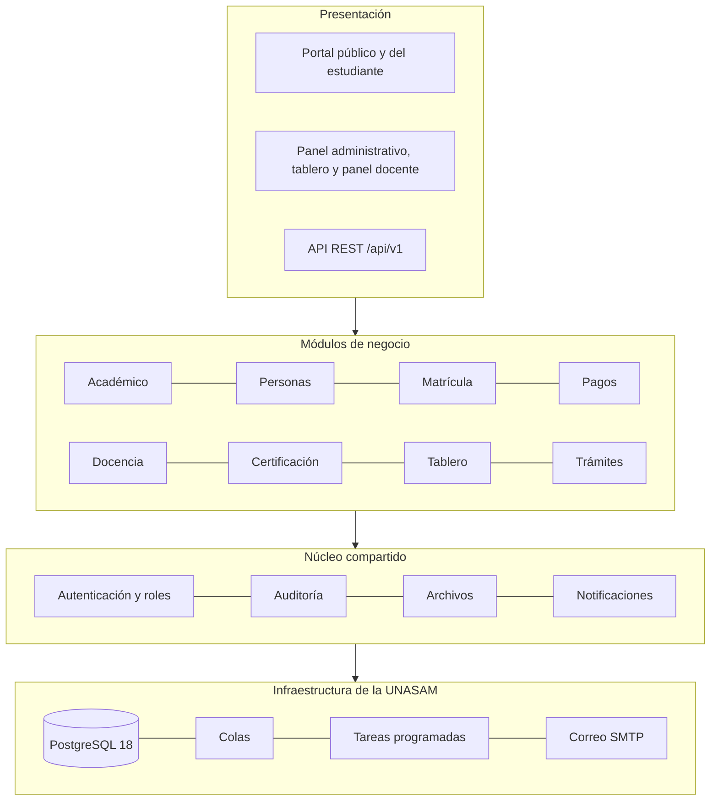

Es grato dirigirme a usted para saludarlo muy cordialmente y, a la vez, presentarle el informe técnico final del Sistema de Gestión Académica y Administrativa del Centro de Idiomas y Lenguas Nativas (CILN), que describe la solución construida y demuestra, requisito por requisito, el cumplimiento de los Términos de Referencia (TdR), conforme se detalla a continuación.

## I. ANTECEDENTES

1.1. Mediante el Informe Técnico N.° 023-2026-FMAJ, remitido con el Oficio N.° 166-2026-UNASAM-DSTI/D, la Dirección de Sistemas y Tecnologías de la Información (DSTI) concluyó que el sistema web del CILN, desarrollado sobre **PHP 5.6 sin soporte desde 2018**, presenta limitaciones técnicas, funcionales y de seguridad que comprometen su continuidad, y recomendó su rediseño y desarrollo integral con tecnologías modernas y seguras.

1.2. En atención a ello, el CILN aprobó los TdR del servicio y su Anexo Técnico, que exigen **seis módulos funcionales**, requisitos técnicos generales (arquitectura, seguridad OWASP, experiencia de usuario y escalabilidad) y condiciones de seguridad, propiedad intelectual, confidencialidad y soporte.

1.3. Con el Informe Técnico N.° 001-2026-YJBF se entregó a la DSTI la guía técnica para el despliegue del sistema en los servidores de la UNASAM. El presente informe completa la documentación técnica de cierre y se acompaña del **Diccionario de Datos** del sistema.

## II. OBJETIVO Y ALCANCE

2.1. **Objetivo.** Demostrar que el sistema desarrollado cumple los requisitos de los TdR y su Anexo Técnico, y documentar su arquitectura, tecnología, modelo de datos, seguridad y aseguramiento de la calidad, para la conformidad del área usuaria y la operación y el mantenimiento a cargo de la DSTI.

2.2. **Alcance.** Comprende los seis módulos funcionales del Anexo Técnico, los requisitos técnicos generales (sección II del Anexo) y las condiciones de la sección IV. Cada requisito se identifica con un código (por ejemplo, `M2.1.b`) que se usa en la matriz de cumplimiento (sección IX) y en la evidencia técnica (Anexo A).

2.3. **Documentos de referencia.**

- Términos de Referencia y Anexo Técnico del servicio (área usuaria: CILN).
- Informe Técnico N.° 023-2026-FMAJ de la DSTI (diagnóstico del sistema anterior y recomendaciones).
- Informe Técnico N.° 001-2026-YJBF (guía de despliegue).
- Ley N.° 29733, Ley de Protección de Datos Personales, y su reglamento.
- NTP-ISO/IEC 12207:2016, procesos del ciclo de vida del software, de uso obligatorio en las entidades públicas (R.M. N.° 041-2017-PCM).
- OWASP Top 10 (2021), riesgos de seguridad en aplicaciones web.

2.4. **Glosario.**

| Término | Significado |
|---|---|
| CILN | Centro de Idiomas y Lenguas Nativas de la UNASAM |
| DSTI | Dirección de Sistemas y Tecnologías de la Información de la UNASAM |
| TdR | Términos de Referencia del servicio, con su Anexo Técnico |
| TUPA / TUSNE | Texto Único de Procedimientos Administrativos / Texto Único de Servicios No Exclusivos |
| API REST | Interfaz de servicios web que permite a otros sistemas consultar datos del sistema |
| Acción (Action) | Clase que contiene una sola regla de negocio y que reutilizan todas las pantallas y la API |
| Trigger | Procedimiento de la base de datos que se ejecuta automáticamente ante un alta, un cambio o una baja |
| Pre-acta | Registro de notas parciales del docente antes del cierre del acta final |
| ULID | Identificador público no secuencial que impide recorrer registros por número |
| OWASP | Open Worldwide Application Security Project, referente internacional de seguridad web |

## III. RESUMEN DEL CUMPLIMIENTO

3.1. Se verificaron **96 requisitos** del Anexo Técnico contra el código fuente, las pantallas y las pruebas automatizadas del sistema. El resultado es el siguiente:

| Sección del Anexo Técnico | Requisitos | Cumple | Cumple parcialmente | No cumple |
|---|---|---|---|---|
| II. Requisitos técnicos generales | 12 | 9 | 3 | 0 |
| M1. Registro, clasificación y matrícula | 22 | 22 | 0 | 0 |
| M2. Pagos | 12 | 12 | 0 | 0 |
| M3. Docencia | 15 | 15 | 0 | 0 |
| M4. Evaluación y certificación | 11 | 11 | 0 | 0 |
| M5. Tablero gerencial | 7 | 7 | 0 | 0 |
| M6. Portal público y trámites | 11 | 11 | 0 | 0 |
| IV. Seguridad, propiedad intelectual y confidencialidad | 6 | 2 | 4 | 0 |
| **Total** | **96** | **89** | **7** | **0** |

3.2. **Los seis módulos funcionales (M1 a M6) se cumplen en su totalidad**: los 78 requisitos funcionales tienen una pantalla o un servicio que los atiende y, al menos, una prueba automatizada que lo comprueba.

3.3. Los **siete requisitos cumplidos parcialmente** no dependen de funciones faltantes, sino de condiciones externas al desarrollo: la definición del entorno de servidores por la DSTI, el escaneo de seguridad OWASP ZAP sobre el entorno de pruebas (que requiere autorización escrita de la DSTI), la formalización contractual de la cesión de derechos, la entrega final de los repositorios y manuales, y la garantía de doce meses, que empieza con la conformidad final. El detalle y la acción que corresponde a cada uno están en la sección X.

## IV. DESCRIPCIÓN GENERAL DEL SISTEMA

### 4.1. Componentes y usuarios

| Componente | Usuarios | Dirección |
|---|---|---|
| Portal público | Público en general | `/` |
| Portal del estudiante | Estudiantes y postulantes | `/estudiante` |
| Panel docente | Docentes | `/docente` |
| Panel administrativo y tablero gerencial | Personal del CILN (coordinación, caja, dirección, administración) | `/admin` |
| Verificación pública de documentos | Cualquier persona o institución | `/verificar` |
| Servicios REST (API) | Otros sistemas de la UNASAM o aplicaciones móviles | `/api/v1` |

### 4.2. Módulos y funciones principales

| Módulo del TdR | Funciones principales | Menú del panel |
|---|---|---|
| M1. Registro, examen de clasificación y matrícula | Autorregistro, solicitud y resultado del examen de clasificación, oferta de grupos con cupos y vacantes en tiempo real, matrícula autogestionada con bloqueos, ficha de matrícula en PDF con QR, traslados y retiros | Matrícula; Oferta académica |
| M2. Gestión y validación de pagos | Registro de pagos con comprobante digital, validación por caja, desbloqueo automático de servicios, anulación con motivo, reportes de recaudación en PDF y Excel | Pagos; Catálogos |
| M3. Gestión docente y carga académica | Legajo docente, disponibilidad, asignación de carga sin cruces de horario, control de clases con llamado de asistencia y confirmación del delegado, pre-actas y expediente de horas | Docencia; panel docente |
| M4. Evaluación y certificación digital | Actas finales con cierre y bloqueo, rectificación autorizada, constancias y certificados con código único y QR, verificación pública | Certificación |
| M5. Tablero de control gerencial | Indicadores financieros y académicos calculados en cada consulta, con exportación a PDF y Excel | Tablero gerencial; Reportes |
| M6. Portal público y trámites | Portada institucional con oferta, requisitos, costos y fechas; trámites con etapas configurables, barra de progreso y notificación por correo | Trámites; Catálogos |

### 4.3. Perfiles y permisos

El acceso se controla por **permisos por acción** que se agrupan en roles desde el propio panel (**Seguridad → Roles** y **Usuarios del personal**), sin modificar código. Los perfiles son:

| Perfil | Cómo se identifica | Acceso |
|---|---|---|
| Personal del CILN | Cuenta con el permiso de acceso al panel y los permisos de su función | Panel administrativo, con doble factor opcional u obligatorio |
| Docente | Cuenta del portal vinculada a un legajo docente | Panel docente: sus grupos, asistencia, pre-actas y actas |
| Estudiante | Cuenta del portal con correo verificado y ficha personal | Portal del estudiante: matrícula, pagos, clasificación, trámites, notas y documentos |
| Público | Sin cuenta | Portada, verificación de documentos y creación de cuenta |

Permisos disponibles para armar los roles del personal: pagos (ver, registrar, validar, anular, configurar, reportar), académico, personas, matrícula y clasificación (ver y gestionar o evaluar), docencia (ver, gestionar, costos, reportar), certificación (actas, documentos), trámites (gestionar, configurar), tablero, auditoría y gestión de usuarios.

## V. ARQUITECTURA Y TECNOLOGÍA

### 5.1. Tecnologías utilizadas

Todas las versiones cuentan con soporte oficial vigente, como exige el numeral II.1 del Anexo y recomienda la DSTI (3.1).

| Capa | Tecnología | Versión |
|---|---|---|
| Lenguaje | PHP | 8.5 |
| Framework | Laravel | 13 |
| Base de datos | PostgreSQL | 18 |
| Panel administrativo y tablero | Filament | 5 |
| Portales público, del estudiante y docente | Blade y Livewire | Livewire 4 |
| Estilos e interfaz | Tailwind CSS (compilado con Vite) | 4 |
| API REST | Laravel Sanctum y recursos JSON; documentación OpenAPI con Scramble | Sanctum 4 |
| Roles y permisos | spatie/laravel-permission | 8 |
| Documentos PDF y códigos QR | spatie/laravel-pdf con DOMPDF; endroid/qr-code | — |
| Hojas de cálculo | maatwebsite/excel | 4 |
| Respaldos | spatie/laravel-backup | 10 |

### 5.2. Arquitectura lógica

El sistema es un **monolito modular**: un solo despliegue organizado en ocho módulos de negocio (Académico, Personas, Matrícula, Pagos, Docencia, Certificación, Tablero y Trámites) y un núcleo compartido (autenticación, auditoría, archivos y notificaciones). Cada módulo sigue el patrón MVC con una capa de **Acciones** que concentra las reglas de negocio, lo que responde a las malas prácticas señaladas por la DSTI (código monolítico y acoplado, sin separación entre lógica y presentación).

**Reglas de desacople**, verificadas por pruebas de arquitectura automatizadas:

- Todas las entradas (pantallas web, panel, API y consola) ejecutan la misma Acción, por lo que una regla de negocio se aplica igual en todos los canales.
- Un módulo solo usa la parte pública de otro (contratos, datos, enumeraciones y eventos); sus modelos y lógica internos no se comparten.
- Las precondiciones se consultan de forma síncrona (por ejemplo, la matrícula pregunta a Pagos si el pago está validado) y los efectos secundarios se comunican por eventos, despachados después de confirmar la transacción.
- Cada módulo es dueño de sus tablas, con prefijo propio, y las relaciones entre módulos son llaves foráneas reales de PostgreSQL.

### 5.3. Arquitectura física

El sistema se instala en los servidores de la UNASAM, sin servicios de terceros en la nube. La DSTI elige una de las dos rutas documentadas en el Informe Técnico N.° 001-2026-YJBF: instalación tradicional o contenedor Docker.

| Componente | Requisito |
|---|---|
| Servidor de aplicación | PHP 8.5 con las extensiones `pdo_pgsql`, `gd`, `intl`, `zip`, `bcmath` y `mbstring`; Nginx o Apache con HTTPS |
| Base de datos | PostgreSQL 18, en el mismo servidor o en otro; dos roles: uno dueño del esquema para las migraciones y otro, sin privilegios de dueño, para la aplicación |
| Procesos en segundo plano | Un proceso supervisado de colas (correos y reacciones a pagos) y el programador de tareas (cron cada minuto) |
| Correo | Servidor SMTP institucional |
| Almacenamiento | Disco del propio servidor, fuera de la carpeta pública, para comprobantes, fotografías y respaldos |

### 5.4. Código fuente

El código fuente se entrega en un repositorio Git con su historial completo. Su organización es:

| Carpeta | Contenido |
|---|---|
| `app/Modules/<Módulo>` | Cada módulo con sus acciones, contratos, modelos, pantallas, rutas, migraciones y vistas |
| `app/Shared` | Autenticación, auditoría, archivos, notificaciones y utilidades comunes |
| `database/migrations` | Migraciones generales (cuentas, colas, caché, permisos, comentarios del diccionario de datos) |
| `resources/` | Estilos, componentes de interfaz y vistas compartidas |
| `tests/` | Pruebas automatizadas por módulo, transversales, de concurrencia y de arquitectura |
| `docs/` | Documentación técnica: arquitectura, módulos, modelo de datos, seguridad, despliegue, decisiones (ADR) y manuales |

### 5.5. Servicios REST

La API `/api/v1` expone 14 servicios de solo lectura (salvo la emisión y revocación de su token) para la interoperabilidad con otros sistemas, con la documentación OpenAPI generada a partir del código en `/docs/api`:

| Grupo | Servicios |
|---|---|
| Públicos | Oferta académica, tarifas vigentes, verificación de documentos y emisión de token |
| Sesión | Consulta y revocación del token actual |
| Estudiante | Perfil, matrículas, pagos, notas, documentos y su PDF, trámites |
| Docente | Grupos a cargo |

### 5.6. Procesos automáticos

| Proceso | Frecuencia | Función |
|---|---|---|
| `clasificacion:expirar` | Diario, 00:10 | Vence las solicitudes de examen de clasificación no evaluadas en 30 días |
| `sanctum:prune-expired` | Diario, 00:20 | Elimina los tokens de la API vencidos |
| `backup:clean` y `backup:run` | Diario, 01:00 y 01:30 | Respaldo nocturno de la base de datos y los archivos (se activa al acordar el destino con la DSTI) |
| Colas | Continuo | Correos de verificación, recuperación de contraseña y cambios de trámite; reacción de los trámites y las solicitudes ante la validación, el rechazo o la anulación de pagos; habilitación del ciclo siguiente al cerrar un acta |

## VI. MODELO DE DATOS

6.1. La base de datos PostgreSQL 18 tiene **62 tablas y 580 columnas**, organizadas por módulo. Todas las tablas y columnas tienen su descripción guardada en la propia base de datos (comentarios del catálogo), de modo que la DSTI puede consultarlas desde cualquier cliente de PostgreSQL. El detalle completo, con tipos, restricciones, relaciones, triggers y diagramas entidad-relación por módulo, se entrega en el **Diccionario de Datos**, que se genera desde la base instalada con el comando `php artisan docs:diccionario-de-datos`.

| Módulo | Tablas | Columnas |
|---|---|---|
| Académico (oferta académica) | 8 | 78 |
| Personas | 1 | 17 |
| Matrícula | 5 | 54 |
| Pagos | 5 | 55 |
| Docencia | 14 | 126 |
| Certificación | 7 | 88 |
| Trámites | 5 | 55 |
| Auditoría | 1 | 10 |
| Seguridad y control de acceso | 9 | 52 |
| Infraestructura de la aplicación | 7 | 45 |
| **Total** | **62** | **580** |

6.2. **Integridad garantizada por la base de datos.** Las reglas críticas no dependen solo del código de la aplicación:

- Llaves foráneas reales entre todos los módulos y restricciones `CHECK`, `UNIQUE` y `EXCLUDE` (por ejemplo, las vacantes nunca son negativas ni superan el cupo, y dos tarifas del mismo concepto no se superponen en el tiempo).
- Triggers que impiden cruces de horario de aulas y docentes, que un sistema de evaluación quede sin habilidades o sin exámenes, la modificación de pagos validados, de actas cerradas y de documentos emitidos, y el borrado de registros financieros y académicos, que solo se anulan con motivo.
- Importes en `numeric` (nunca en coma flotante) y fechas con zona horaria, mostradas en hora de Lima.

## VII. SEGURIDAD DE LA INFORMACIÓN

### 7.1. Controles frente al OWASP Top 10

| Riesgo OWASP (2021) | Control implementado |
|---|---|
| A01 Control de acceso roto | Permiso por acción y política de autorización en cada recurso; el panel niega toda acción no concedida explícitamente; identificadores públicos no secuenciales (ULID); cada estudiante y docente ve solo sus propios datos |
| A02 Fallas criptográficas | Contraseñas con hash; sesión, cuenta bancaria del docente y secretos del doble factor cifrados; HTTPS con `Strict-Transport-Security` |
| A03 Inyección | Consultas parametrizadas; escapado automático de las vistas; política de seguridad de contenido (CSP) |
| A04 Diseño inseguro | Reglas de negocio en una sola Acción por regla, validadas también en la base de datos; bloqueo de filas en operaciones concurrentes (última vacante, doble validación) |
| A05 Configuración insegura | Cabeceras de seguridad en toda respuesta; modo de depuración desactivado en producción; páginas de error sin trazas técnicas |
| A06 Componentes vulnerables | Versiones con soporte vigente; auditoría de dependencias con `composer audit` en la integración continua |
| A07 Fallas de autenticación | Límite de intentos en el ingreso, el registro, la recuperación de contraseña y la verificación pública; doble factor con aplicación autenticadora para el personal; cierre del panel tras 30 minutos sin actividad |
| A08 Integridad de datos y software | Huella SHA-256 de cada comprobante de pago; verificación del tipo real de los archivos subidos; documentos verificables por código único y QR |
| A09 Registro y monitoreo | Pista de auditoría inmutable; registro de rechazos de negocio con datos personales enmascarados; identificador de solicitud en cada registro |
| A10 Falsificación de solicitudes del lado del servidor | El sistema no realiza peticiones a direcciones ingresadas por el usuario |

### 7.2. Autenticación y sesiones

Las sesiones usan cookies `HttpOnly`, `Secure` y `SameSite`, con el contenido cifrado y regeneración al iniciar sesión; la protección CSRF verifica el token y el origen de cada formulario. El personal ingresa por una página propia, separada de la de estudiantes y docentes, con doble factor que puede volverse obligatorio por configuración. La API usa tokens personales que vencen a los 30 días.

### 7.3. Pista de auditoría inmutable

Conforme al numeral II.2 y a la sección IV.2 del Anexo, un trigger de PostgreSQL registra en la tabla `aud_registros` cada alta, cambio o baja de **más de 40 tablas críticas** (notas, actas, pagos, matrículas, documentos, roles y permisos, entre otras), con fecha y hora, dirección IP, usuario, operación, valores anteriores y nuevos e identificador de la solicitud. La tabla rechaza toda modificación, borrado o vaciado; en producción, la aplicación debe conectarse con un rol que no sea dueño de las tablas, para que no pueda desactivar los triggers. El personal autorizado la consulta en **Seguridad → Auditoría**, con los datos sensibles ocultos.

### 7.4. Protección de datos personales (Ley N.° 29733)

- El autorregistro exige el consentimiento expreso para el tratamiento de datos personales y guarda su fecha y hora.
- La verificación pública de documentos y fichas muestra solo los datos mínimos, con el documento de identidad enmascarado, y no se indexa en buscadores.
- Las fotografías se guardan fuera de la carpeta pública y sin metadatos (ubicación GPS, equipo).
- El tablero gerencial solo muestra cifras agregadas, sin nombres ni documentos.
- Las pruebas y los entornos de demostración usan exclusivamente datos sintéticos.

### 7.5. Atención a las observaciones de la DSTI

| Observación del Informe N.° 023-2026-FMAJ | Respuesta del nuevo sistema |
|---|---|
| 1.1 Tecnología obsoleta (PHP 5.6) | PHP 8.5, Laravel 13 y PostgreSQL 18, todos con soporte vigente |
| 1.2 Vulnerabilidades y malas prácticas | Controles OWASP (7.1), arquitectura modular con pruebas de desacople, manejo centralizado de errores |
| 1.3 Problemas de lógica funcional | Reglas de negocio en Acciones únicas, validadas también en la base de datos y cubiertas por pruebas automatizadas |
| 1.4 Experiencia de usuario | Interfaz adaptable a móviles, sistema de diseño único y contraste de colores conforme a WCAG AA |
| 1.5 Impacto institucional | Auditoría inmutable, respaldos programados, documentación técnica y despliegue en la infraestructura de la UNASAM |
| 3.1 Recomendaciones | Cumplidas en tecnologías, seguridad, UX/UI y arquitectura escalable (sección IX, requisitos II.1 a II.4) |

## VIII. ASEGURAMIENTO DE LA CALIDAD

8.1. **Pruebas automatizadas.** El sistema cuenta con **240 archivos de prueba** que se ejecutan siempre sobre PostgreSQL con datos sintéticos. Cubren las reglas de negocio de cada módulo, los flujos completos de las pantallas, la API, la seguridad (autorización, sesiones, cabeceras, auditoría), la concurrencia con conexiones reales (última vacante, doble validación de pagos) y la arquitectura (desacople entre módulos).

| Tipo de prueba | Archivos | Casos |
|---|---|---|
| Reglas de negocio por módulo (`tests/Modules`) | 158 | 1217 |
| Flujos transversales, API, seguridad y portales (`tests/Feature`) | 58 | 327 |
| Concurrencia con conexiones reales (`tests/Concurrency`) | 15 | 33 |
| Unitarias (`tests/Unit`) | 6 | 20 |
| Arquitectura y desacople (`tests/Architecture`) | 3 | 8 |
| **Total** | **240** | **1605** |

8.2. **Resultado de la última ejecución.** El 14 de noviembre de 2026 se ejecutó la suite completa sobre PostgreSQL 18: **2 280 ejecuciones de prueba aprobadas y ninguna fallida**, con 9 624 verificaciones (aserciones), en 5 minutos y 7 segundos. Las ejecuciones superan a los casos del inventario porque los casos con conjuntos de datos se ejecutan una vez por cada dato.

8.3. **Análisis estático y estilo.** Cada cambio pasa por Larastan en nivel 8, con un límite de complejidad cognitiva (8 por método y 40 por clase), Rector y Pint. La integración continua (`.github/workflows/ci.yml`) ejecuta las mismas verificaciones y la auditoría de dependencias de PHP (`composer audit`).

8.4. **Verificación funcional.** Cada flujo se verificó además en el navegador con datos de demostración.

## IX. MATRIZ DE CUMPLIMIENTO DE LOS TÉRMINOS DE REFERENCIA

Para cada requisito se indica dónde se atiende en el sistema y su estado. Las rutas del código y las pruebas que lo comprueban están en el Anexo A. Los números precedidos de "#" remiten al registro de decisiones del proyecto (`docs/decisiones-pendientes.md`).

En la columna de ubicación, «Admin» es el panel administrativo del personal (`/admin`), «Portal docente» es el panel `/docente` y «Portal» o «Portal del estudiante» son las páginas `/estudiante`.

### 9.1. Requisitos técnicos generales (sección II del Anexo)

| ID | Requisito | Ubicación en el sistema | Estado | Observación |
|---|---|---|---|---|
| II.1.a | PHP 8.5 o superior, con soporte LTS y parches vigentes | Plataforma | Cumple | — |
| II.1.b | Framework consolidado bajo patrón MVC o multicapa | Plataforma | Cumple | Laravel 13; monolito modular (Controlador/Livewire/Filament → Form Request → Action → Modelo), ADR 0001 |
| II.1.c | Servicios expuestos por API REST y diseño desacoplado | API `/api/v1` | Cumple | 14 servicios REST, de solo lectura salvo la emisión/revocación de tokens (#86); módulos se comunican por `Contracts/` |
| II.1.d | Base de datos relacional normalizada con índices adecuados | Plataforma | Cumple | PostgreSQL 18 con claves foráneas reales, `CHECK` y tablas con prefijo por módulo |
| II.1.e | Compatible con entorno y estándares de la DSTI | Despliegue | Cumple parcialmente | Falta que la DSTI defina el entorno (SO, servidor web, Docker, SMTP) (#8) |
| II.2.a | Cumplimiento del OWASP Top 10 | Transversal | Cumple parcialmente | Controles implementados y probados; el reporte OWASP ZAP contra staging (evidencia prevista en `docs/seguridad.md`) aún no existe y requiere autorización escrita de la DSTI |
| II.2.b | Validación de entradas; protección contra SQLi, XSS y CSRF | Transversal | Cumple | No hay una prueba automatizada dedicada a CSRF; la protección la da el middleware del framework |
| II.2.c | Gestión segura de sesiones y cifrado de datos sensibles | Admin → (perfil) Doble factor; transversal | Cumple | Doble factor opcional (#92); cierre del panel a los 30 min (#93) |
| II.2.d | Tratamiento de datos personales conforme a la Ley 29733 | Portal del estudiante → Crear cuenta; Sitio público → `/fichas/{código}`, `/verificar` | Cumple | Consentimiento registrado, documento enmascarado en verificación pública (#67), sin exportación de personas; datos de prueba sintéticos |
| II.2.e | Log Triggers inmutables: fecha, hora, IP, usuario y detalle | Admin → Seguridad → Auditoría | Cumple | Función `aud_registrar()` en 40+ tablas (notas, pagos, actas); `aud_registros` rechaza UPDATE/DELETE/TRUNCATE |
| II.3.a | Interfaz responsive, intuitiva, accesible y adaptable a móviles | Todas las pantallas | Cumple | Tailwind con puntos de quiebre y Filament; no hay prueba automatizada de vistas móviles (se verifica en navegador) |
| II.4.a | Escalabilidad, interoperabilidad, alta disponibilidad e integraciones futuras | Plataforma | Cumple parcialmente | Arquitectura preparada (módulos desacoplados, API, colas); alta disponibilidad, concurrencia y respaldos dependen de la infraestructura aún no acordada (#5, #8); respaldos programados apagados |

### 9.2. Módulo 1: Registro, examen de clasificación y matrícula

| ID | Requisito | Ubicación en el sistema | Estado | Observación |
|---|---|---|---|---|
| M1.1.a | Registro de postulantes que desean ingresar a nivel superior al básico | Portal del estudiante → Crear cuenta (`/estudiante/registro`) | Cumple | — |
| M1.1.b | Gestión de solicitudes para rendir el examen de clasificación | Portal del estudiante → Clasificación; Admin → Matrícula → Solicitudes de clasificación | Cumple | Exige pago validado del concepto; vence a los 30 días (#11, #33, #36) |
| M1.1.c | Ingreso de resultados por coordinación y asignación automática del nivel | Admin → Matrícula → Solicitudes de clasificación (registrar resultado) | Cumple | Fija el ciclo habilitado (origen "Examen de clasificación"); la coordinación elige el ciclo, no hay tabla de rangos de puntaje (#34, #35) |
| M1.1.campos: postulante | Tipo/N.º documento, apellidos, nombres, nacimiento, correo, celular | Admin → Matrícula → Personas; Portal → Crear cuenta | Cumple | — |
| M1.1.campos: vínculo | Tipo de usuario (Estudiante, Docente/Administrativo UNASAM, Público) para tarifas | Admin → Matrícula → Personas; Admin → Catálogos → Conceptos y tarifas | Cumple | Autorregistro como Público General; solo el personal cambia el vínculo (#26) |
| M1.1.campos: examen | Idioma, fecha, puntaje, nivel asignado | Admin → Matrícula → Solicitudes de clasificación | Cumple | El nivel asignado se expresa como ciclo del idioma (con su nivel) |
| M1.1.campos: estado | Pendiente de Evaluación, Evaluado, Expirado | Admin → Matrícula → Solicitudes de clasificación | Cumple | Se agrega "Pago anulado" (#131); expiración diaria `clasificacion:expirar` |
| M1.2.a | Crear y ofertar cursos: cupos, horarios, idiomas, modalidades y acelerado | Admin → Oferta académica → Periodos / Idiomas y ciclos / Grupos / Aulas | Cumple | Modalidad Presencial/Virtual/Semipresencial y marca "acelerado" |
| M1.2.campos: ciclo | Año, mes/periodo, fecha de inicio y fin | Admin → Oferta académica → Periodos | Cumple | — |
| M1.2.campos: grupo | Código, idioma, nivel, ciclo (I a XII) | Admin → Oferta académica → Grupos; Idiomas y ciclos | Cumple | Distribución de ciclos por nivel configurable (#9) |
| M1.2.campos: capacidad | Cupo máximo, mínimo de apertura, vacantes en tiempo real | Admin → Oferta académica → Grupos; Portal → Matrícula | Cumple | `CHECK matriculados <= cupo_maximo`; cupo mínimo al iniciar clases (#127) |
| M1.2.campos: asignación | Docente, aula o enlace virtual, horario | Admin → Oferta académica → Grupos (Horarios); Admin → Docencia → Docentes (Carga académica) | Cumple | Choques de aula bloqueados por trigger (#22) |
| M1.3.a | Interfaz para que el estudiante se matricule de forma autónoma | Portal del estudiante → Matrícula | Cumple | — |
| M1.3.b | Bloqueos: ciclo previo/nivel, pago no validado, grupo sin vacantes | Portal del estudiante → Matrícula (requisitos) | Cumple | Prerrequisito = ciclo habilitado por idioma (#10, #15) |
| M1.3.c | Generación automática de la Ficha de Matrícula en PDF | Portal → Mis matrículas (Ficha); Admin → Matrícula → Matrículas | Cumple | Una ficha por estudiante y periodo, con QR (#96) |
| M1.3.campos: inscripción | ID estudiante, grupo, fecha y hora de matrícula | Admin → Matrícula → Matrículas | Cumple | — |
| M1.3.campos: pago | Estado de pago (Verificado/Pendiente) según Pagos | Portal → Matrícula; Admin → Matrícula → Matrículas (pago) | Cumple | La ficha muestra "Verificado"; el portal lista el pago pendiente como requisito |
| M1.3.campos: condición | Condición Regular o Repitente | Admin → Matrícula → Matrículas; Ficha | Cumple | Criterio de repitente (#16) |
| M1.3.campos: documentos | Ficha de Matrícula (PDF), Constancia de Inscripción | Portal → Mis matrículas | Cumple | Constancia gratuita e inmediata, sin QR (#29, #30) |
| M1.4.a | Cambiar alumno de grupo/horario por motivos excepcionales | Admin → Matrícula → Matrículas (Trasladar) | Cumple | Mismo periodo y ciclo (#32) |
| M1.4.b | Registro de retiros oficiales del ciclo | Admin → Matrícula → Matrículas (Retirar) | Cumple | Retirados no figuran en el acta final (#58) |
| M1.4.campos | Grupo origen/destino, fecha, motivo, usuario que autoriza | Admin → Matrícula → Matrículas (movimientos) | Cumple | Movimientos inmutables por trigger |

### 9.3. Módulo 2: Gestión y validación de pagos

| ID | Requisito | Ubicación en el sistema | Estado | Observación |
|---|---|---|---|---|
| M2.1.a | Registro de pagos (matrícula, pensión, clasificación, certificados) | Admin → Pagos → Pagos (Registrar pago); Portal → Registro de pagos | Cumple | — |
| M2.1.b | Validación por administrador o cajero con recibo digital JPG/PNG/PDF | Admin → Pagos → Pagos (Validar / Rechazar) | Cumple | Tipo detectado por contenido, huella SHA-256, separación de funciones (#114, #117, #118) |
| M2.1.c | Desbloqueo automático de matrícula, constancias y exámenes al validar | Portal → Matrícula / Clasificación / Trámites | Cumple | Constancias y certificados se desbloquean vía trámites (#75) |
| M2.1.d | Auditoría de qué usuario validó cada pago y en qué fecha | Admin → Pagos → Pagos (ficha); Admin → Seguridad → Auditoría | Cumple | — |
| M2.1.campos: identificador | Número de recibo / código de operación | Admin → Pagos → Pagos | Cumple | Único por medio entre pagos no rechazados (#14, #116) |
| M2.1.campos: pagador | Tipo y número de documento del pagador | Admin → Pagos → Pagos (búsqueda por documento) | Cumple | El documento se toma de la ficha de la persona |
| M2.1.campos: financiero | Monto total, fecha de pago, medio de pago | Admin → Pagos → Pagos; Admin → Catálogos → Medios de pago | Cumple | Medios como catálogo (#119) |
| M2.1.campos: concepto | Código del concepto TUPA/TUSNE | Admin → Catálogos → Conceptos y tarifas; Fuentes TUPA/TUSNE | Cumple | Tarifas por concepto y vínculo (#12, #120) |
| M2.1.campos: evidencia | Recibo escaneado, estado, usuario y fecha de validación | Admin → Pagos → Pagos (ficha y recibo) | Cumple | Se agrega estado "Anulado" (#13) |
| M2.2.a | Reportes consolidados por periodo, idioma, nivel y concepto | Admin → Pagos → Reporte de recaudación | Cumple | Periodo = rango de fechas de pago más filtro de periodo académico (#37) |
| M2.2.b | Exportación PDF y/o hoja de cálculo (Excel/CSV) para DGF/Tesorería | Admin → Pagos → Reporte de recaudación (PDF, CSV) | Cumple | CSV UTF-8 con BOM; sin .xlsx (#38) |
| M2.2.campos | Periodo, concepto, monto total, N.º operaciones, detalle por estudiante | Admin → Pagos → Reporte de recaudación | Cumple | Montos sumados en céntimos enteros |

### 9.4. Módulo 3: Gestión docente y reportes de carga académica

| ID | Requisito | Ubicación en el sistema | Estado | Observación |
|---|---|---|---|---|
| M3.1.a | Padrón de docentes con idiomas y disponibilidad horaria | Admin → Docencia → Docentes (Disponibilidad horaria) | Cumple | — |
| M3.1.b | Estado del docente: Activo, Inactivo, De Licencia | Admin → Docencia → Docentes | Cumple | Acceso de docentes inactivos al panel por decidir (#48) |
| M3.1.campos: personales | ID docente, nombres, DNI/CE, correo institucional y personal, celular | Admin → Docencia → Docentes | Cumple | Datos personales desde Personas (#39) |
| M3.1.campos: expediente | RUC, cuenta bancaria, banco, condición laboral | Admin → Docencia → Docentes; Admin → Catálogos → Condiciones laborales | Cumple | Cuenta bancaria cifrada y enmascarada (#122) |
| M3.1.campos: académico | Idiomas habilitados, nivel máximo autorizado | Admin → Docencia → Docentes | Cumple | Nivel máximo por idioma (#40) |
| M3.2.a | Vincular docente con grupos/ciclos aperturados | Admin → Docencia → Docentes → Carga académica | Cumple | — |
| M3.2.b | Cálculo automático del total de horas asignadas en el periodo | Admin → Docencia → Docentes → Carga académica; Admin → Docencia → Carga docente | Cumple | Horas = sesiones programadas del periodo (#42) |
| M3.2.c | Control de cruces de horarios del docente | Admin → Docencia → Docentes → Carga académica | Cumple | Regla en Action y en trigger de restricción (#41, #43) |
| M3.2.d | Llamado de asistencia y registro de pre-actas según cronograma | Portal docente → Mis grupos → Asistencia / Pre-acta | Cumple | Dos llamados y confirmación del delegado (ADR 0009; #45, #46, #98) |
| M3.2.campos: grupo | Código, nivel, idioma del grupo | Admin → Docencia → Docentes → Carga académica | Cumple | — |
| M3.2.campos: carga | Semanas, fechas de inicio y fin, días de dictado, horas totales | Admin → Docencia → Docentes → Carga académica | Cumple | — |
| M3.3.a | Consolidar horas dictadas × costo por hora: monto bruto referencial | Admin → Docencia → Expediente de horas; Costos por hora | Cumple | Costo por grado académico (#49 resuelto; #50, #51) |
| M3.3.b | Reporte por docente en PDF y/o Excel/CSV para DGF/Tesorería | Admin → Docencia → Expediente de horas (PDF, CSV) | Cumple | — |
| M3.3.c | No calcula retenciones ni procesa el pago | Admin → Docencia → Expediente de horas | Cumple | Sin cálculo de retenciones en el código |
| M3.3.campos | Mes y año; nombres, idioma/nivel, horas, costo/hora, monto bruto | Admin → Docencia → Expediente de horas | Cumple | — |

### 9.5. Módulo 4: Evaluación y certificación digital

| ID | Requisito | Ubicación en el sistema | Estado | Observación |
|---|---|---|---|---|
| M4.1.a | Interfaz exclusiva del docente asignado, solo en fechas del calendario | Portal docente → Mis grupos → Acta final | Cumple | Rango "actas desde/hasta" por periodo (#55) |
| M4.1.b | Cálculo automático de promedios (Parcial, Final, Participación) | Portal docente → Acta final; Admin → Catálogos → Sistemas de evaluación | Cumple | Según el sistema de evaluación del CILN: promedio de las cuatro habilidades, promedio de parcial y final y nota final igual al promedio de ambos, redondeada al entero; el Anexo menciona «Participación», pero remite al sistema del CILN (#56, #121) |
| M4.1.c | Cierre y bloqueo; modificación con autorización del Administrador y en auditoría | Admin → Certificación → Actas finales (autorizar rectificación) | Cumple | Triggers `cer_actas_bloqueo`, `cer_notas_finales_bloqueo` (#59) |
| M4.1.campos: curso | Idioma, nivel, ciclo, periodo académico | Admin → Certificación → Actas finales | Cumple | — |
| M4.1.campos: docente | ID y nombres completos del docente | Admin → Certificación → Actas finales; PDF del acta | Cumple | Se muestra el código `DOC-00001` |
| M4.1.campos: calificaciones | ID estudiante, notas parciales, promedio, estado Aprobado/Desaprobado/NSP | Admin → Certificación → Actas finales | Cumple | — |
| M4.2.a | Emisión masiva o individual de constancias y certificados de nivel | Admin → Certificación → Constancias y certificados; Actas finales | Cumple | Alcance de cada documento (#63, #64, #65) |
| M4.2.b | PDF estandarizado con diseño institucional | Admin → Certificación → Constancias y certificados (PDF) | Cumple | Firmantes y numeración anual; firma digital no exigida (#69) |
| M4.2.c | QR único que lleva al portal oficial de verificación | Sitio público → Verificar un documento (`/verificar/{código}`) | Cumple | Con límite de 30 consultas/min; datos mínimos (#62, #67) |
| M4.2.campos: documento | Código único, fecha de emisión, código QR | Admin → Certificación → Constancias y certificados | Cumple | — |
| M4.2.campos: acreditación | Nombres, idioma, nivel, horas lectivas, nota final | Admin → Certificación → Constancias y certificados | Cumple | — |

### 9.6. Módulo 5: Tablero de control gerencial

| ID | Requisito | Ubicación en el sistema | Estado | Observación |
|---|---|---|---|---|
| M5.1.a | Ingresos recaudados por periodo, idioma y nivel | Admin → Tablero gerencial | Cumple | Atribución de pagos (#80) |
| M5.1.b | Tasa de morosidad o pagos pendientes de validación | Admin → Tablero gerencial | Cumple | Indicador de pendientes de validación (#4) |
| M5.1.c | Rentabilidad básica por grupo (ingresos vs. costo docente) | Admin → Tablero gerencial | Cumple | (#81) |
| M5.2.a | Número de matrículas y crecimiento mes a mes / año a año | Admin → Tablero gerencial | Cumple | (#82) |
| M5.2.b | Tasa de deserción por nivel y por idioma | Admin → Tablero gerencial | Cumple | (#83) |
| M5.2.c | Distribución de la demanda horaria | Admin → Tablero gerencial | Cumple | (#84) |
| M5.3.a | Tablero único con gráficos, tablas, filtros y exportación PDF/Excel | Admin → Tablero gerencial (Exportar PDF, Excel) | Cumple | Filtros periodo/idioma/nivel; Excel .xlsx (maatwebsite/excel); tiempo real sin caché (#85) |

### 9.7. Módulo 6: Portal público y trazabilidad de trámites

| ID | Requisito | Ubicación en el sistema | Estado | Observación |
|---|---|---|---|---|
| M6.1.a | Página pública: oferta, requisitos, fechas, costos TUPA/TUSNE | Sitio público → Portada (`/`) | Cumple | Requisitos como texto fijo hasta recibir el oficial (#70, #71, #72); dominio oficial depende del despliegue (#8) |
| M6.1.b | Inicio de sesión diferenciado para estudiantes y docentes | Sitio público → Ingresar (`/ingresar`) → Portal del estudiante o Portal docente | Cumple | Una sola entrada que deriva por perfil (#73, por confirmar) |
| M6.1.c | Recuperación de credenciales con token al correo registrado | Sitio público → Recuperar clave (`/recuperar-clave`, `/restablecer-clave/{token}`) | Cumple | — |
| M6.2.a | Flujo configurable por trámite (constancia, certificado, traslado, retiro) | Admin → Catálogos → Tipos de trámite; Portal → Trámites | Cumple | (#74, #76) |
| M6.2.b | Flujo bloqueado hasta que Pagos valide la tasa | Portal → Trámites; Admin → Trámites → Trámites | Cumple | Aplicación automática del pago (#75) |
| M6.2.c | Barra de progreso visible para el usuario | Portal del estudiante → Trámites | Cumple | Etapas con porcentaje configurables; estados fijos (#6) |
| M6.2.d | Notificación automática por correo en cada cambio de estado | Correo al estudiante; Admin → Trámites → Trámites (notificaciones) | Cumple | Por cola, 3 intentos (#79); requiere SMTP de la DSTI (#8) |
| M6.2.e | Panel para configurar etapas, estados y condiciones sin programar | Admin → Catálogos → Tipos de trámite | Cumple | Condiciones de etapa de un catálogo cerrado (solicitud, pago validado, acción del personal) y acciones finales predefinidas |
| M6.2.campos: id | ID de trámite (código único de seguimiento) | Portal → Trámites; Admin → Trámites → Trámites | Cumple | (#78) |
| M6.2.campos: estados | Pendiente de Pago, En Proceso, Observado, Finalizado | Admin → Trámites → Trámites | Cumple | Se agrega "Cerrado sin atender" (#134) |
| M6.2.campos: log | Log de notificaciones: fecha, hora, estado de entrega | Admin → Trámites → Trámites (ficha: notificaciones) | Cumple | Estados pendiente, enviado, fallido; inmutable por trigger |

### 9.8. Seguridad, propiedad intelectual y confidencialidad (sección IV del Anexo)

| ID | Requisito | Ubicación en el sistema | Estado | Observación |
|---|---|---|---|---|
| IV.1.a | Cesión total de derechos patrimoniales a la UNASAM | Contractual | Cumple parcialmente | Obligación contractual; el repositorio no tiene archivo LICENSE ni aviso de titularidad a favor de la UNASAM |
| IV.1.b | Entrega de repositorios completos y documentados al finalizar | Repositorio | Cumple parcialmente | Documentación técnica presente; entrega final pendiente; no se hallaron manuales de usuario en `docs/` |
| IV.2.a | Seguridad conforme a Ley 29733 y OWASP | Transversal | Cumple parcialmente | Mismo pendiente que II.2.a (reporte ZAP) |
| IV.2.b | Log Triggers inmutables: fecha, hora, IP, usuario y detalle | Admin → Seguridad → Auditoría | Cumple | — |
| IV.3.a | Confidencialidad de la información académica, financiera y personal | Proceso del proveedor | Cumple | Compromiso contractual; en lo técnico, pruebas y demo solo con datos sintéticos |
| IV.4.a | Garantía y soporte técnico mínimo de 12 meses | Contractual | Cumple parcialmente | Obligación posterior a la conformidad final; no verificable en código |

## X. PENDIENTES PARA LA CONFORMIDAD FINAL

10.1. Requisitos cumplidos parcialmente y acción que corresponde:

| Requisito | Situación | Acción y responsable |
|---|---|---|
| II.1.e Compatibilidad con el entorno de la DSTI | El sistema está listo para las dos rutas de despliegue | La DSTI define el entorno (sistema operativo, servidor web, Docker, SMTP) |
| II.2.a y IV.2.a OWASP Top 10 | Controles implementados y probados | La DSTI autoriza por escrito el escaneo OWASP ZAP sobre el entorno de pruebas; el reporte se adjunta como evidencia |
| II.4.a Alta disponibilidad y escalabilidad | Arquitectura preparada (módulos desacoplados, API, colas, respaldos programados) | CILN y DSTI acuerdan usuarios concurrentes, disponibilidad y destino de los respaldos; se activan los respaldos y se prueba la restauración |
| IV.1.a Cesión de derechos a la UNASAM | Obligación contractual | Se formaliza con el acta de entrega y cesión del código fuente |
| IV.1.b Repositorios documentados | Documentación técnica y diccionario de datos entregados | Entrega de los manuales de usuario y del repositorio en la versión final |
| IV.4.a Garantía de 12 meses | Se inicia con la conformidad final | Plan de soporte y garantía |

10.2. **Supuestos por validar con el CILN.** Durante el desarrollo se registraron 136 decisiones en `docs/decisiones-pendientes.md`. La mayoría son supuestos ya implementados de forma configurable (por ejemplo, la nota mínima aprobatoria, la distribución de ciclos por nivel o las etapas de cada trámite) que el CILN debe confirmar durante las pruebas de aceptación. Ninguno impide el uso del sistema; los que requieren datos institucionales (tarifas TUPA/TUSNE, firmantes, denominación del año) se registran desde el panel sin modificar código.

## XI. CONCLUSIONES

11.1. El Sistema de Gestión Académica y Administrativa del CILN **cumple los seis módulos funcionales** del Anexo Técnico: los 78 requisitos funcionales tienen una pantalla o un servicio que los atiende y pruebas automatizadas que lo comprueban.

11.2. De los 96 requisitos verificados, **89 se cumplen y 7 se cumplen parcialmente** por depender de condiciones externas al desarrollo (entorno de servidores, autorización del escaneo de seguridad, formalización contractual y garantía). **Ningún requisito queda sin atender.**

11.3. El sistema supera las limitaciones señaladas por la DSTI en el Informe Técnico N.° 023-2026-FMAJ: usa tecnologías con soporte vigente, aplica los controles del OWASP Top 10, registra una pista de auditoría inmutable en la base de datos y protege los datos personales conforme a la Ley N.° 29733.

## XII. RECOMENDACIONES

12.1. Que la DSTI defina el entorno de servidores y autorice por escrito el escaneo OWASP ZAP sobre el entorno de pruebas, para cerrar los requisitos II.1.e, II.2.a y IV.2.a.

12.2. Que el CILN y la DSTI acuerden el destino y la retención de los respaldos, se activen los respaldos programados y se realice una prueba de restauración antes del inicio de operaciones.

12.3. Que se active el doble factor obligatorio para el personal del panel (`PANEL_DOBLE_FACTOR_OBLIGATORIO=true`) y se conecte la aplicación con un rol de base de datos distinto del dueño del esquema, como indica la guía de despliegue.

12.4. Que el CILN valide los supuestos registrados durante las pruebas de aceptación y registre en el panel los datos institucionales (tarifas, firmantes, denominación del año y roles del personal).

12.5. Que la DSTI mantenga actualizadas las dependencias del sistema dentro de sus versiones con soporte, apoyándose en las auditorías automáticas de la integración continua.

Sin otro particular, hago propicia la ocasión para expresarle las muestras de mi especial consideración y estima.

<!-- firma -->

## ANEXO A. EVIDENCIA TÉCNICA POR REQUISITO

Rutas del código fuente que implementan cada requisito y pruebas automatizadas que lo comprueban.

**Requisitos técnicos generales (sección II del Anexo)**

| ID | Código fuente | Pruebas automatizadas |
|---|---|---|
| II.1.a | `composer.json` (`"php": "^8.5"`), `Dockerfile` | `tests/Architecture/ModulesTest.php` (suite completa corre sobre PHP 8.5) |
| II.1.b | `bootstrap/providers.php`, `app/Shared/Support/ModuleServiceProvider.php` | `tests/Architecture/ModulesTest.php`, `tests/Architecture/TransaccionesTest.php` |
| II.1.c | `routes/api.php`, `app/Modules/*/routes/api.php` | `tests/Feature/Api/ServiciosPublicosTest.php`, `tests/Feature/Api/DatosDelEstudianteTest.php` |
| II.1.d | `app/Modules/*/Database/Migrations/`, `app/Modules/Matricula/Database/Migrations/2026_10_24_161000_index_matricula_foreign_keys.php` | `tests/Feature/Database/IndicesTest.php`, `tests/Modules/Academico/SchemaConstraintsTest.php` |
| II.1.e | `docs/despliegue.md`, `Dockerfile`, `docker/` | `tests/Feature/HealthTest.php`, `tests/Feature/ProxiesDeConfianzaTest.php` |
| II.2.a | `docs/seguridad.md`, `app/Shared/Support/Http/Middleware/` (cabeceras de seguridad) | `tests/Feature/CabecerasDeSeguridadTest.php`, `tests/Feature/Auth/PanelAuthorizationTest.php` |
| II.2.b | Form Requests y Actions de cada módulo; Eloquent con bindings; middleware CSRF de Laravel | `tests/Feature/Portal/SeguridadDelPortalTest.php`, `tests/Modules/Tramites/PortadaPublicaTest.php` |
| II.2.c | `config/session.php` (cifrado, HttpOnly, SameSite), `app/Shared/Auth/Http/Middleware/`, `app/Modules/Docencia/Models/Docente.php` (cuenta bancaria cifrada) | `tests/Feature/Auth/SesionDelPanelTest.php`, `tests/Feature/Auth/DobleFactorDelPanelTest.php` |
| II.2.d | `app/Modules/Personas/Actions/RegistrarCuentaDeEstudiante.php` (`tratamiento_aceptado_en`), `app/Modules/Matricula/Http/Controllers/VerFichaPorCodigo.php` | `tests/Modules/Personas/Portal/RegistroTest.php`, `tests/Modules/Matricula/Portal/FichaPublicaTest.php` |
| II.2.e | `app/Shared/Audit/Database/Migrations/2026_10_24_125000_create_aud_registros_table.php`, `app/Shared/Audit/Http/Middleware/` | `tests/Feature/Audit/AuditTrailTest.php`, `tests/Feature/Auditoria/TablasAuditadasTest.php` |
| II.3.a | `resources/views/components/layouts/portal.blade.php`, `app/Providers/Filament/AparienciaDelPanel.php` | `tests/Unit/PaletaCilnTest.php` (contraste WCAG AA), `tests/Feature/Portal/MenuDelPortalTest.php` |
| II.4.a | `app/Modules/*/Contracts/`, `routes/api.php`, colas (`database/migrations/0001_01_01_000002_create_jobs_table.php`) | `tests/Architecture/ModulesTest.php`, `tests/Feature/Api/SesionesDeApiTest.php` |

**Módulo 1: Registro, examen de clasificación y matrícula**

| ID | Código fuente | Pruebas automatizadas |
|---|---|---|
| M1.1.a | `app/Modules/Personas/Actions/RegistrarCuentaDeEstudiante.php`, `app/Modules/Personas/Livewire/Registro.php` | `tests/Modules/Personas/Portal/RegistroTest.php`, `tests/Feature/Portal/RegistroYCredencialesTest.php` |
| M1.1.b | `app/Modules/Matricula/Actions/SolicitarExamenDeClasificacion.php`, `app/Modules/Matricula/Filament/Resources/SolicitudesClasificacion/SolicitudClasificacionResource.php` | `tests/Modules/Matricula/ExamenDeClasificacionTest.php`, `tests/Modules/Matricula/Filament/SolicitudesClasificacionPanelTest.php` |
| M1.1.c | `app/Modules/Matricula/Actions/RegistrarResultadoDeClasificacion.php`, `app/Modules/Matricula/Actions/CorregirResultadoDeClasificacion.php` | `tests/Modules/Matricula/ClasificacionTest.php`, `tests/Modules/Matricula/CorreccionDeClasificacionTest.php` |
| M1.1.campos: postulante | `app/Modules/Personas/Database/Migrations/2026_10_24_110000_create_per_personas_table.php`, `app/Modules/Personas/Filament/Resources/Personas/PersonaResource.php` | `tests/Modules/Personas/PersonaTest.php`, `tests/Modules/Personas/Portal/RegistroTest.php` |
| M1.1.campos: vínculo | `per_personas.tipo_vinculo`, `app/Modules/Pagos/Actions/RegistrarTarifa.php` | `tests/Modules/Pagos/TarifaTest.php`, `tests/Modules/Personas/PersonaTest.php` |
| M1.1.campos: examen | `app/Modules/Matricula/Database/Migrations/2026_10_24_120000_create_mat_clasificacion_and_habilitaciones_tables.php` | `tests/Modules/Matricula/ClasificacionTest.php` |
| M1.1.campos: estado | `app/Modules/Matricula/Enums/EstadoSolicitudClasificacion.php`, `app/Modules/Matricula/Actions/ExpirarSolicitudesDeClasificacion.php` | `tests/Modules/Matricula/ExamenDeClasificacionTest.php`, `tests/Concurrency/ClasificacionConcurrenteTest.php` |
| M1.2.a | `app/Modules/Academico/Actions/GuardarGrupo.php`, `app/Modules/Academico/Filament/Resources/Grupos/GrupoResource.php` | `tests/Modules/Academico/GruposTest.php`, `tests/Modules/Academico/Filament/GruposPanelTest.php` |
| M1.2.campos: ciclo | `app/Modules/Academico/Database/Migrations/2026_10_24_100100_create_aca_periodos_table.php`, `app/Modules/Academico/Actions/CambiarEstadoPeriodo.php` | `tests/Modules/Academico/Filament/PeriodosTest.php`, `tests/Modules/Academico/CambiarEstadoPeriodoTest.php` |
| M1.2.campos: grupo | `app/Modules/Academico/Database/Migrations/2026_10_24_100000_create_aca_idiomas_and_ciclos_tables.php`, `app/Modules/Academico/Actions/GuardarCiclo.php` | `tests/Modules/Academico/CiclosTest.php`, `tests/Modules/Academico/GruposTest.php` |
| M1.2.campos: capacidad | `app/Modules/Academico/Actions/ReservarVacante.php`, `app/Modules/Academico/Actions/CambiarEstadoGrupo.php` | `tests/Modules/Academico/OfertaDeMatriculaTest.php`, `tests/Concurrency/MatriculaConcurrenteTest.php` |
| M1.2.campos: asignación | `app/Modules/Academico/Actions/GuardarHorario.php`, `app/Modules/Docencia/Actions/AsignarDocente.php` | `tests/Modules/Academico/HorariosDelGrupoTest.php`, `tests/Modules/Academico/GuardaDeCrucesEnLaBaseTest.php` |
| M1.3.a | `app/Modules/Matricula/Livewire/Matricularse.php`, `app/Modules/Matricula/Actions/MatricularEstudiante.php` | `tests/Modules/Matricula/Portal/MatricularseTest.php`, `tests/Modules/Matricula/MatricularEstudianteTest.php` |
| M1.3.b | `app/Modules/Matricula/Actions/MatricularEstudiante.php`, `app/Modules/Pagos/Actions/VerificarPagoParaServicio.php` | `tests/Modules/Matricula/MatricularEstudianteTest.php`, `tests/Modules/Matricula/Portal/RequisitosDeMatriculaTest.php` |
| M1.3.c | `app/Modules/Matricula/Actions/GenerarFichaDelPeriodo.php`, `app/Modules/Matricula/Http/Controllers/DescargarFichaDeMatricula.php` | `tests/Modules/Matricula/Portal/DocumentosDeMatriculaTest.php`, `tests/Modules/Matricula/Portal/FichaPublicaTest.php` |
| M1.3.campos: inscripción | `app/Modules/Matricula/Database/Migrations/2026_10_24_120100_create_mat_matriculas_and_movimientos_tables.php` | `tests/Modules/Matricula/MatriculaTest.php` |
| M1.3.campos: pago | `mat_matriculas.pago_id`, `app/Modules/Pagos/Contracts/` (`VerificacionDePago`) | `tests/Modules/Matricula/PagoVinculadoTest.php`, `tests/Modules/Matricula/PagoDeClasificacionYMatriculaTest.php` |
| M1.3.campos: condición | `app/Modules/Matricula/Enums/CondicionMatricula.php`, `app/Modules/Matricula/Actions/MatricularEstudiante.php` | `tests/Modules/Matricula/MatriculaTest.php` |
| M1.3.campos: documentos | `app/Modules/Matricula/Http/Controllers/DescargarConstanciaDeInscripcion.php`, `app/Modules/Matricula/Actions/GenerarFichaDeMatricula.php` | `tests/Modules/Matricula/Portal/DocumentosDeMatriculaTest.php` |
| M1.4.a | `app/Modules/Matricula/Actions/TrasladarMatricula.php` | `tests/Modules/Matricula/TrasladosYRetirosTest.php`, `tests/Concurrency/TrasladoConcurrenteTest.php` |
| M1.4.b | `app/Modules/Matricula/Actions/RetirarMatricula.php` | `tests/Modules/Matricula/TrasladosYRetirosTest.php`, `tests/Modules/Matricula/VerificacionDeTrasladosTest.php` |
| M1.4.campos | `mat_movimientos`; `app/Modules/Matricula/Database/Migrations/2026_10_24_140100_audit_enrollments_and_freeze_movements.php` | `tests/Modules/Matricula/TrasladosYRetirosTest.php`, `tests/Modules/Matricula/PermisosYAuditoriaTest.php` |

**Módulo 2: Gestión y validación de pagos**

| ID | Código fuente | Pruebas automatizadas |
|---|---|---|
| M2.1.a | `app/Modules/Pagos/Actions/RegistrarPago.php`, `app/Modules/Pagos/Livewire/MisPagos.php` | `tests/Modules/Pagos/RegistrarPagoTest.php`, `tests/Modules/Pagos/Filament/RegistroDePagoTest.php` |
| M2.1.b | `app/Modules/Pagos/Actions/ValidarPago.php`, `app/Modules/Pagos/Actions/RechazarPago.php` | `tests/Modules/Pagos/ValidacionPagoTest.php`, `tests/Modules/Pagos/ValidacionConBoletaOriginalTest.php` |
| M2.1.c | `app/Modules/Pagos/Actions/VerificarPagoParaServicio.php`, `app/Modules/Tramites/Listeners/AlValidarPago.php` | `tests/Modules/Matricula/PagoDeClasificacionYMatriculaTest.php`, `tests/Modules/Tramites/PagoDeTramitesTest.php` |
| M2.1.d | `pag_pagos.validado_por/validado_en`, trigger `pag_pagos_auditoria` | `tests/Modules/Pagos/CicloDeVidaPagoTest.php`, `tests/Feature/Audit/AuditTrailTest.php` |
| M2.1.campos: identificador | `app/Modules/Pagos/Database/Migrations/2026_10_24_130100_create_pag_pagos_table.php` | `tests/Modules/Pagos/PagoTest.php` |
| M2.1.campos: pagador | `pag_pagos.persona_id` → `per_personas` | `tests/Modules/Pagos/Filament/PagoResourceTest.php` |
| M2.1.campos: financiero | `pag_pagos`, `app/Modules/Pagos/Filament/Resources/MediosDePago/MedioDePagoResource.php` | `tests/Modules/Pagos/Filament/MediosDePagoPanelTest.php`, `tests/Modules/Pagos/RegistrarPagoTest.php` |
| M2.1.campos: concepto | `app/Modules/Pagos/Filament/Resources/Conceptos/ConceptoResource.php`, `app/Modules/Pagos/Actions/ActualizarConcepto.php` | `tests/Modules/Pagos/ConfiguracionDePagosTest.php`, `tests/Modules/Pagos/TipoDeConceptoConPagosTest.php` |
| M2.1.campos: evidencia | `pag_pagos.recibo_path/estado/validado_por/validado_en`, trigger `pag_pagos_ciclo_de_vida` | `tests/Modules/Pagos/CicloDeVidaPagoTest.php`, `tests/Modules/Pagos/Portal/ReciboDelPortalTest.php` |
| M2.2.a | `app/Modules/Pagos/Actions/GenerarReporteDeRecaudacion.php`, `app/Modules/Pagos/Filament/Pages/ReporteDeRecaudacion.php` | `tests/Modules/Pagos/ReporteDeRecaudacionTest.php`, `tests/Modules/Pagos/Filament/ReporteDeRecaudacionPanelTest.php` |
| M2.2.b | `app/Modules/Pagos/Actions/ExportarRecaudacionPdf.php`, `app/Modules/Pagos/Actions/ExportarRecaudacionCsv.php` | `tests/Modules/Pagos/ReporteDeRecaudacionTest.php`, `tests/Modules/Pagos/VerificacionDeRecaudacionTest.php` |
| M2.2.campos | `app/Modules/Pagos/Actions/GenerarReporteDeRecaudacion.php` | `tests/Modules/Pagos/ReporteDeRecaudacionTest.php` |

**Módulo 3: Gestión docente y reportes de carga académica**

| ID | Código fuente | Pruebas automatizadas |
|---|---|---|
| M3.1.a | `app/Modules/Docencia/Actions/GuardarDocente.php`, `app/Modules/Docencia/Actions/GuardarDisponibilidad.php` | `tests/Modules/Docencia/PadronDocenteTest.php`, `tests/Modules/Docencia/DisponibilidadDocenteTest.php` |
| M3.1.b | `app/Modules/Docencia/Actions/CambiarEstadoDocente.php` | `tests/Modules/Docencia/PadronDocenteTest.php`, `tests/Modules/Docencia/Filament/DocentesPanelTest.php` |
| M3.1.campos: personales | `app/Modules/Docencia/Database/Migrations/2026_10_24_150000_create_doc_docentes_tables.php` (código `DOC-00001`) | `tests/Modules/Docencia/PadronDocenteTest.php` |
| M3.1.campos: expediente | `doc_docentes`, `app/Modules/Docencia/Filament/Resources/CondicionesLaborales/CondicionLaboralResource.php` | `tests/Modules/Docencia/PadronDocenteTest.php`, `tests/Modules/Docencia/CatalogosDocentesTest.php` |
| M3.1.campos: académico | `doc_docente_idiomas.nivel_maximo` | `tests/Modules/Docencia/PadronDocenteTest.php` |
| M3.2.a | `app/Modules/Docencia/Actions/AsignarDocente.php`, `app/Modules/Docencia/Filament/Resources/Docentes/RelationManagers/CargasRelationManager.php` | `tests/Modules/Docencia/CargaAcademicaTest.php`, `tests/Modules/Docencia/Filament/CargaAcademicaPanelTest.php` |
| M3.2.b | `app/Modules/Docencia/Actions/ResumirCargaDelDocente.php`, `app/Modules/Docencia/Data/CargaHoraria.php` | `tests/Modules/Docencia/CargaAcademicaTest.php`, `tests/Modules/Tablero/Reportes/ReportesGeneralesTest.php` |
| M3.2.c | `app/Modules/Docencia/Support/ReglasDeCargaDocente.php`, `app/Modules/Docencia/Database/Migrations/2026_11_01_110100_guard_teacher_clashes_across_overlapping_periods.php` | `tests/Concurrency/CargaDocenteConcurrenteTest.php`, `tests/Modules/Academico/CrucesEntrePeriodosTest.php` |
| M3.2.d | `app/Modules/Docencia/Actions/RegistrarAsistencia.php`, `app/Modules/Docencia/Actions/RegistrarNotasParciales.php` | `tests/Modules/Docencia/AsistenciaTest.php`, `tests/Modules/Docencia/Panel/PreActaDelGrupoTest.php` |
| M3.2.campos: grupo | `app/Modules/Docencia/Actions/ResumirCargaDelDocente.php` | `tests/Modules/Docencia/Filament/CargaAcademicaPanelTest.php` |
| M3.2.campos: carga | `app/Modules/Docencia/Data/CargaHoraria.php` | `tests/Modules/Docencia/CargaAcademicaTest.php` |
| M3.3.a | `app/Modules/Docencia/Actions/ConsolidarHorasDictadas.php`, `app/Modules/Docencia/Actions/RegistrarCostoPorHora.php` | `tests/Modules/Docencia/ExpedienteDeHorasTest.php`, `tests/Modules/Docencia/CostosPorHoraTest.php` |
| M3.3.b | `app/Modules/Docencia/Actions/ExportarExpedienteDeHorasPdf.php`, `app/Modules/Docencia/Actions/ExportarExpedientesDeHorasCsv.php` | `tests/Modules/Docencia/Filament/ExpedienteDeHorasPanelTest.php` |
| M3.3.c | `app/Modules/Docencia/Actions/ConsolidarHorasDictadas.php` | `tests/Modules/Docencia/ExpedienteDeHorasTest.php` |
| M3.3.campos | `app/Modules/Docencia/Filament/Pages/ExpedienteDeHorasDocentes.php` | `tests/Modules/Docencia/ExpedienteDeHorasTest.php` |

**Módulo 4: Evaluación y certificación digital**

| ID | Código fuente | Pruebas automatizadas |
|---|---|---|
| M4.1.a | `app/Modules/Certificacion/Filament/Docente/Pages/ActaFinalDelGrupo.php`, `app/Modules/Certificacion/Actions/CerrarActa.php` | `tests/Modules/Certificacion/CerrarActaTest.php`, `tests/Modules/Certificacion/Panel/ActaFinalDelGrupoTest.php` |
| M4.1.b | `app/Modules/Certificacion/Support/PromedioFinal.php`, `app/Modules/Academico/Actions/GuardarEsquemaDeEvaluacion.php` | `tests/Modules/Certificacion/PromedioFinalTest.php`, `tests/Modules/Academico/EsquemasDeEvaluacionTest.php` |
| M4.1.c | `app/Modules/Certificacion/Actions/AutorizarRectificacion.php`, `app/Modules/Certificacion/Actions/RectificarNotasFinales.php` | `tests/Modules/Certificacion/RectificacionDeActaTest.php`, `tests/Concurrency/ActaConcurrenteTest.php` |
| M4.1.campos: curso | `app/Modules/Certificacion/Database/Migrations/2026_10_25_100000_create_cer_actas_tables.php` | `tests/Modules/Certificacion/Filament/ActasPanelTest.php` |
| M4.1.campos: docente | `cer_actas.docente_id/docente_nombre`, `app/Modules/Certificacion/Support/DocenteDelActa.php` | `tests/Modules/Certificacion/CerrarActaTest.php` |
| M4.1.campos: calificaciones | `cer_notas_finales` (notas, promedio, estado_final) | `tests/Modules/Certificacion/PromedioFinalTest.php`, `tests/Modules/Certificacion/CerrarActaTest.php` |
| M4.2.a | `app/Modules/Certificacion/Actions/EmitirCertificadosDelPeriodo.php`, `app/Modules/Certificacion/Actions/EmitirConstanciasDeNotasDelActa.php` | `tests/Modules/Certificacion/Documentos/EmisionDeDocumentosTest.php`, `tests/Modules/Certificacion/Documentos/EmisionMasivaTest.php` |
| M4.2.b | `app/Modules/Certificacion/Actions/GenerarDocumentoPdf.php`, `app/Modules/Certificacion/resources/views/pdf/` | `tests/Modules/Certificacion/Documentos/DocumentosFormalesTest.php`, `tests/Modules/Certificacion/Documentos/FirmantesYNumeracionTest.php` |
| M4.2.c | `app/Shared/Ui/CodigoQr.php`, `app/Modules/Certificacion/Http/Controllers/VerificarDocumento.php` | `tests/Modules/Certificacion/Documentos/DocumentosPdfYVerificacionTest.php`, `tests/Modules/Matricula/Portal/VerificacionDeDocumentosTest.php` |
| M4.2.campos: documento | `app/Modules/Certificacion/Database/Migrations/2026_10_25_120000_create_cer_documentos_table.php` | `tests/Modules/Certificacion/Documentos/DocumentosPdfYVerificacionTest.php` |
| M4.2.campos: acreditación | `cer_documentos` (estudiante_nombre, idioma, nivel, horas_lectivas, nota_final) | `tests/Modules/Certificacion/Documentos/EmisionDeDocumentosTest.php` |

**Módulo 5: Tablero de control gerencial**

| ID | Código fuente | Pruebas automatizadas |
|---|---|---|
| M5.1.a | `app/Modules/Tablero/Actions/CalcularRecaudacion.php` | `tests/Modules/Tablero/IndicadoresFinancierosTest.php` |
| M5.1.b | `app/Modules/Tablero/Actions/CalcularPagosPorValidar.php` | `tests/Modules/Tablero/IndicadoresFinancierosTest.php` |
| M5.1.c | `app/Modules/Tablero/Actions/CalcularRentabilidadPorGrupo.php` | `tests/Modules/Tablero/RentabilidadPorGrupoTest.php` |
| M5.2.a | `app/Modules/Tablero/Actions/CalcularMatriculas.php` | `tests/Modules/Tablero/IndicadoresAcademicosTest.php`, `tests/Modules/Tablero/NumerosDePeriodoTest.php` |
| M5.2.b | `app/Modules/Tablero/Actions/CalcularDesercion.php` | `tests/Modules/Tablero/IndicadoresAcademicosTest.php` |
| M5.2.c | `app/Modules/Tablero/Actions/CalcularDemandaHoraria.php` | `tests/Modules/Tablero/IndicadoresAcademicosTest.php` |
| M5.3.a | `app/Modules/Tablero/Filament/Pages/TableroGerencial.php`, `app/Modules/Tablero/Actions/ExportarTableroExcel.php` | `tests/Modules/Tablero/Filament/TableroGerencialTest.php`, `tests/Modules/Tablero/PresentacionDelTableroTest.php` |

**Módulo 6: Portal público y trazabilidad de trámites**

| ID | Código fuente | Pruebas automatizadas |
|---|---|---|
| M6.1.a | `app/Modules/Tramites/Livewire/PortadaPublica.php`, `app/Modules/Tramites/Support/ContenidoDePortada.php` | `tests/Modules/Tramites/PortadaPublicaTest.php`, `tests/Modules/Tramites/PortadaEnCacheTest.php` |
| M6.1.b | `app/Shared/Auth/Livewire/IniciarSesion.php`, `app/Shared/Auth/Support/DestinoTrasIngreso.php` | `tests/Feature/Portal/IngresoUnificadoTest.php`, `tests/Feature/Portal/IniciarSesionTest.php` |
| M6.1.c | `app/Shared/Auth/Livewire/SolicitarRestablecimiento.php`, `app/Shared/Auth/Notifications/CorreoDeRestablecimiento.php` | `tests/Feature/Portal/RestablecerClaveTest.php`, `tests/Feature/Portal/CorreosEnColaTest.php` |
| M6.2.a | `app/Modules/Tramites/Actions/GuardarTipoDeTramite.php`, `app/Modules/Tramites/Enums/AccionFinal.php` | `tests/Modules/Tramites/Filament/TiposDeTramitePanelTest.php`, `tests/Modules/Tramites/SolicitudDeTramitesTest.php` |
| M6.2.b | `app/Modules/Tramites/Actions/AplicarPagoValidado.php`, `app/Modules/Tramites/Listeners/AlValidarPago.php` | `tests/Modules/Tramites/PagoDeTramitesTest.php`, `tests/Concurrency/PagoDeTramiteConcurrenteTest.php` |
| M6.2.c | `app/Modules/Tramites/Livewire/MisTramites.php`, `resources/views/components/portal/etapas.blade.php` | `tests/Modules/Tramites/Portal/MisTramitesTest.php`, `tests/Modules/Tramites/ReglasDeEtapasTest.php` |
| M6.2.d | `app/Modules/Tramites/Listeners/NotificarCambioDeTramite.php`, `app/Modules/Tramites/Support/CorreoDeCambioDeTramite.php` | `tests/Modules/Tramites/NotificacionesDeTramitesTest.php` |
| M6.2.e | `app/Modules/Tramites/Filament/Resources/TiposTramite/TipoTramiteResource.php`, `app/Modules/Tramites/Support/ReglasDeEtapas.php` | `tests/Modules/Tramites/Filament/TiposDeTramitePanelTest.php`, `tests/Modules/Tramites/EsquemaDeTramitesTest.php` |
| M6.2.campos: id | `tra_tramites.codigo` (`TR-AAAA-NNNNNN`) | `tests/Modules/Tramites/SolicitudDeTramitesTest.php` |
| M6.2.campos: estados | `app/Modules/Tramites/Enums/EstadoTramite.php`, `app/Modules/Tramites/Actions/CerrarTramiteSinAtender.php` | `tests/Modules/Tramites/AtencionDeTramitesTest.php`, `tests/Modules/Tramites/CierreSinAtenderTest.php` |
| M6.2.campos: log | `tra_notificaciones`, `app/Modules/Tramites/resources/views/filament/notificaciones-del-tramite.blade.php` | `tests/Modules/Tramites/NotificacionesDeTramitesTest.php`, `tests/Modules/Tramites/Filament/BandejaDeTramitesTest.php` |

**Seguridad, propiedad intelectual y confidencialidad (sección IV del Anexo)**

| ID | Código fuente | Pruebas automatizadas |
|---|---|---|
| IV.1.a | — | — |
| IV.1.b | `docs/` (arquitectura, modelo de datos, despliegue, seguridad, ADR 0001–0009) | — |
| IV.2.a | Ver II.2.a a II.2.d | Ver II.2 |
| IV.2.b | `app/Shared/Audit/Database/Migrations/2026_10_24_125000_create_aud_registros_table.php`, `app/Shared/Audit/Database/Migrations/2026_10_24_160000_add_solicitud_id_to_aud_registros.php` | `tests/Feature/Audit/AuditTrailTest.php`, `tests/Feature/Auditoria/CambiosDelRegistroTest.php` |
| IV.3.a | `database/seeders/DatabaseSeeder.php` (se niega a correr en producción) | `tests/Feature/DemoSeederTest.php` |
| IV.4.a | — | — |

## ANEXO B. INVENTARIO DE PRUEBAS AUTOMATIZADAS

Conteo de casos de prueba por directorio. Los casos con conjuntos de datos se ejecutan una vez por cada dato, por lo que el número de ejecuciones de la suite es mayor.

| Directorio | Archivos | Casos de prueba |
|---|---|---|
| `tests/Modules/Academico` | 20 | 170 |
| `tests/Modules/Personas` | 7 | 68 |
| `tests/Modules/Matricula` | 32 | 258 |
| `tests/Modules/Pagos` | 23 | 179 |
| `tests/Modules/Docencia` | 33 | 267 |
| `tests/Modules/Certificacion` | 21 | 138 |
| `tests/Modules/Tablero` | 8 | 54 |
| `tests/Modules/Tramites` | 14 | 83 |
| `tests/Feature` (raíz) | 17 | 71 |
| `tests/Feature/Api` | 7 | 51 |
| `tests/Feature/Audit` | 1 | 8 |
| `tests/Feature/Auditoria` | 4 | 12 |
| `tests/Feature/Auth` | 8 | 60 |
| `tests/Feature/Database` | 4 | 13 |
| `tests/Feature/Observabilidad` | 2 | 8 |
| `tests/Feature/Portal` | 14 | 101 |
| `tests/Feature/Support` | 1 | 3 |
| `tests/Concurrency` | 15 | 33 |
| `tests/Unit` | 6 | 20 |
| `tests/Architecture` | 3 | 8 (3 `it` + 5 `arch`) |
| **Total** | **240** | **1605** |
