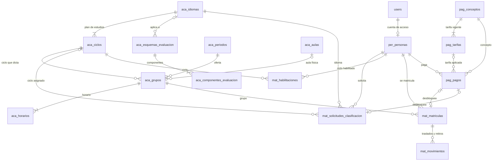

# Modelo de datos

Esquema de PostgreSQL 18 de los módulos **Academico**, **Personas**, **Matricula** y **Pagos**, más la **auditoría** compartida. Las reglas que no deben romperse viven también en la base de datos (`CHECK`, `UNIQUE` y llaves foráneas), no solo en el código.

## Diagrama

## Tablas

| Tabla | Módulo | Propósito | ID público |
|---|---|---|---|
| `aca_idiomas` | Academico | Idiomas y lenguas nativas | — |
| `aca_ciclos` | Academico | Plan de estudios por idioma: ciclos I–XII con su nivel y horas lectivas | — |
| `aca_periodos` | Academico | Periodo académico con fechas de clases y de matrícula | — |
| `aca_aulas` | Academico | Aulas físicas con capacidad | — |
| `aca_grupos` | Academico | Oferta: grupo de un ciclo en un periodo, con modalidad, cupos y contador de matriculados | ULID |
| `aca_horarios` | Academico | Días y horas de cada grupo | — |
| `aca_esquemas_evaluacion` | Academico | Esquema de notas configurable por idioma/nivel y vigencia | — |
| `aca_componentes_evaluacion` | Academico | Componentes del esquema (parcial, final, participación) con su peso | — |
| `per_personas` | Personas | Identidad de postulantes, estudiantes y docentes | ULID |
| `mat_solicitudes_clasificacion` | Matricula | Solicitud y resultado del examen de clasificación | ULID |
| `mat_habilitaciones` | Matricula | Ciclo en el que cada persona puede matricularse por idioma | — |
| `mat_matriculas` | Matricula | Inscripción de una persona en un grupo | ULID |
| `mat_movimientos` | Matricula | Traslados y retiros con su sustento | — |
| `pag_conceptos` | Pagos | Conceptos TUPA/TUSNE (matrícula, pensión, examen, certificado...) | — |
| `pag_tarifas` | Pagos | Monto por concepto y tipo de vínculo, con vigencia | — |
| `pag_pagos` | Pagos | Pago con recibo, medio, número de operación y estado de validación | ULID |
| `aud_registros` | Shared/Audit | Pista de auditoría inmutable de las tablas críticas | — |

## Restricciones clave

| Regla de negocio | Cómo la garantiza PostgreSQL |
|---|---|
| Los matriculados nunca superan el cupo ni bajan de cero | `aca_grupos_matriculados_check` |
| Cupo mínimo entre 0 y el cupo máximo | `aca_grupos_cupos_check` |
| Código de grupo único dentro del periodo | `UNIQUE (periodo_id, codigo)` |
| Ciclo I–XII, único por idioma | `aca_ciclos_numero_check`, `UNIQUE (idioma_id, numero)` |
| Fechas coherentes del periodo y de matrícula | `aca_periodos_fechas_check`, `aca_periodos_matricula_check` |
| Pesos de componentes entre 0 y 100; nota mínima ≤ nota máxima | `aca_componentes_evaluacion_peso_check`, `aca_esquemas_evaluacion_notas_check` |
| DNI de 8 dígitos; CE o pasaporte de 6 a 12 caracteres alfanuméricos | `per_personas_documento_check` |
| Un documento por persona | `UNIQUE (tipo_documento, numero_documento)` |
| Una cuenta de usuario por persona | `UNIQUE (user_id)` |
| Una evaluación de clasificación debe estar completa (puntaje, ciclo, fecha, evaluador) | `mat_solicitudes_clasificacion_evaluado_check` |
| Una sola solicitud pendiente por persona e idioma | índice único parcial `mat_solicitudes_clasificacion_pendiente_unique` |
| El ciclo asignado o habilitado pertenece al idioma de la solicitud | FK compuestas `mat_solicitudes_clasificacion_ciclo_fk`, `mat_habilitaciones_ciclo_fk` |
| Una matrícula activa por persona y grupo | índice único parcial `mat_matriculas_activa_unique` |
| Fecha de retiro solo cuando la matrícula está retirada | `mat_matriculas_retiro_check` |
| Traslado con grupo destino distinto; retiro sin destino; motivo obligatorio | `mat_movimientos_destino_check`, `mat_movimientos_motivo_check` |
| No se borran grupos, personas ni ciclos con registros que dependan de ellos | FK con `RESTRICT` |
| Una tarifa por concepto y vínculo en cada fecha | `pag_tarifas_sin_superposicion` (`EXCLUDE` con `btree_gist` y `daterange`) |
| Medio de pago + número de operación único, sin evasión por mayúsculas o espacios | `UNIQUE (medio_pago, numero_operacion)` + `pag_pagos_numero_operacion_check` |
| Cada estado del pago tiene sus datos (validado: quién y cuándo; rechazado: además motivo; anulado: quién, cuándo y motivo) | `pag_pagos_datos_estado_check`, `pag_pagos_anulacion_check` |
| Un pago nunca se borra | trigger `pag_pagos_sin_borrado` |
| Un pago desbloquea una sola matrícula o solicitud | `UNIQUE (pago_id)` en `mat_matriculas` y `mat_solicitudes_clasificacion` |
| La auditoría no se modifica, borra ni trunca | triggers `aud_registros_inmutable`, `aud_registros_sin_truncate` |

## Decisiones de diseño

- **Llaves foráneas reales entre módulos**, pero sin relaciones Eloquent hacia modelos de otro módulo (por ejemplo, `Matricula` guarda `grupo_id` y `persona_id`).
- **El contador `matriculados` no es asignable masivamente**: solo lo modificará la Action que reserva y libera vacantes, con bloqueo de fila.
- **Habilitación por idioma**: sin fila, la persona solo puede empezar en el ciclo 1. La clasificación fija el ciclo asignado y la aprobación (módulo Certificacion) lo avanzará.
- **Asignación docente** (`doc_*`) se agrega con el módulo Docencia.
- **Pagos auditados**: cada `INSERT`/`UPDATE` de `pag_pagos` queda en `aud_registros` con el usuario y la IP de la petición (ver [`seguridad.md`](seguridad.md)).
- **Estado anulado**: además de Pendiente, Validado y Rechazado (Anexo), un pago validado puede anularse con motivo; nunca se borra.
- Enteros con `CHECK` (PostgreSQL no tiene `unsigned`), fechas con zona horaria (`timestamptz`) y valores de enum literales en las migraciones.

## Supuestos a confirmar con el CILN

Ver [`decisiones-pendientes.md`](decisiones-pendientes.md), filas 9 a 13.

## Datos de demostración

`php artisan db:seed` (solo local; el seeder se niega a correr en producción) crea Inglés y Quechua con 12 ciclos (4 por nivel, supuesto), un periodo con matrícula abierta, aulas, dos grupos con horario, un esquema de evaluación 40/40/20, 28 personas, 10 de ellas matriculadas, conceptos TUPA de ejemplo con tarifas ficticias y un pago validado por cada matrícula. Usuario del panel: `admin@ciln.test` / `password`.
